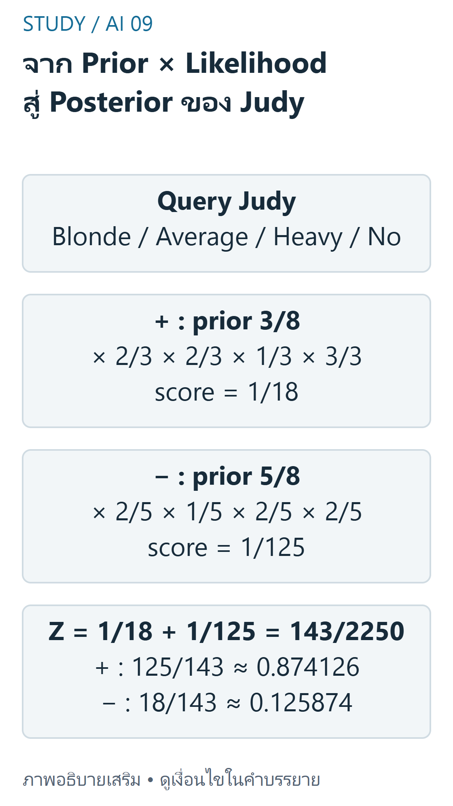
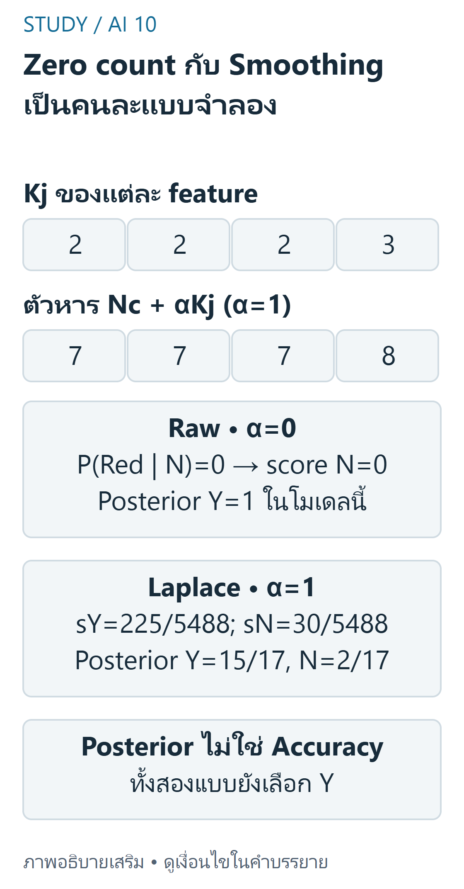

> บท FINAL นี้ใช้ S07 `Final/KNN_NB_Classification.pdf` หน้า PDF จริง **6–8**, X01 Buy, X03 sheet NaiveBayes และ C01 ส่วน Naive Bayes คำอธิบายพื้นฐานเพิ่มเติม โค้ดดัดแปลง และเฉลยแบบฝึกที่ผู้เขียนคำนวณใหม่ไม่ใช่ official answer key ไม่รวม Decision Tree และไม่แก้ไฟล์ต้นฉบับ

## เป้าหมายการเรียนรู้ (Learning Objectives) {#objectives}
- แยก prior, likelihood, evidence และ posterior พร้อมใช้ Bayes' theorem
- คำนวณ categorical class scores จากความถี่และสมมติฐาน conditional independence
- ตรวจตัวอย่าง July/Judy ในสไลด์และ Buy ใน workbook โดยไม่ปะปน smoothing settings
- อธิบายกรณีศูนย์ การ normalize และขอบเขตการตีความคำตอบ
- แยก CategoricalNB จาก GaussianNB และอ่านผล Python โดยไม่อ้าง accuracy เกินหลักฐาน

ทบทวน [FINAL KNN](final-knn.md) เรื่อง features/labels ได้ บทเรียนเหล่านี้อ่านแยกกันได้ ลำดับเผยแพร่ไม่ใช่ลำดับสอนที่ยืนยันแล้ว และ BFS/DFS ไม่ใช่ prerequisite ของหัวข้อนี้

## ทบทวน Classification และความน่าจะเป็น {#probability}
คำอธิบายพื้นฐานส่วนนี้เขียนเสริมเพื่ออ่านสูตรใน S07 หน้า 6: Classification เลือก label จากชุดคลาสที่กำหนด ไม่ใช่ทำนายค่าเฉลี่ยตัวเลขแบบ regression และไม่ใช่โหวตเพื่อนบ้านแบบ KNN

- ความน่าจะเป็นอยู่ระหว่าง 0 ถึง 1; ผลรวมของคลาสที่ไม่ทับกันและครอบคลุมผลทั้งหมดเท่ากับ 1
- ถ้าประมาณด้วย sample frequency: P(C)=จำนวนแถวคลาส C / จำนวนแถวทั้งหมด
- P(A|C) คือสัดส่วนของ A **ภายในคลาส C** จึงใช้จำนวนแถว C เป็นตัวหาร ไม่ใช่จำนวนข้อมูลทั้งหมด
- เมื่อ P(C)>0 จะมี P(A|C)=P(A∩C)/P(C) โดยทั่วไป P(A|C) ไม่เท่ากับ P(C|A)

ตัวอย่างจากตารางหน้า 7: คลาส + มี 3 จาก 8 แถว ดังนั้น prior P(+)=3/8 ส่วนแถว + ที่มีผม Blonde มี 2 จึง P(Blonde|+)=2/3 ไม่ใช่ 2/8

## Bayes' Theorem และคำศัพท์ {#bayes}
S07 หน้า 6 ให้สูตร Bayes สำหรับ X ซึ่งเป็นเวกเตอร์ features

$$
P(C\mid X)=\frac{P(X\mid C)P(C)}{P(X)},\qquad P(X)>0
$$

| คำศัพท์ | ความหมาย |
|---|---|
| Prior P(C) | ความน่าจะเป็นคลาสก่อนใช้ features ของ query |
| Likelihood P(X given C) | โอกาสได้ features นี้เมื่อกำหนดคลาส ไม่ใช่ posterior |
| Evidence P(X) | โอกาสของ features รวมทุกคลาส เป็นตัวหารร่วม |
| Posterior P(C given X) | ความน่าจะเป็นคลาสหลังพิจารณา features |

**ตัวอย่างคำนวณเสริม:** ตารางหน้า 7 มี Blonde 4 แถว โดยเป็น + จำนวน 2 ถ้าใช้แค่ Hair จะได้ P(+|Blonde)=(2/3)(3/8)/(4/8)=1/2 อย่าใช้ 2/3 แทนคำตอบ 1/2 เพราะเงื่อนไขคนละทิศ และอย่าใช้ผลจาก feature เดียวแทนผลที่ใช้ทั้งสี่ features

## สมมติฐาน Naive Conditional Independence {#independence}
หน้า 6 ใช้ถ้อยคำว่า features ภายในคลาสไม่เกี่ยวข้องกัน คำอธิบายเชิงสูตรที่ขยายความคือ **เมื่อทราบคลาส C แล้ว** แบบจำลองสมมติว่า features เป็นอิสระแบบมีเงื่อนไข จึงเขียน joint likelihood เป็นผลคูณ

$$
P(X\mid C)\approx\prod_{j=1}^{p}P(x_j\mid C),\qquad s_C=P(C)\prod_{j=1}^{p}P(x_j\mid C)
$$

ไม่ได้สมมติว่า features อิสระจากกันแบบไม่มีเงื่อนไขในข้อมูลทั้งหมด และการ fit ไม่ใช่การพิสูจน์ว่าสมมติฐานนี้จริง Features ที่ซ้ำซ้อนกันอาจทำให้ model posterior มั่นใจเกินไป ข้อควรระวังนี้เป็นคำอธิบายเพิ่มเติม

## Class Scores และการ Normalize {#scores}
สูตรเลือกคลาสใน S07 หน้า 7 คือเลือก score มากที่สุด ตัวหารร่วมบวกไม่เปลี่ยนการจัดอันดับ จึงไม่จำเป็นต้อง normalize หากต้องการเพียง argmax

$$
\hat C=\mathop{\arg\max}_{C}s_C,\qquad Z=\sum_C s_C,\qquad P_{NB}(C\mid X)=\frac{s_C}{Z}\quad(Z>0)
$$

Z นี้เป็น evidence **ภายใต้แบบจำลอง Naive Bayes ที่ใช้ผลคูณ** ไม่จำเป็นต้องเท่าความถี่ร่วมของ query ใน sample จริง ถ้าทุก score เป็นศูนย์จะได้ Z=0 และ normalize ไม่ได้ ห้ามแอบคืน posterior 0.5/0.5 โดยไม่ระบุการเปลี่ยนแบบจำลอง

## ตัวอย่างจากหน้า 7: Judy (July ในแผนงาน) {#judy}
**ตรวจชื่อจากภาพ:** request/แผนหลักสูตรเดิมเรียกว่า July แต่ชื่อ query ในภาพสไลด์สะกด **Judy** เราคงคำ July เป็นชื่ออ้างอิงแผนงานเท่านั้น Name ไม่ใช่ feature จึงไม่กระทบผลคำนวณ Features ตามต้นฉบับคือ Hair, Height, Weight, Lotion และ label คือ Result +/− ไม่แปล +/− เป็นความหมายทางการแพทย์ที่สไลด์ไม่ได้กำหนดไว้

Query คือ `Blonde, Average, Heavy, No` ตารางต้นฉบับมี 8 แถวตามลำดับด้านล่าง ไม่มีการเพิ่มข้อมูลสมมติ

```text
Name   Hair    Height   Weight   Lotion Result
Sarah  Blonde  Average  Light    No     +
Paola  Blonde  Tall     Average  Yes    -
Alex   Brown   Short    Average  Yes    -
Annie  Blonde  Short    Average  No     +
Emily  Red     Average  Heavy    No     +
Pete   Brown   Tall     Heavy    No     -
John   Brown   Average  Heavy    No     -
Katie  Blonde  Short    Light    Yes    -
```

### Prior และตารางความถี่แบบมีเงื่อนไข {#judy-counts}
จำนวน + = 3 และ − = 5 จึง prior 3/8 และ 5/8 ตารางแสดง **counts**; หารคอลัมน์ + ด้วย 3 และคอลัมน์ − ด้วย 5 เพื่อได้ conditional probabilities ของแต่ละ feature

| Feature=value | + | − |
|---|---|---|
| Hair=Blonde | 2 | 2 |
| Hair=Brown | 0 | 3 |
| Hair=Red | 1 | 0 |
| Height=Average | 2 | 1 |
| Height=Short | 1 | 2 |
| Height=Tall | 0 | 2 |
| Weight=Average | 1 | 2 |
| Weight=Heavy | 1 | 2 |
| Weight=Light | 1 | 1 |
| Lotion=No | 3 | 2 |
| Lotion=Yes | 0 | 3 |

### คำนวณ Score และ Posterior {#judy-calculation}
ไม่ใช้ smoothing เพื่อทำซ้ำตัวเลขในหน้า 7



ที่มา: [ภาพเขียนเสริม ตรวจตามบทเรียนและเอกสารเทคนิค](https://scikit-learn.org/1.7/modules/naive_bayes.html)

อ่านภาพ: Judy ใช้ Blonde/Average/Heavy/No และไม่ smooth: prior +3/8 กับ −5/8 คูณ conditional likelihoods ได้ scores 1/18 และ 1/125 แล้วหารผลรวม 143/2250 จึง posterior +125/143 และ −18/143 ค่าที่ normalize เป็นโมเดล ไม่ใช่ความถี่ร่วมที่สังเกต

$$
s_+=\frac38\cdot\frac23\cdot\frac23\cdot\frac13\cdot\frac33=\frac1{18},\qquad s_-=\frac58\cdot\frac25\cdot\frac15\cdot\frac25\cdot\frac25=\frac1{125}
$$

จึงเลือก **+** ตรงกับผลที่สไลด์แสดง ไม่ใช่เปรียบเทียบ prior อย่างเดียว การ normalize ต่อไปนี้ผู้เขียนคำนวณเพิ่ม ไม่ใช่ค่าที่หน้า 7 พิมพ์ไว้

$$
Z=\frac1{18}+\frac1{125}=\frac{143}{2250},\qquad P_{NB}(+\mid X)=\frac{125}{143}\approx0.874126,\qquad P_{NB}(-\mid X)=\frac{18}{143}\approx0.125874
$$

ผลรวมเท่ากับ 1 ภายใต้โมเดล แม้ไม่มีแถวฝึกที่ตรง query ทั้งสี่ค่าแบบพอดี ก็ยังได้ model score บวกจากการคูณ marginal conditional probabilities ห้ามตีความเป็นการพบ query จริง 87.4% ในข้อมูล หรือรับรองว่าคำตอบจะถูกเสมอ

## Buy จาก X01/X03 และ C01 {#buy}
ข้อมูลเดิมมี Model, Color, Type, Origin ทำนาย Buy=Y/N Query คือ `A,Red,General,Thailand` Train มี Y=5,N=5; X02 เป็นสำเนา byte-identical ของ X01 ไม่ใช่อีก dataset ที่เพิ่มน้ำหนักได้ Buy? ใน Test เป็น `??` ไม่ใช่ observed answer

ตาราง counts ต่อไปนี้นับใหม่จาก 10 แถว X01 ทุกคอลัมน์หาร 5 เพื่อได้ conditional probabilities (ข้อมูลแถวทั้งหมดแสดงใน Python)

| Feature=value | Y | N |
|---|---|---|
| Model=A | 4 | 2 |
| Model=B | 1 | 3 |
| Color=Red | 4 | 0 |
| Color=Yellow | 1 | 5 |
| Type=General | 2 | 4 |
| Type=Sport | 3 | 1 |
| Origin=China | 2 | 2 |
| Origin=Japan | 1 | 2 |
| Origin=Thailand | 2 | 1 |

### ผลแบบไม่ Smooth ของ Worksheet {#buy-raw}
X03 NaiveBayes!G3:K3 และ G6:K6 ใช้ prior และความถี่ของ query ผลคูณอยู่ M3/M6 ส่วน **L3/L6 มีสูตรเพียง `=` จึงใช้เป็นคำตอบที่ตรวจแล้วไม่ได้** เราไม่แก้ต้นฉบับ และตรวจ raw counts/ผลคูณใหม่ แทนเชื่อ cached values โดยลำพัง

$$
s_Y=\frac5{10}\cdot\frac45\cdot\frac45\cdot\frac25\cdot\frac25=\frac{32}{625}=0.0512,\qquad s_N=\frac5{10}\cdot\frac25\cdot0\cdot\frac45\cdot\frac15=0
$$

ถ้าใช้ unsmoothed NB ตามนี้จะเลือก **Y** และ normalize ได้ P(Y|X)=1,P(N|X)=0 เพราะ Z=0.0512>0 แต่ 1 นี้เกิดจาก zero count ของ Red ในคลาส N ไม่ใช่การยืนยันว่าลูกค้าจะซื้อจริงแน่นอน หรือมี test accuracy 100%

## Zero Counts และ Smoothing {#smoothing}
คำอธิบายเสริมที่จำเป็นเพื่อเทียบกับ C01: ใช้ additive smoothing กับ **conditional probabilities** โดย category universe ของ feature j มี Kj ค่าที่ประกาศไว้



ที่มา: [ภาพเขียนเสริม ตรวจตามบทเรียนและเอกสารเทคนิค](https://scikit-learn.org/1.7/modules/naive_bayes.html)

อ่านภาพ: Buy มี Y=N=5 และ category counts [2,2,2,3]; raw Red ใน N มี count ศูนย์จึง scoreN=0 แต่ alpha=1 ใช้ตัวหาร [7,7,7,8] และ prior ยัง 1/2 ทำให้ scores225/5488 และ30/5488 แล้ว posterior Y=15/17 ไม่ใช่1

$$
P(x_j=v\mid C)=\frac{N_{C,j,v}+\alpha}{N_C+\alpha K_j}
$$

α=0 คือ raw counts; α=1 คือ Laplace smoothing ในตัวอย่างนี้ เราคง prior เป็น class frequency ไม่บวก 1 ให้ prior เอง C01 เรียก `CategoricalNB()` โดยไม่กำหนด α; เวอร์ชันที่ตรวจใช้ alpha=1, fit_prior=True, class_prior=None, force_alpha=True จึง **ไม่ใช่สูตรดิบใน worksheet**

Buy มี Kj = [2,2,2,3] สำหรับ Model/Color/Type/Origin ตัวหารเมื่อ α=1 คือ [7,7,7,8] เพราะแต่ละคลาสมี 5 แถว

$$
s_Y=\frac12\cdot\frac57\cdot\frac57\cdot\frac37\cdot\frac38=\frac{225}{5488},\qquad s_N=\frac12\cdot\frac37\cdot\frac17\cdot\frac57\cdot\frac28=\frac{30}{5488}
$$

ผล normalize คือ Y=15/17≈0.882353, N=2/17≈0.117647 ยังเลือก **Y** แต่ posterior ไม่ใช่ 1 เหมือนสูตรดิบ ห้ามเอา score ดิบ 0.0512 ไปหารด้วยผลรวมของ score แบบ smooth หรือบอกว่า likelihood เท่ากับ posterior

### ตัวอย่างศูนย์ที่ผู้เขียนสร้างใหม่ {#zero-example}
มี feature Color หนึ่งตัว ข้อมูลฝึก Red→A และ Blue→B; **ประกาศล่วงหน้า** ว่า category ที่เป็นไปได้คือ Red,Blue,Green Query Green ไม่เคยปรากฏในทั้งสองคลาส

- α=0: score ทั้งคู่ 0, Z=0 จึงไม่มี posterior จากการหาร ต้องแจ้งข้อจำกัด ไม่สรุปว่า tie ด้วย 0.5 โดยอัตโนมัติ
- α=1,K=3: แต่ละคลาสมี conditional P(Green|C)=(0+1)/(1+3)=1/4; prior=1/2 จึง score=1/8 ทั้งคู่ และ posterior=1/2 ทั้งคู่ เป็น tie ที่ต้องมีกติกาเพิ่มหากจะบังคับเลือกคลาส
- **Known possible but unobserved** ต่างจากหมวดหมู่ใหม่ที่อยู่นอก vocabulary ของ encoder การเพิ่ม smoothing ไม่ได้ทำให้ OrdinalEncoder ค่า default รู้จัก Green เอง ตัวอย่างนี้เป็นการประกาศ universe ล่วงหน้า ไม่ใช่พฤติกรรม default ของ C01

## Raw Labels, Ordinal Encoding และ CategoricalNB {#encoding}
C01 ใช้ OrdinalEncoder แล้ว `.astype(int)` ก่อน CategoricalNB แต่ละ feature จึงเป็น category index ไม่ใช่ตัวเลขสำหรับคำนวณระยะอย่าง KNN หรือค่าต่อเนื่องสำหรับ Gaussian

เมื่อ fit X01 ด้วย encoder default ในเวอร์ชันที่ตรวจ ได้ Model A/B→0/1, Color Red/Yellow→0/1, Type General/Sport→0/1, Origin China/Japan/Thailand→0/1/2 Query จึงเป็น `[0,0,0,2]` และจำนวน category คือ [2,2,2,3] การเปลี่ยนดัชนีหมวดหมู่อย่างสอดคล้องกันไม่ควรเปลี่ยนความหมายของ conditional counts แต่การส่งรหัสผิดคอลัมน์ทำให้ทำนายผิด

ค่า default ของ OrdinalEncoder ไม่รับ unknown category จึง error หาก query มีค่าใหม่ ไม่ควรแอบแทนด้วย -1 แล้วส่งเข้า CategoricalNB ที่คาดรหัสจำนวนเต็มไม่ติดลบ ต้องกำหนด policy/vocabulary อย่างชัดเจนก่อนใช้งานจริง

### Python: คำนวณด้วยเศษส่วนอย่างอิสระ {#python-manual}
โค้ดเสริม standard library นี้ใช้ category universe ชัดเจน และรองรับ α เป็นจำนวนเต็มไม่ติดลบเพื่อคำนวณ exact fractions ถ้า Z=0 จะ error แทนแอบเปลี่ยนกฎ สังเกตว่า July/Judy และ Buy เป็นคนละ dataset และ label คนละชุด

```python
from collections import Counter
from fractions import Fraction as F
from math import prod


def categorical_scores(rows, labels, query, categories, alpha=0):
    if not isinstance(alpha, int) or alpha < 0 or not rows or len(rows) != len(labels):
        raise ValueError("Invalid data or smoothing")
    if len(query) != len(categories) or any(len(r) != len(query) for r in rows):
        raise ValueError("Mismatched dimensions")
    for row in [*rows, query]:
        if any(value not in cats for value, cats in zip(row, categories)):
            raise ValueError("Category outside the declared vocabulary")
    scores = {}
    for label in sorted(set(labels)):
        group = [row for row, y in zip(rows, labels) if y == label]
        likelihoods = [
            F(sum(row[j] == value for row in group) + alpha,
              len(group) + alpha * len(categories[j]))
            for j, value in enumerate(query)
        ]
        scores[label] = F(len(group), len(rows)) * prod(likelihoods)
    return scores


def normalize(scores):
    total = sum(scores.values())
    if total == 0:
        raise ValueError("Zero evidence: posterior is undefined")
    return {label: score / total for label, score in scores.items()}


# S07 p.7: Hair, Height, Weight, Lotion (Name is not a feature)
judy_rows = [
    ("Blonde","Average","Light","No"),
    ("Blonde","Tall","Average","Yes"),
    ("Brown","Short","Average","Yes"),
    ("Blonde","Short","Average","No"),
    ("Red","Average","Heavy","No"),
    ("Brown","Tall","Heavy","No"),
    ("Brown","Average","Heavy","No"),
    ("Blonde","Short","Light","Yes"),
]
judy_labels = ["+","-","-","+","+","-","-","-"]
judy_query = ("Blonde","Average","Heavy","No")
judy_categories = (("Blonde","Brown","Red"), ("Average","Short","Tall"),
                   ("Average","Heavy","Light"), ("No","Yes"))
judy = categorical_scores(judy_rows, judy_labels, judy_query, judy_categories)
print("Judy scores", judy)
print("Judy posterior", normalize(judy))

# X01 Buy: Model, Color, Type, Origin; original ten training rows
buy_rows = [
    ("A","Red","Sport","Thailand"), ("A","Yellow","General","Japan"),
    ("B","Yellow","General","Japan"), ("A","Red","General","China"),
    ("B","Yellow","General","Thailand"), ("B","Red","Sport","China"),
    ("B","Yellow","Sport","China"), ("A","Yellow","General","Thailand"),
    ("A","Yellow","General","China"), ("A","Red","Sport","Japan"),
]
buy_labels = ["Y","N","N","Y","N","Y","N","Y","N","Y"]
buy_query = ("A","Red","General","Thailand")
buy_categories = (("A","B"), ("Red","Yellow"),
                  ("General","Sport"), ("China","Japan","Thailand"))
for alpha in (0, 1):
    scores = categorical_scores(buy_rows, buy_labels, buy_query, buy_categories, alpha)
    print("Buy alpha", alpha, "scores", scores, "posterior", normalize(scores))
```

### Python: CategoricalNB ของ Buy {#python-categorical}
รันต่อจาก block ด้านบน ใช้ feature/target/query เดียวกับ C01 ส่วน Naive Bayes บรรทัด 50–59 แต่ระบุค่า default ของ model ให้ชัด ไม่อ่าน source workbook จากหน้าเว็บหรือรัน Python ใน browser ต้องมี scikit-learn ใน Python ของผู้เรียน

```python
from sklearn.preprocessing import OrdinalEncoder
from sklearn.naive_bayes import CategoricalNB

encoder = OrdinalEncoder()  # C01 default: unknown categories raise an error
X_encoded = encoder.fit_transform(buy_rows).astype(int)
query_encoded = encoder.transform([buy_query]).astype(int)
model = CategoricalNB(alpha=1.0, force_alpha=True, fit_prior=True)
model.fit(X_encoded, buy_labels)
print("encoded query", query_encoded.tolist())
print("category counts", model.n_categories_.tolist())
print("classes", model.classes_.tolist())
print("probabilities", model.predict_proba(query_encoded).round(6).tolist())
print("prediction", model.predict(query_encoded).tolist())
```

ผลที่ตรวจคือ classes เรียง `['N','Y']`, probabilities ≈ `[[0.117647,0.882353]]` และ prediction `['Y']` อ่านลำดับจาก classes ไม่เดาว่าคอลัมน์แรกคือ Y เสมอ สคริปต์ต้นฉบับ C01 ส่วนนี้ตรวจรันแยกแบบ read-only แล้วได้ Y เช่นกัน โดยไม่รันโมเดลอื่น

## Gaussian Naive Bayes {#gaussian}
S07 หน้า 8 เปลี่ยนไปใช้ **GaussianNB กับ Iris** ไม่ใช่ตาราง categorical ของ Judy หรือ Buy สูตร density ต่อไปนี้เป็นคำอธิบายเสริมเพื่ออ่านสมมติฐานของโค้ด ไม่ใช่สูตรที่พิมพ์อยู่บนหน้า 8

$$
p(x_j\mid C)=\frac{1}{\sqrt{2\pi\sigma_{Cj}^2}}\exp\left(-\frac{(x_j-\mu_{Cj})^2}{2\sigma_{Cj}^2}\right)
$$

GaussianNB ประมาณ mean/variance ของแต่ละ feature ภายในคลาสแล้วคูณ conditional densities ภายใต้สมมติฐาน independence สำหรับข้อมูลต่อเนื่อง density ณ จุดหนึ่ง **ไม่ใช่ความน่าจะเป็นของจุดนั้น** และอาจมากกว่า 1 ได้ การ normalize class density scores ยังทำได้เมื่อผลรวมเป็นบวก แต่ไม่เรียก density ว่า frequency ของหมวดหมู่

| ประเด็น | CategoricalNB | GaussianNB |
|---|---|---|
| Feature | ดัชนีหมวดหมู่ | ตัวเลขต่อเนื่อง |
| Likelihood | ความถี่หมวดหมู่พร้อม α ที่กำหนด | Gaussian density จาก mean/variance |
| Source | C01/X01/X03 Buy | S07 p.8 Iris |
| ระวัง | zero counts, vocabulary, encoding | variance ศูนย์/เล็ก, รูปร่างไม่ตรง Gaussian |

**ตัวอย่างสร้างใหม่ ไม่ใช่ข้อมูลสไลด์:** มี feature เดียว x=0, prior A=B=0.5; A มี mean=0, variance=1 ส่วน B มี mean=2, variance=1 จะได้ density A≈0.398942,B≈0.053991 และ score A≈0.199471,B≈0.026995 หลัง normalize P(A|x)≈0.880797,P(B|x)≈0.119203 จึงเลือก A สำหรับสมมติฐานนี้ ไม่ใช่ใช้สูตรจำนวนครั้งที่พบ x=0 ในตาราง categorical

### Python: Density ตัวอย่างและ Iris หน้า 8 {#python-gaussian}
โค้ด Iris รักษา test_size=0.3, random_state=42 และ GaussianNB() ตาม source ไม่เติม stratify/scaling ส่วน density example และ train-score print เขียนเพิ่มเพื่อการเรียน เวอร์ชันที่ตรวจใช้ priors=None และ var_smoothing=1e-9 ซึ่งเพิ่มค่าปรับ variance เพื่อเสถียรภาพ ไม่ใช่ Laplace α ของ categorical counts

```python
from math import exp, pi, sqrt
from sklearn.model_selection import train_test_split
from sklearn.naive_bayes import GaussianNB
from sklearn.metrics import accuracy_score
from sklearn.datasets import load_iris

# Authored one-dimensional density example, not a slide dataset
def gaussian_density(x, mean, variance):
    if variance <= 0:
        raise ValueError("A Gaussian density needs positive variance")
    return exp(-(x - mean) ** 2 / (2 * variance)) / sqrt(2 * pi * variance)

score_a = 0.5 * gaussian_density(0, 0, 1)
score_b = 0.5 * gaussian_density(0, 2, 1)
print("density-example posterior A", f"{score_a / (score_a + score_b):.6f}")

# S07 p.8: same split/model as the source; no scaling or stratify added
iris = load_iris()
X_train, X_test, y_train, y_test = train_test_split(
    iris.data, iris.target, test_size=0.3, random_state=42)
gnb = GaussianNB()  # priors=None, var_smoothing=1e-9 in tested version
gnb.fit(X_train, y_train)
y_pred = gnb.predict(X_test)
print("sizes", len(X_train), len(X_test))
# Training score added for comparison; source evaluates test accuracy
print("train accuracy", f"{accuracy_score(y_train, gnb.predict(X_train)):.6f}")
print("test accuracy", f"{accuracy_score(y_test, y_pred):.6f}")
```

ผลรันตรวจใน scikit-learn 1.7.2 คือ train 105/test 45; train ถูก 99/105≈0.942857 และ test ถูก 44/45≈0.977778 เป็นผลที่ผู้เขียนทำซ้ำ **ไม่ใช่ accuracy ที่สไลด์พิมพ์รับรองหรือผลบนประชากรใหม่** ไม่สลับกับ KNN หน้า 5 ที่เป็นคนละโมเดล ผลิตภัณฑ์ของ probabilities/densities จำนวนมากอาจ underflow; library ใช้ log scores ภายใน ต่างจาก helper exact fractions ที่ใช้เพื่อการเรียน

## ข้อผิดพลาดที่พบบ่อย (Common Mistakes) {#mistakes}
- ใช้จำนวนทุกแถวหาร conditional ภายในคลาส หรือสลับ P(X|C) กับ P(C|X)
- ลืม prior หรือใช้ prior อย่างเดียวแทนผลคูณ features
- สมมติ independence แบบไม่มีเงื่อนไข ทั้งที่เงื่อนไขคือทราบคลาสแล้ว
- นำ score ดิบไปเรียกว่า posterior หรือ normalize เมื่อ Z=0
- เอาค่า +/− หรือ Y/N มาแปลความหมาย/หน่วยที่ source ไม่ระบุ
- เปรียบเทียบ workbook unsmoothed กับ CategoricalNB(alpha=1) แล้วเรียกว่าได้ผลไม่ตรงโดยไม่ตรวจ parameter
- ใช้ Kj เดียวกันทุก feature ทั้งที่ Origin มี 3 categories และตัวอื่นมี 2
- มอง ordinal category code เป็นค่าต่อเนื่อง/ระยะ แล้วเปลี่ยนเป็น GaussianNB โดยไม่ประกาศแบบจำลองใหม่
- ใช้ cached answers หรือ L3/L6 ที่ไม่สมบูรณ์เป็นหลักฐานเฉลย; นับ X02 สำเนาเป็นข้อมูลอิสระ
- อ้าง split เดียวหรือ model posterior สูงว่าเป็นหลักฐานความแม่นยำทั่วไป/เหตุและผล

## แบบฝึกพร้อมเฉลยตรวจใหม่ (Practice) {#practice}
แบบฝึกและเฉลยทั้งหมดต่อไปนี้ผู้เขียนจัดทำใหม่โดยใช้ข้อมูลที่ระบุ **ไม่ใช่ official answer key**

### 1. Prior กับ Conditional {#question-prior}
ใช้ตาราง Judy หน้า 7 หา P(+),P(−),P(Blonde|+) พร้อมตัวหาร

**เฉลย:** + มี 3 แถว, − มี 5 จาก 8 จึง 3/8 และ 5/8; Blonde ใน + มี 2 จาก 3 จึง 2/3 ไม่ใช่ 2/8 และผลรวม prior เท่ากับ 1

### 2. Bayes แบบ Feature เดียว {#question-bayes}
เมื่อรู้เพียง Hair=Blonde จากข้อมูลเดียวกัน จงหา P(+|Blonde)

**เฉลย:** Blonde ทั้งหมด 4 จาก 8; joint Blonde,+ คือ 2/8 ดังนั้น (2/3)(3/8)/(4/8)=1/2 ส่วน 2/3 เป็น P(Blonde|+) ไม่ใช่คำตอบเดียวกัน ไม่ใช้ผลนี้แทน posterior ของ query ทั้งสี่ feature

### 3. Judy แบบสี่ Features {#question-judy}
ใช้ Blonde/Average/Heavy/No แบบไม่ smooth หา scores, class และ posterior ที่ normalize แล้ว

**เฉลย:** s+=(3/8)(2/3)(2/3)(1/3)(3/3)=1/18 และ s−=(5/8)(2/5)(1/5)(2/5)(2/5)=1/125 จึงเลือก +; Z=143/2250 ทำให้ posterior + =125/143 และ − =18/143 ซึ่งรวมเป็น 1 การ normalize ไม่จำเป็นถ้าเลือก argmax อย่างเดียว

### 4. Buy แบบดิบ {#question-buy}
Query A/Red/General/Thailand มี conditional ตัวใดทำให้ score ของ N เป็นศูนย์ และ normalize ได้หรือไม่?

**เฉลย:** Red ใน N มี 0 จาก 5 จึง P(Red|N)=0; sN=0, sY=(1/2)(4/5)(4/5)(2/5)(2/5)=32/625 จึง Z>0 และ normalize ได้ Y=1,N=0 เฉพาะ model นี้ ไม่ได้รู้ observed label ของ Test จริง

### 5. Buy กับ Laplace α=1 {#question-smoothing}
แสดงตัวหารของแต่ละ feature, score และ posterior แล้วเทียบกับสูตรดิบ

**เฉลย:** Kj=[2,2,2,3], class count=5 จึงตัวหาร [7,7,7,8]; sY=(1/2)(5/7)(5/7)(3/7)(3/8)=225/5488 และ sN=(1/2)(3/7)(1/7)(5/7)(2/8)=30/5488 จึง posterior Y=15/17,N=2/17 ยังเลือก Y แต่ไม่ใช่ posterior 1; prior ยังคง 1/2 ไม่บวก α เอง

### 6. เมื่อทุก Score เป็นศูนย์ {#question-zero}
ในตัวอย่างสร้างใหม่ Red→A,Blue→B กับ vocabulary Red/Blue/Green ทำนาย Green โดย α=0 และ α=1 ต่างกันอย่างไร?

**เฉลย:** α=0 ให้ score 0 ทั้งคู่ Z=0 จึง normalize ไม่ได้ เมื่อ α=1 แต่ละ class count=1,K=3 ให้ conditional=1/4, prior=1/2 จึง score=1/8 แต่ละคลาส และ posterior=1/2 เท่ากัน ต้องระบุกติกา tie หากต้องเลือกหนึ่งคลาส การรับ Green นี้อาศัย vocabulary ที่ประกาศไว้ ไม่ใช่พฤติกรรม default encoder ของ C01

### 7. Gaussian ไม่ใช่ Categorical Counts {#question-gaussian}
ในตัวอย่าง x=0 กับ A mean0/variance1,B mean2/variance1,prior เท่ากัน จงแสดงเหตุผลที่เลือก A และอธิบายว่า likelihood เป็นอะไร

**เฉลย:** density A=1/√(2π),B=exp(−2)/√(2π) คูณ prior 0.5 ได้ score≈0.199471,0.026995 จึง posterior A≈0.880797 สูงกว่า ตัวเลข likelihood เป็น density ไม่ใช่สัดส่วนแถวที่มี category เท่ากับ 0 ห้ามแทนด้วย count แล้วเรียกว่า Gaussian เดิม

### 8. อ่าน Python และผลประเมิน {#question-python}
C01 กับหน้า 8 ใช้โมเดล/ข้อมูลใด และควรตีความ `classes_=['N','Y']` หรือ test correct 44/45 อย่างไร?

**เฉลย:** C01 ใช้ OrdinalEncoder + CategoricalNB บน Buy; p.8 ใช้ GaussianNB บน Iris หาก probability row เป็น [2/17,15/17] ลำดับคือ N,Y จึงทำนาย Y ส่วน 44/45≈0.977778 เป็น test accuracy ของ split .3/random_state42/GaussianNB ที่ทำซ้ำ ไม่ใช่ posterior ของ Buy หรือคำรับรองผลกับข้อมูลใหม่

## สรุป FINAL (Quick Exam Summary) {#summary}
- เขียน feature order, labels, prior, conditional counts และ smoothing ก่อนคำนวณ
- NB ใช้ conditional independence ภายในคลาส; score=prior×ผลคูณ likelihoods
- ถ้า Z>0 จะ normalize scores เป็น model posterior ได้; argmax ไม่ต้องหารร่วม ถ้า Z=0 ห้ามหาร
- ตัวอย่างในแผนเรียก July แต่ภาพจริง Judy; scores 1/18 กับ 1/125 เลือก +
- Buy ดิบเลือก Y ด้วย posterior 1 แต่ alpha=1 ได้ Y=15/17,N=2/17
- Category indices ไม่ใช่ระยะ/ตัวเลขต่อเนื่อง; Gaussian density ไม่ใช่ categorical probability
- แยก Laplace smoothing ของ counts จาก variance smoothing ของ GaussianNB และแยก model posterior จาก accuracy

## แหล่งข้อมูลและขอบเขต (Sources) {#sources}
Local-only sources อยู่ใต้ `FinalSource/Artificial Intelligence/` ไม่คัดลอก PDF/workbook หรือสร้างลิงก์ดาวน์โหลดที่ไม่มีไฟล์บนเว็บ

| Source | ตำแหน่งและขอบเขต |
|---|---|
| S07 | `Final/KNN_NB_Classification.pdf` physical p.6 Bayes/vector/independence พร้อมภาพ Feature1/2 และ Class A/B/C; ไม่มีตารางพิกัดให้แต่ง prediction เพิ่ม |
| S07 | p.7 ตาราง 8 แถว query Judy และ scores 1/18,1/125 เลือก +; posterior normalized เป็นการคำนวณเสริม |
| S07 | p.8 GaussianNB/Iris, split/test accuracy code; ไม่ใช่ categorical-frequency formula |
| X01 | `Assignment/input.xlsx` Train!A1:E11, Test!A1:E2; X02 เป็นสำเนาไม่ใช่ข้อมูลอิสระ |
| X03 | `Assignment/input_sol.xlsx` NaiveBayes!A1:M16, counts G3:K3/G6:K6, products M3/M6; L3/L6 ไม่สมบูรณ์และไม่ใช้เป็นเฉลย |
| C01 | `Assignment/lab_sol.py` features/query ที่กำหนดก่อนหน้า และ Naive Bayes lines 50–59; settings/ผลรันตรวจใหม่โดยไม่แก้ต้นฉบับ |

พื้นฐาน probability, normalization, α/vocabulary, zero example, Gaussian density formula/ตัวอย่าง, โค้ดผู้เขียนและเฉลยเป็นคำอธิบายเสริมที่ติดป้ายไว้ ไม่อ้างว่า source ให้ official answer keys หรือ accuracy ตามที่คำนวณเพิ่ม ไม่มี Decision Tree หรือโมเดลฝึกออนไลน์ในงานนี้
