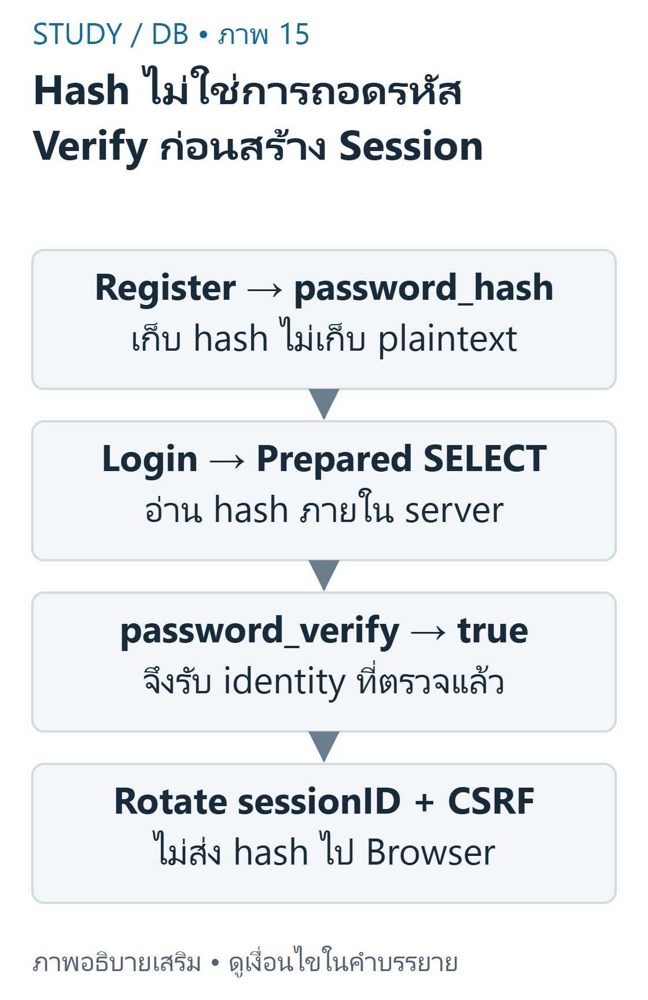
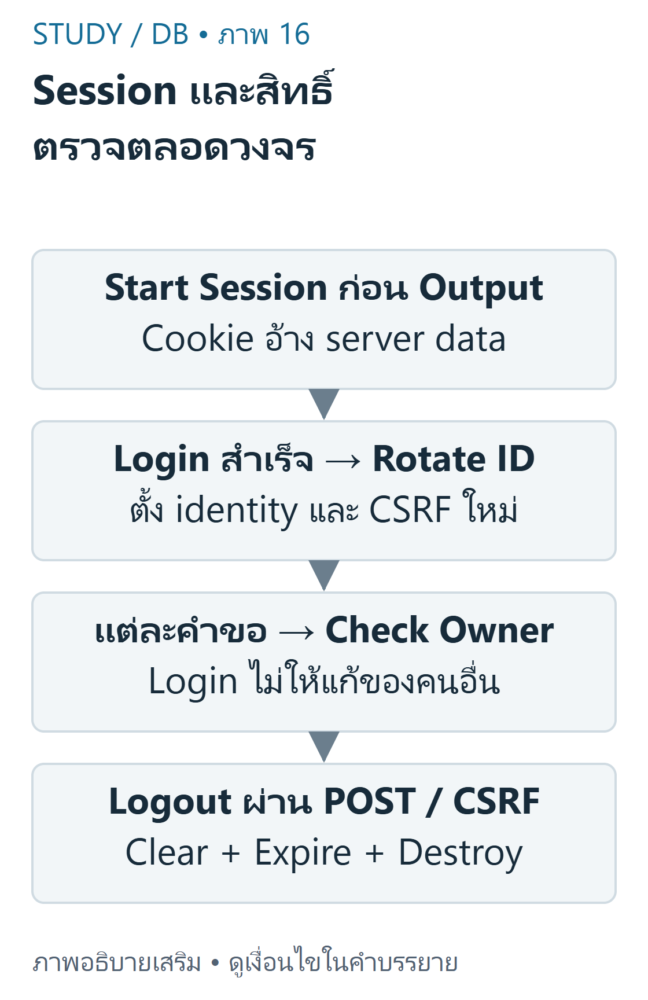

---
{"version":1,"id":"database-management-authentication-authorization","course":"database-management","category":"summaries","slug":"authentication-authorization","title":"DB 08 — ยืนยันตัวตนและกำหนดสิทธิ์","language":"th"}
---

> ตัวอย่างเชิงป้องกันเรียบเรียงจากDB-S03หน้า9–18และpublic repositoryที่pinไว้ ไม่ใช่บริการLoginจริงบนStudy

## เป้าหมายการเรียนรู้ {#objectives}
- แยก Authentication จาก Authorization และตรวจสิทธิ์ในทุกการอ่าน/เขียน
- อธิบาย hash/verify,session,cookie,rotation,logoutและCSRF
- แก้TODOในstarterอย่างเข้าใจโดยไม่เปิดเผยsecretหรือทดสอบบัญชีจริง

## ใครเข้าระบบ และมีสิทธิ์ทำอะไร {#identity}
Authentication ตอบว่าเป็นใครจากหลักฐานการเข้าสู่ระบบ Authorization ตอบว่าผู้ใช้นั้นทำอะไรกับresourceนี้ได้ Loginสำเร็จไม่ให้สิทธิ์แก้Resumeของคนอื่น การซ่อนปุ่มในBrowserไม่แทนการตรวจบนServer และprofile_idจากhidden fieldยังแก้ได้

DB-S03หน้า12แสดงusersแบบขั้นต่ำ ส่วนmigrationในpublicrepoที่ตรวจเพิ่มprofile_idเป็นUNIQUE FKไปprofile จึงเป็นschemaคนละระยะ ไม่ควรอ้างว่าคอลัมน์นี้อยู่ในสไลด์แล้ว ผู้ใช้หนึ่งบัญชีเชื่อมหนึ่งprofileในตัวอย่างภายหลัง

public login.phpมีTODO1–5และlogout.phpมีTODO6ที่ยังไม่เสร็จจริง ส่วนSQLCRUDในpublicrepoใส่ครบแล้วแม้commentTODOยังอยู่ ต่างจากstudent.zipที่ยังมีSELECT1สี่จุด เลือกดูโค้ดจริง ไม่อนุมานจากชื่อไฟล์

## รหัสผ่านและการสมัคร {#passwords}
password_hashสร้างhashแบบทางเดียวพร้อมsaltตามalgorithm; password_verifyตรวจรหัสผ่านกับhash ไม่ใช่ถอดรหัส และhashใหม่ของpasswordเดิมอาจไม่เท่ากัน ไม่เก็บplaintextหรือเปรียบเทียบpasswordกับhashด้วย==



ที่มา: [ภาพเขียนเสริม ตรวจตามบทเรียนและเอกสารเทคนิค](https://www.php.net/manual/en/function.password-hash.php)

อ่านภาพ: สมัครใช้ password_hash เก็บ hash ไม่เก็บ plaintext; Login ใช้ prepared query แล้ว password_verify เมื่อสำเร็จจึงสร้าง identity และเปลี่ยน sessionID Salt ทำให้ hash ใหม่อาจต่างกัน

```php
<?php
function register(\mysqli $conn, string $name, string $email, string $password): int {
    $email = strtolower(trim($email)); $name = trim($name);
    // This lab policy is explicit, not a universal password-strength rule.
    // PHP8.4 PASSWORD_DEFAULT uses bcrypt, whose input limit is72 bytes.
    if (mb_strlen($name, 'UTF-8') < 2 || mb_strlen($name, 'UTF-8') > 150 ||
        !filter_var($email, FILTER_VALIDATE_EMAIL) || strlen($email) > 150 ||
        strlen($password) < 10 || strlen($password) > 72) {
        throw new \InvalidArgumentException('Invalid registration');
    }
    mysqli_begin_transaction($conn);
    try {
        $stmt = mysqli_prepare($conn, 'INSERT INTO profile(full_name,email) VALUES (?,?)');
        mysqli_stmt_bind_param($stmt, 'ss', $name, $email);
        mysqli_stmt_execute($stmt); $pid = mysqli_insert_id($conn); mysqli_stmt_close($stmt);
        $hash = password_hash($password, PASSWORD_DEFAULT);
        $stmt = mysqli_prepare($conn,
            'INSERT INTO users(profile_id,email,password_hash) VALUES (?,?,?)');
        mysqli_stmt_bind_param($stmt, 'iss', $pid, $email, $hash);
        mysqli_stmt_execute($stmt); $uid = mysqli_insert_id($conn); mysqli_stmt_close($stmt);
        mysqli_commit($conn);
        return $uid;
    } catch (\Throwable $error) {
        mysqli_rollback($conn); throw $error; // HTTP layer must show a generic message, not DB details
    }
}
```

ตัวอย่างนี้เรียกหลังเปิดmysqliแบบstrictและutf8mb4 รับname/emailที่ตรวจแล้ว สร้างprofile+usersในtransaction หากemailซ้ำและINSERTusersล้มเหลวจะrollbackไม่ทิ้งprofileกำพร้า PHP8.4.27ที่ทดสอบใช้PASSWORD_DEFAULTเป็นbcryptซึ่งจำกัดอินพุต72bytes จึงกำหนดนโยบายแลป10–72bytesอย่างชัดเจน นี่ไม่ใช่คำรับรองว่ารหัสผ่าน10ตัวทุกแบบปลอดภัยหรือDEFAULTจะไม่เปลี่ยนในอนาคต ภาษาไทยหนึ่งตัวอาจใช้หลายbytes

ตัวอย่างจำกัดemail150bytesให้เข้าได้ทั้งprofile.emailVARCHAR150และusers.emailVARCHAR190ในschemaที่ตรวจ ไม่อ้างว่าทุกตารางรับ190 การนำไปใช้จริงต้องทบทวนนโยบายและschemaร่วมกัน เก็บhashในคอลัมน์ที่รองรับการเปลี่ยนalgorithm เช่นVARCHAR255

## ตรวจLoginและวงจรSession {#sessions}
Browserเก็บsession cookieที่มีidentifier;PHPเชื่อมidentifierกับข้อมูลฝั่งserver ไม่ส่งpassword_hashหรือสิทธิ์ทั้งหมดให้Browserเชื่อเอง



ที่มา: [ภาพเขียนเสริม ตรวจตามบทเรียนและเอกสารเทคนิค](https://www.php.net/manual/en/features.session.security.management.php)

อ่านภาพ: Cookie อ้าง session ฝั่ง server; Login สำเร็จ rotateID และ CSRF ทุกคำขอตรวจ owner Logout clearข้อมูล expirecookieและdestroy แยก Authentication กับ Authorization

```php
<?php
function authenticate(\mysqli $conn, string $email, string $password): ?array {
    $email = strtolower(trim($email));
    $stmt = mysqli_prepare($conn,
        'SELECT id,profile_id,password_hash FROM users WHERE email=? LIMIT 1');
    mysqli_stmt_bind_param($stmt, 's', $email); mysqli_stmt_execute($stmt);
    mysqli_stmt_bind_result($stmt, $uid, $pid, $hash);
    $found = mysqli_stmt_fetch($stmt); mysqli_stmt_close($stmt);
    if (!$found || !password_verify($password, $hash)) return null;
    return ['user_id' => $uid, 'profile_id' => $pid];
}
```

ผลตัวอย่าง: emailที่มีอยู่+passwordถูกคืนuser_id/profile_id; passwordผิดหรือไม่มีบัญชีคืนNULL ข้อความหน้าเว็บควรทั่วไปเพื่อลดการเปิดเผยบัญชี พร้อมrate limiting/HTTPSในการใช้งานจริง ซึ่งไม่ได้สร้างในstaticlessonนี้

```php
<?php
function startSession(bool $https): void {
    if (session_status() !== PHP_SESSION_ACTIVE) {
        ini_set('session.use_strict_mode', '1');
        ini_set('session.use_only_cookies', '1');
        session_set_cookie_params(['httponly'=>true, 'secure'=>$https, 'samesite'=>'Lax']);
        session_start();
    }
}
function finishLogin(array $verifiedUser): void {
    if (session_status() !== PHP_SESSION_ACTIVE ||
        !is_int($verifiedUser['user_id'] ?? null) || $verifiedUser['user_id'] < 1 ||
        !is_int($verifiedUser['profile_id'] ?? null) || $verifiedUser['profile_id'] < 1) {
        throw new \RuntimeException('Verified user and active session required');
    }
    session_regenerate_id(true);
    $_SESSION = ['user_id'=>$verifiedUser['user_id'], 'profile_id'=>$verifiedUser['profile_id'],
        'csrf'=>bin2hex(random_bytes(32))];
}
function actorProfile(array $session): int {
    if (!is_int($session['user_id'] ?? null) || $session['user_id'] < 1 ||
        !is_int($session['profile_id'] ?? null) || $session['profile_id'] < 1) {
        throw new \RuntimeException('Login required');
    }
    return $session['profile_id']; // never take the owner ID from a hidden form field
}
```

เรียกstartSessionก่อนoutput และตั้งsecureตามHTTPSจริง finishLoginต้องรับผลที่ตรวจpasswordแล้ว ไม่รับarrayจากrequest เมื่อLoginสำเร็จเปลี่ยนsessionIDและCSRFtokenเพื่อลดsessionfixation HttpOnlyช่วยกันJavaScriptอ่านcookie แต่ไม่แก้XSSทุกแบบ Secureให้ส่งผ่านHTTPS; SameSiteช่วยบางสถานการณ์แต่ไม่แทนCSRFtoken

```php
<?php
function logout(): void {
    $_SESSION = [];
    if (ini_get('session.use_cookies')) {
        $p = session_get_cookie_params();
        setcookie(session_name(), '', ['expires'=>time()-3600, 'path'=>$p['path'],
            'domain'=>$p['domain'], 'secure'=>$p['secure'], 'httponly'=>$p['httponly'],
            'samesite'=>$p['samesite'] ?? 'Lax']);
    }
    session_destroy();
}
```

Logoutที่เปลี่ยนสถานะควรใช้POSTผ่านcheckCsrfก่อน จากนั้นล้างข้อมูลsession,expirecookieโดยใช้path/domainเดิมและdestroy การunsetเพียงuser_idอาจเหลือข้อมูลหรือcookieอื่น ต้องพิจารณาทั้งวงจร

## ตรวจเจ้าของทุกครั้ง {#ownership}
ตัวอย่างพื้นฐาน: ผู้ใช้Aเข้าสู่ระบบได้profile1และอ่านskillของ1 ตัวอย่างท้าทาย: Aแก้URLส่งidของskillที่เป็นของprofile2 ต้องไม่แก้ได้ แม้เป็นidจริงและผ่านCSRFแล้ว ใช้session-ownerร่วมกับresource-idในWHERE

```sql
UPDATE skill SET skill_name=?,skill_level=?
WHERE id=? AND profile_id=?;
```

parameterตัวสุดท้ายมาจากactorProfile($_SESSION)ที่เชื่อถือได้จากserver ไม่ใช้$_POST['profile_id'] การทดสอบอิสระสร้างสองบัญชี พบwrong-ownerupdate/deleteไม่เปลี่ยนแถว ขณะที่เจ้าของแก้ได้ การaffected_rows=0อาจหมายถึงค่าไม่เปลี่ยน จึงไม่สรุปทันทีว่าไม่มีresourceหรือผิดสิทธิ์

## ป้องกันเป็นหลายชั้น {#security}
Prepared statementsกันค่าปะปนโครงสร้างSQL แต่ไม่แทนAuthorization; HTMLescapingกันบริบทoutput ไม่แทนCSRF; CSRFtokenไม่แทนLogin

```php
<?php
function checkCsrf(string $method, mixed $submitted, array $session): void {
    if ($method !== 'POST' || !is_string($submitted) ||
        !is_string($session['csrf'] ?? null) || $session['csrf'] === '' ||
        !hash_equals($session['csrf'], $submitted)) {
        throw new \RuntimeException('Forbidden request');
    }
}
```

| ความเสี่ยง | ชั้นป้องกันที่เหมาะสม |
|---|---|
| SQLInjection | preparedstatement+allowlistidentifier |
| XSSในHTMLtext/attributeที่ใส่quote | htmlspecialcharsตามบริบท |
| CSRFเปลี่ยนข้อมูล | POST+secretCSRFtoken+hash_equals |
| IDOR/แก้คนอื่น | ตรวจsessionownerบนทุกquery |
| Sessionfixation | strictsession+rotateหลังLogin |
| secretหลุด | ไม่commit.env/credentials;rotateเมื่อรั่ว |

### การตรวจที่ทำจริงและข้อจำกัด
PHP8.4.27 lintและCLIintegrationกับMariaDB11.4.9ตรวจregister,hash/verify,sessionIDrotation,CSRF,logoutและownershipแล้ว แต่ไม่ใช่การทดสอบHTTPcookieบนAngsila,rate limit,HTTPSจริงหรือการรับรองproductionauthenticationครบระบบ ไม่ได้ลองบัญชีหรือเปลี่ยนserverมหาวิทยาลัย

## ข้อผิดพลาดและแบบฝึกคิด {#practice}
- **ข้อ1:** ALoginผ่านจึงแก้idของBได้หรือไม่? **เฉลย:** ไม่ ต้องตรวจownerด้วย;hiddenfieldไม่เป็นหลักฐาน
- **ข้อ2:** hashสองครั้งไม่เท่ากันแปลว่าpasswordผิดหรือไม่? **เฉลย:** ไม่ ต้องpassword_verifyเพราะมีsalt
- **ข้อ3:** มีCSRFtokenแล้วจึงตัดWHEREprofile_idได้หรือไม่? **เฉลย:** ไม่ tokenตรวจที่มาคำขอคนละเรื่องกับสิทธิ์

## สรุปทบทวน {#summary}
- Loginกับpermissionเป็นคนละคำถาม;serverต้องตรวจทั้งคู่
- hash/verify,rotate,CSRF,preparedและescapingทำงานคนละชั้น
- แยกstarterที่ยังไม่เสร็จจากตัวอย่างที่ทดสอบแล้ว; ไม่อ้างCLIว่าเป็นHTTPdeployment

เนื้อหาฝึกเขียนและเฉลยต่อไปนี้เรียบเรียงเพื่อการเรียน ไม่ใช่ข้อสอบจริงหรือเฉลยทางการของผู้สอน เว็บไซต์นี้แสดงตัวอย่างแบบ static; ไม่ส่ง SQL, PHP หรือข้อมูลบัญชีไปรันบนเซิร์ฟเวอร์มหาวิทยาลัย


## แหล่งข้อมูลและขอบเขต {#sources}
DB-S03 หน้า9–18,29–30,37; DB-R01 public auth.php/register.php/login.php/logout.php และmigrationที่pinในinventory. อ้างอิงเสริม [password_hash](https://www.php.net/manual/en/function.password-hash.php), [password_verify](https://www.php.net/manual/en/function.password-verify.php), [session security](https://www.php.net/manual/en/features.session.security.management.php).

[บัญชีแหล่งข้อมูลและข้อจำกัด](../../../docs/database-source-coverage.md) ระบุเลขหน้ากายภาพของ PDF ทุกครั้ง เอกสารต้นฉบับที่ผู้ใช้ให้เป็นไฟล์ local-only และไม่ได้เผยแพร่ซ้ำ ภาพและโจทย์ฝึกเป็นงานเขียนเสริมที่แยกจากต้นฉบับ
