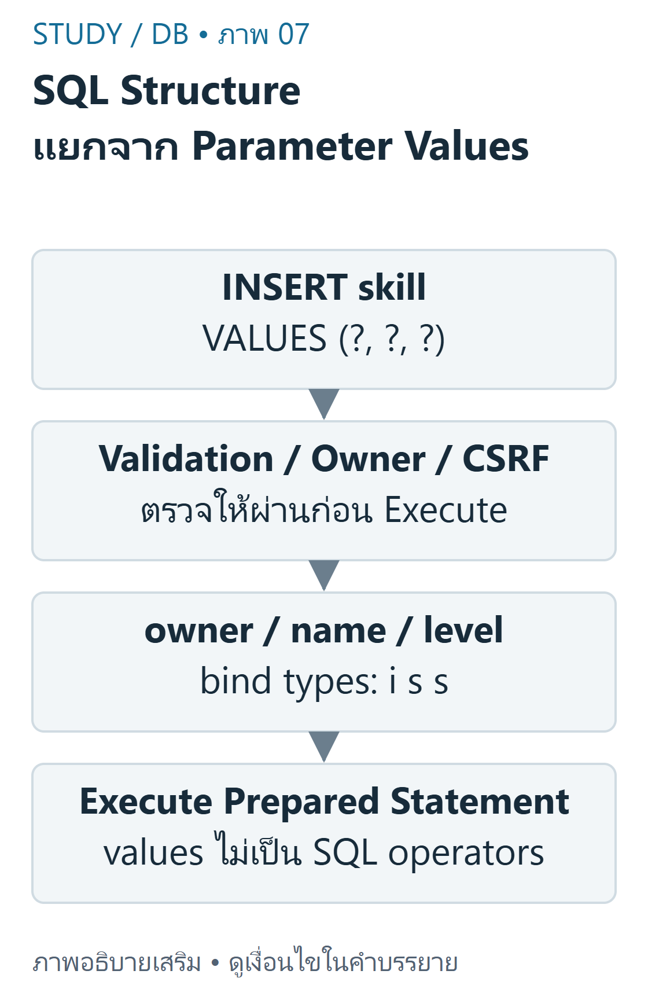
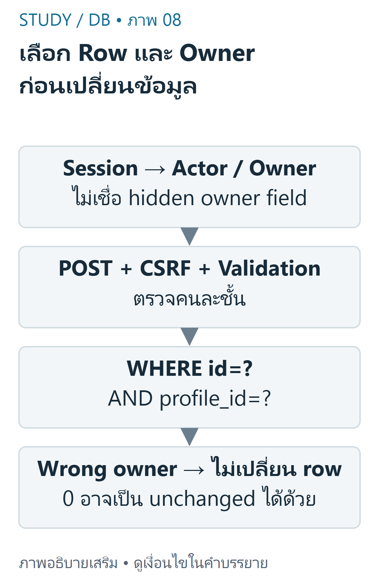

---
{"version":1,"id":"database-management-crud-prepared-statements","course":"database-management","category":"summaries","slug":"crud-prepared-statements","title":"DB 04 — CRUD และ Prepared Statements","language":"th"}
---

> อ่าน DB-Z02 และ DB-S03 หน้า5–8,18 เป็นฐาน ตัวอย่าง PHP ต่อไปนี้เขียนเสริมและทดสอบแยก ไม่ได้คัดไฟล์ config หรือทำให้ starter กลายเป็น production app โดยอัตโนมัติ

## เป้าหมายการเรียนรู้ {#objectives}
- จับคู่ CRUD กับ SQL และ bind parameters ตามตำแหน่ง/ชนิด
- ตรวจข้อมูลก่อนเปลี่ยนแถวและจำกัด WHERE ตาม record/owner
- แยก validation, SQL binding, authentication, authorization และ CSRF

## CRUD คือการเปลี่ยนสถานะข้อมูล {#crud}
Create/Read/Update/Delete เป็นงานข้อมูล ในแลปนี้ใช้ INSERT/SELECT/UPDATE/DELETE ตามลำดับ คำว่า Create ใน CRUD ไม่ได้หมายความว่าต้อง CREATE TABLE ทุกครั้งที่ผู้ใช้เพิ่ม skill; CREATE TABLE เป็นการกำหนดโครงสร้าง schema ต่างหาก

| งาน | SQL | สิ่งที่ควรตรวจ |
|---|---|---|
| Create | INSERT | ข้อมูลใหม่และ owner ที่ตรวจจาก session |
| Read | SELECT | เจ้าของและเงื่อนไขการอ่าน |
| Update | UPDATE | SET fields และ WHERE id/owner |
| Delete | DELETE | POST,CSRF,สิทธิ์และ WHERE ที่แคบพอ |

DB-Z02 ใช้ profile แรกเป็น demo เท่านั้น และมี SQL `SELECT 1` ค้างใน4ตำแหน่งซึ่งต้องเติม INSERT,SELECT,UPDATE,DELETE อย่าถือว่าการเปิดฟอร์มได้แปลว่าบันทึกข้อมูลสำเร็จ ส่วน public repository เวอร์ชันที่ตรวจเติม CRUD SQL แล้ว แต่ยังเหลือ login/logout ที่ทำไม่ครบ

## Prepare → Bind → Execute {#binding}
Prepared Statement ส่งโครงสร้าง SQL แยกจากค่าข้อมูล `?` เป็น placeholder สำหรับค่า ไม่ใส่ quote ครอบ และไม่ใช้แทนชื่อตาราง ชื่อคอลัมน์ หรือคำว่า ASC/DESC แบบตรง ๆ ถ้าต้องเลือก identifier ให้เลือกจาก allowlist ฝั่งโปรแกรม



ที่มา: [ภาพเขียนเสริม ตรวจตามบทเรียนและเอกสารเทคนิค](https://www.php.net/manual/en/mysqli.quickstart.prepared-statements.php)

อ่านภาพ: คำสั่ง INSERT skill มี placeholder3ตัว ownerเป็น int ชื่อและระดับเป็น strings จึง bind iss ตามลำดับ ไม่ต่อ raw input ให้กลายเป็นโครงสร้าง SQL

ตัวอย่างพื้นฐานเพิ่ม skill: profile_id เป็นจำนวนเต็ม ส่วนชื่อ/ระดับเป็น string จึง bind เป็น `iss` ตามลำดับเดียวกับ placeholders ทั้ง3ตัว การ binding ไม่ได้ตรวจว่า owner เป็นใครให้อัตโนมัติ

```php
<?php
function createSkill(\mysqli $conn, int $sessionProfileId, mixed $name, mixed $level): int {
    positiveId($sessionProfileId);
    [$name, $level] = skillInput($name, $level);
    $stmt = mysqli_prepare($conn,
        'INSERT INTO skill(profile_id,skill_name,skill_level) VALUES (?,?,?)');
    mysqli_stmt_bind_param($stmt, 'iss', $sessionProfileId, $name, $level);
    mysqli_stmt_execute($stmt);
    $id = mysqli_insert_id($conn);
    mysqli_stmt_close($stmt);
    return $id;
}
```

ถ้าชื่อเป็น `O'Reilly <SQL>` ค่าทั้งหมดต้องเป็นข้อมูลหนึ่งค่า ไม่ทำให้ SQL กลายเป็นคำสั่งใหม่ ขาออกยังต้องใช้ HTML escaping เพราะ binding ไม่ใช่การป้องกัน XSS

## Validation ก่อนส่งคำสั่ง {#validation}
ตัวอย่างต่อยอดรับ ID ที่เป็น scalar integerบวก, ชื่อ UTF-8 ยาว1–120อักขระหลัง trim และ level จากชุดที่กำหนด นี่คือนโยบายฟอร์มที่เขียนเสริม ไม่ใช่ CHECK constraint ที่มีอยู่แล้วในทุกตารางต้นฉบับ

```php
<?php
function positiveId(mixed $raw): int {
    if (!is_int($raw) && !is_string($raw)) {
        throw new \InvalidArgumentException('Scalar ID required');
    }
    $id = filter_var($raw, FILTER_VALIDATE_INT, ['options' => ['min_range' => 1]]);
    if ($id === false) throw new \InvalidArgumentException('Positive integer required');
    return $id;
}
function skillInput(mixed $name, mixed $level): array {
    if (!is_string($name) || !is_string($level) || !mb_check_encoding($name, 'UTF-8')) {
        throw new \InvalidArgumentException('UTF-8 text required');
    }
    $name = trim($name);
    if ($name === '' || mb_strlen($name, 'UTF-8') > 120 ||
        !in_array($level, ['Beginner','Intermediate','Advanced'], true)) {
        throw new \InvalidArgumentException('Invalid skill');
    }
    return [$name, $level];
}
```

การมี `required` ใน HTML ช่วยผู้ใช้ แต่ request สามารถถูกส่งเองได้ จึงยังต้องตรวจฝั่ง Server และป้องกัน array input ที่ไม่ใช่ string อย่าฝืน cast ค่าที่ผิดรูปแล้วดำเนินการต่อ

## เปลี่ยนเฉพาะ record ของ actor {#ownership}
WHERE `id=? AND profile_id=?` ป้องกันการเปลี่ยนแถวของคนอื่นได้เมื่อ profile_id มาจาก session ที่ตรวจแล้ว ตัวเลขจาก hidden input หรือ GET ของผู้ใช้ไม่ใช่หลักฐานสิทธิ์ ห้ามย้ายการตรวจ owner ออกเพียงเพราะ query ใช้ prepared statement



ที่มา: [ภาพเขียนเสริม ตรวจตามบทเรียนและเอกสารเทคนิค](https://dev.mysql.com/doc/refman/8.4/en/join.html)

อ่านภาพ: id เลือก resource ส่วน profile_id จำกัดเจ้าของจาก session การผ่าน CSRF ไม่ได้อนุญาตแก้ของผู้อื่น และ affected_rows0 อาจหมายถึงค่าเดิมไม่เปลี่ยน

```php
<?php
function updateSkill(\mysqli $conn, int $sessionProfileId, int $id, mixed $name, mixed $level): int {
    positiveId($sessionProfileId); positiveId($id);
    [$name, $level] = skillInput($name, $level);
    $stmt = mysqli_prepare($conn,
        'UPDATE skill SET skill_name=?,skill_level=? WHERE id=? AND profile_id=?');
    mysqli_stmt_bind_param($stmt, 'ssii', $name, $level, $id, $sessionProfileId);
    mysqli_stmt_execute($stmt);
    $changed = mysqli_stmt_affected_rows($stmt);
    mysqli_stmt_close($stmt);
    return $changed; // 0 also means an existing row already had these values
}
```

```php
<?php
function deleteSkill(\mysqli $conn, int $sessionProfileId, int $id): int {
    positiveId($sessionProfileId); positiveId($id);
    $stmt = mysqli_prepare($conn, 'DELETE FROM skill WHERE id=? AND profile_id=?');
    mysqli_stmt_bind_param($stmt, 'ii', $id, $sessionProfileId);
    mysqli_stmt_execute($stmt);
    $changed = mysqli_stmt_affected_rows($stmt);
    mysqli_stmt_close($stmt);
    return $changed;
}
```

ใน fixture เมื่อ actor1แก้ record ของactor2 ผล affected_rows เป็น0และข้อมูลactor2ไม่เปลี่ยน แต่0ยังอาจหมายถึง record มีอยู่และค่าใหม่เหมือนค่าเดิม จึงไม่ควรตีความว่า0พิสูจน์ว่า unauthorized เสมอ แอปจริงควรอ่าน record แบบ owner-scoped และตอบนโยบาย not-found/forbidden ที่ไม่รั่วรายละเอียด

SQL `UPDATE skill SET ...` หรือ `DELETE FROM skill` ที่ไม่มี WHERE อาจเปลี่ยนทุกแถว ห้ามทดลองกับข้อมูลสำคัญ การทดสอบในคอร์สใช้ disposable fixtures เท่านั้นและไม่ execute DROP จากไฟล์ต้นฉบับ

## POST และ CSRF {#csrf}
CSRF เป็นการชักให้ Browser ของผู้ใช้ที่มีสิทธิ์ส่ง state-changing request โดยผู้ใช้ไม่ตั้งใจ ควรใช้ POST และตรวจ token ที่ผูกกับ session ฝั่งเซิร์ฟเวอร์ก่อนทำงาน แต่ POST อย่างเดียวและ hidden field ที่ไม่ได้ตรวจไม่ใช่การป้องกันที่พอ

```php
<?php
function checkCsrf(string $method, mixed $submitted, array $session): void {
    if ($method !== 'POST' || !is_string($submitted) ||
        !is_string($session['csrf'] ?? null) || $session['csrf'] === '' ||
        !hash_equals($session['csrf'], $submitted)) {
        throw new \RuntimeException('Forbidden request');
    }
}
```

ฟอร์มส่ง token เดิมที่เซิร์ฟเวอร์สร้างไว้ ไม่ใช่สร้าง token ใหม่จาก request แล้วเปรียบเทียบกับตัวเอง ตรวจ login → CSRF → input → owner → SQL ตามความเหมาะสม ความสามารถเหล่านี้ทำหน้าที่คนละส่วน

### ผลการทดลองที่เขียนเสริม {#worked-crud}
- actor1เพิ่มชื่อที่มีquote/แท็กได้เป็นข้อมูลหนึ่งแถว แล้วแสดงแบบescape
- actor2พยายามUPDATE/DELETE recordนั้น ได้0แถวเปลี่ยนและข้อมูลยังเดิม
- actor1เปลี่ยนค่าใหม่ได้1แถว; ส่งค่าเดิมซ้ำได้0แถวเปลี่ยน
- GETหรือPOSTพร้อมtokenผิดถูกปฏิเสธก่อนเปลี่ยนข้อมูล


เนื้อหาฝึกเขียนและเฉลยต่อไปนี้เรียบเรียงเพื่อการเรียน ไม่ใช่ข้อสอบจริงหรือเฉลยทางการของผู้สอน เว็บไซต์นี้แสดงตัวอย่างแบบ static; ไม่ส่ง SQL, PHP หรือข้อมูลบัญชีไปรันบนเซิร์ฟเวอร์มหาวิทยาลัย

## ข้อผิดพลาดที่พบบ่อย {#mistakes}
- สับสน CREATE TABLE กับ INSERT ของ CRUD
- ต่อ input เข้า SQL แล้ว escape HTML แทนที่จะ bind ค่า
- bind จำนวน/type/order ไม่ตรง placeholder หรือเชื่อ hidden profile_id
- ใช้ GETลบข้อมูล,ไม่มี CSRF,ไม่มี WHERE หรือถือว่า execute สำเร็จเท่ากับมีแถวถูกเปลี่ยนเสมอ

## ฝึกคิดพร้อมเหตุผล {#practice}
- **ข้อ1:** `VALUES(?,?,?)` รับ profile_id,name,level ควร bind อะไร? **เฉลย:** `iss` เมื่อใช้ int,string,string ตาม schema และนโยบายข้างต้น
- **ข้อ2:** ส่งชื่อเดิม/ระดับเดิมแล้ว affected_rows0แปลว่าพังหรือไม่? **เฉลย:** ไม่จำเป็น อาจไม่ต้องเปลี่ยนค่า ต้องแยก record availability/owner ออกจาก changed-row count
- **ข้อ3:** เปิด POSTฟอร์มสำเร็จจะพิสูจน์ว่า CSRFผ่านหรือไม่? **เฉลย:** ไม่ ต้องตรวจ requestจริงและtokenจากsessionก่อนทำSQL

## สรุปทบทวน {#summary}
- Prepared SQLแยกโครงสร้างกับข้อมูล แต่ไม่ทำแทนvalidation/สิทธิ์/CSRF
- ownerต้องมาจากactorที่ตรวจแล้ว และWHEREต้องจำกัดแถว
- ทดสอบทั้งsuccess,wrong owner,invalid input,unchanged value และwrong token

## แหล่งข้อมูลและขอบเขต {#sources}
DB-S03 หน้า5–8,18; DB-Z02 README/bootstrap/skill_create.php/skill_edit.php/skill_delete.php; DB-R01 pinned CRUD pages. โค้ดเสริมตรวจจริงด้วย mysqli บน MariaDB11.4.9 แต่ไม่ได้ deploy ฟอร์มบน Angsila. อ้างอิง [PHP prepared statements](https://www.php.net/manual/en/mysqli.quickstart.prepared-statements.php), [affected_rows](https://www.php.net/manual/en/mysqli-stmt.affected-rows.php) และ [OWASP CSRF guidance](https://cheatsheetseries.owasp.org/cheatsheets/Cross-Site_Request_Forgery_Prevention_Cheat_Sheet.html).

[บัญชีแหล่งข้อมูลและข้อจำกัด](../../../docs/database-source-coverage.md) ระบุเลขหน้ากายภาพของ PDF ทุกครั้ง เอกสารต้นฉบับที่ผู้ใช้ให้เป็นไฟล์ local-only และไม่ได้เผยแพร่ซ้ำ ภาพและโจทย์ฝึกเป็นงานเขียนเสริมที่แยกจากต้นฉบับ
