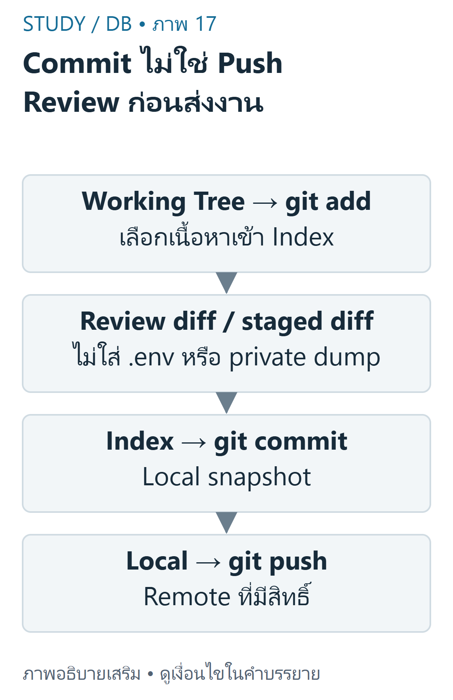
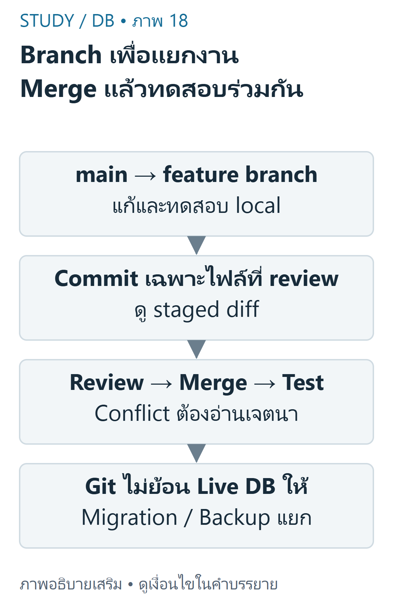

---
{"version":1,"id":"database-management-git-version-control","course":"database-management","category":"summaries","slug":"git-version-control","title":"DB 09 — Git GitHub และการทำงานร่วมกัน","language":"th"}
---

> ขอบเขตจากDB-S01หน้า22–34,36และDB-S03หน้า19–28 คำสั่งเป็นตัวอย่างlocalที่ตรวจในrepositoryชั่วคราว ไม่ได้pushงานส่วนตัวขึ้นremote

## เป้าหมายการเรียนรู้ {#objectives}
- แยกGitจากGitHub และworkingtree/staging/commitจากremote
- ทำbranch/mergeและreviewdiffก่อนcommitอย่างมีเหตุผล
- เก็บschema/migration/READMEโดยไม่เก็บsecretหรือข้อมูลผู้ใช้

## Gitและสามสถานะ {#states}
Gitเป็นระบบควบคุมเวอร์ชันแบบกระจาย ส่วนGitHubเป็นบริการhosting/collaborationที่ใช้Git Commitบันทึกsnapshotที่อยู่ในstagingในlocalrepository ไม่ได้ส่งขึ้นGitHubโดยอัตโนมัติ และไม่ได้สำรองข้อมูลMySQLที่กำลังเปลี่ยนอยู่



ที่มา: [ภาพเขียนเสริม ตรวจตามบทเรียนและเอกสารเทคนิค](https://git-scm.com/docs/gittutorial)

อ่านภาพ: Working Tree คือไฟล์ที่แก้ Indexคือ snapshotที่stage Commitบันทึก localhistory แล้ว Pushจึงส่งremote Gitไม่backupMySQLสดและไม่deployPHPให้อัตโนมัติ

```bash
git status --short
git diff -- database/schema.sql
git add database/schema.sql README.md
git diff --cached
git commit -m "Add reviewed skill schema"
```

Working Treeคือไฟล์ที่กำลังแก้ Staging/Indexคือสิ่งที่เลือกสำหรับcommitถัดไป Repositoryเก็บcommits ถ้าgit addแล้วแก้ไฟล์ต่อ commitจะยังใช้versionที่stageไว้จนstageใหม่ อย่าgit add .โดยไม่reviewในโครงการที่อาจมี.env

ตัวอย่างพื้นฐาน: แก้READMEและstageเฉพาะREADME commitนั้นไม่รวมไฟล์PHPที่ยังunstaged ตัวอย่างท้าทาย: แก้schemaหลังstageแล้วให้git diffเห็นworking-indexและgit diff --cachedเห็นindex-HEADก่อนตัดสินใจ

## BranchและMerge {#branches}
Branchเป็นreferenceที่เลื่อนไปตามcommit ไม่ใช่สำเนาฐานข้อมูลสด การเปลี่ยนbranchไม่ย้อนข้อมูลMySQLโดยอัตโนมัติ ใช้migrationและbackupตามกระบวนการที่ทดสอบแยก



ที่มา: [ภาพเขียนเสริม ตรวจตามบทเรียนและเอกสารเทคนิค](https://git-scm.com/docs/gitignore)

อ่านภาพ: Branchเป็นreferenceในcodehistory ไม่ใช่สำเนาDBสด Reviewความหมายเมื่อconflictและทดสอบหลังmerge .gitignoreไม่ลบsecretที่เคยtrackedหรือrotatepasswordให้

```bash
git switch -c feature/skill-list
# แก้และทดสอบไฟล์ในเครื่อง
git add skill-list.php
git diff --cached
git commit -m "Show owner-scoped skills"
git switch main
git merge feature/skill-list
```

ถ้าไม่มีการแตกประวัติmergeอาจfast-forwardโดยไม่สร้างmergecommit ถ้าแก้บรรทัดเดียวกันอาจconflict ต้องอ่านเจตนาของทั้งสองฝ่าย ลบmarkerให้ถูก ทดสอบก่อนcommit ไม่สุ่มเลือกours/theirsเพียงเพราะคำสั่งผ่าน

## RemoteและการReview {#remotes}
Cloneสร้างlocalrepositoryจากremote Fetchนำobjects/refsมาโดยไม่บังคับmergeเข้าbranchปัจจุบัน Pullโดยทั่วไปfetchแล้วintegrateตามconfiguration ส่วนPushส่งcommits/refsไปremoteที่มีสิทธิ์ PullRequestเป็นคำขอreviewบนplatform ไม่ใช่คำสั่งGitที่mergeให้อัตโนมัติ

```bash
git clone https://github.com/example/learning-demo.git
# URLนี้เป็นรูปแบบตัวอย่าง ไม่ใช่repositoryที่รับรองว่ามีจริง
git remote -v
git fetch origin
git log --oneline --decorate -5
```

ก่อนpushให้ตรวจremoteและbranchจริงพร้อมสิทธิ์และขอบเขต หลีกเลี่ยงforcepushบนงานร่วมกันในบทนี้ การสาธิตlocalไม่อ้างว่าได้ส่งPRหรือdeployAngsilaแล้ว

## ป้องกันSecret {#secrets}
.gitignoreช่วยกันuntrackedfilesเข้าstageโดยไม่ตั้งใจ แต่ไม่ลบไฟล์ที่เคยtracked ไม่ลบข้อมูลจากประวัติ และไม่เพิกถอนpasswordที่รั่ว หากsecretถูกเผยแพร่ต้องrotate/revokeและประสานผู้ดูแลก่อนจัดการประวัติอย่างได้รับอนุญาต

```text
.env
.env.*
*.log
/uploads/
/vendor/
```

นี่คือตัวอย่างpolicyที่ต้องปรับตามโครงการ ไม่ควรignoreทุกSQLเพราะschema/migrationที่reviewแล้วควรversioned ขณะเดียวกันbackupSQLที่มีข้อมูลส่วนตัวไม่ควรpublic ตัวอย่าง.env.exampleถ้าจะใช้ต้องมีเพียงชื่อkey/placeholderที่ไม่ใช่ค่าจริง

## ร่วมทำDatabase Project {#collaboration}
READMEควรบอกวิธีตั้งค่าruntime/schema/seedแบบข้อมูลจำลอง วิธีรันทดสอบและข้อจำกัด ไม่ใส่passwordจริง แยกmigrationที่reviewได้จากdumpจริงที่มีข้อมูลส่วนตัว และตรวจSQLก่อนรันเสมอ

```sql
CREATE TABLE skill (
  id INT AUTO_INCREMENT PRIMARY KEY,
  profile_id INT NOT NULL,
  skill_name VARCHAR(120) NOT NULL,
  skill_level VARCHAR(40) NULL,
  FOREIGN KEY (profile_id) REFERENCES profile(id)
);
```

ตัวอย่างschemaเสริมต้องใช้บนdatabaseทดสอบที่มีprofileตรงชนิด/FKอยู่แล้ว ไม่ใช่คำสั่งให้รันซ้ำบนระบบจริง การเพิ่มคอลัมน์/เปลี่ยนconstraintอาจกระทบข้อมูลเดิม ต้องมีแผนmigration/backout/backupที่เหมาะสม Gitไม่ทำสิ่งนี้ให้เอง

```php
<?php
// เรียกหลังเปิดconnectionและตรวจsession; ตัวอย่างการเรียก helperในDB03
$rows = \StudyDatabase\skills($conn, $sessionProfileId);
echo '<p>พบ ' . count($rows) . ' ทักษะ</p>';
```

ผลกับfixtureprofile1ที่มีสามskillsคือพบ3ทักษะ ต้องreviewทั้งschemaและPHPที่อ่านfieldดังกล่าวร่วมกัน เมื่อmergeผ่านแล้วยังต้องทดสอบใหม่ GitHubPagesรันHTML/CSS/JSได้แต่ไม่รันPHP/MySQL; การhostingPHPต้องใช้serverที่รองรับและได้รับอนุญาต

## ข้อผิดพลาดและแบบฝึก {#practice}
- **ข้อ1:** Commitแล้วเพื่อนเห็นทันทีหรือไม่? **เฉลย:** ไม่ เป็นlocalจนpushไปremoteที่เพื่อนเข้าถึงได้
- **ข้อ2:** เพิ่ม.envใน.gitignoreแก้passwordรั่วแล้วหรือไม่? **เฉลย:** ไม่ ไฟล์tracked/historyยังอยู่และต้องrotate
- **ข้อ3:** switchbranchย้อนschemaDBหรือไม่? **เฉลย:** ไม่ ต้องจัดmigrationแยก

## สรุปทบทวน {#summary}
- Review workingdiffและstageddiffแยกกัน Commit≠Push≠Deploy
- ใช้branch/PRเพื่อreview ไม่ใช้GitแทนการควบคุมDBmigration
- Versionโค้ด/schemaที่reviewแล้ว ไม่เผยแพร่secretหรือข้อมูลผู้ใช้

เนื้อหาฝึกเขียนและเฉลยต่อไปนี้เรียบเรียงเพื่อการเรียน ไม่ใช่ข้อสอบจริงหรือเฉลยทางการของผู้สอน เว็บไซต์นี้แสดงตัวอย่างแบบ static; ไม่ส่ง SQL, PHP หรือข้อมูลบัญชีไปรันบนเซิร์ฟเวอร์มหาวิทยาลัย


## แหล่งข้อมูลและขอบเขต {#sources}
DB-S01 หน้า22–34,36; DB-S03 หน้า19–28. อ้างอิงเสริม [Git basics](https://git-scm.com/docs/gittutorial), [gitignore](https://git-scm.com/docs/gitignore), [git-pull](https://git-scm.com/docs/git-pull), [GitHub Pages](https://docs.github.com/en/pages/getting-started-with-github-pages/what-is-github-pages).

[บัญชีแหล่งข้อมูลและข้อจำกัด](../../../docs/database-source-coverage.md) ระบุเลขหน้ากายภาพของ PDF ทุกครั้ง เอกสารต้นฉบับที่ผู้ใช้ให้เป็นไฟล์ local-only และไม่ได้เผยแพร่ซ้ำ ภาพและโจทย์ฝึกเป็นงานเขียนเสริมที่แยกจากต้นฉบับ
