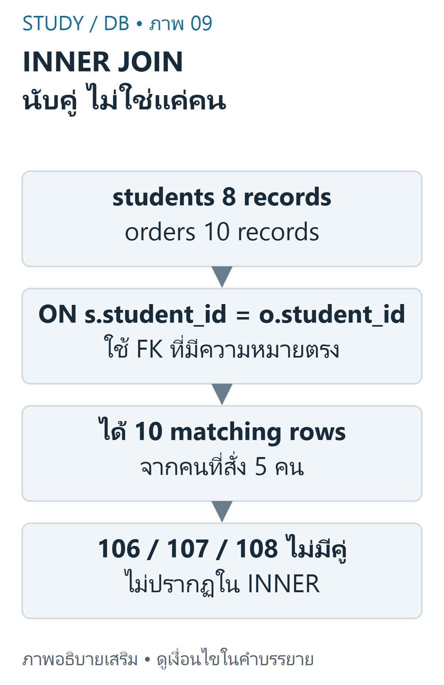
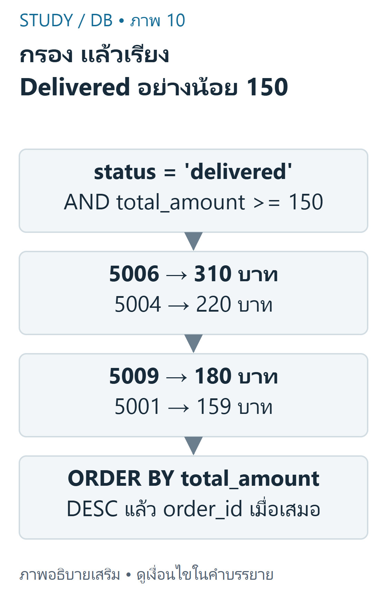

---
{"version":1,"id":"database-management-inner-join","course":"database-management","category":"summaries","slug":"inner-join","title":"DB 05 — INNER JOIN และจำนวนแถว","language":"th"}
---

> แยกให้ชัด: สไลด์ DB-S02 ใช้4นิสิต/3ออเดอร์ แต่ homework DB-D01/DB-H01 ใช้8นิสิต/10ออเดอร์ ไม่แทนผลนับของสองชุดให้กัน

## เป้าหมายการเรียนรู้ {#objectives}
- ระบุคู่คีย์ที่มีความหมายและอ่าน ON ได้
- คาดการณ์ matching rows และจำนวนคนแบบไม่ซ้ำให้ต่างจากจำนวนแถว
- เขียน alias,filter,sort ของ JOIN และตรวจผลกับข้อมูลต้นทาง

## ข้อมูลที่ใช้ในบท {#source-data}
Campus HWเป็นข้อมูลจำลองตาม DB-D01 มี8studentsและ10orders ด้านล่างครบทุกแถวที่ต้องใช้ในบทนี้ จึงสามารถตรวจคู่คีย์และคำตอบได้โดยไม่ต้องเดาข้อมูลที่ไม่ได้ให้ จำนวนร้าน6/รายการ14จะใช้ในบทmulti-tableต่อไป

| student_id | student_name | faculty |
|---|---|---|
| 101 | มีนา | Informatics |
| 102 | ต้น | Science |
| 103 | ปอนด์ | Logistics |
| 104 | ฟ้า | Nursing |
| 105 | บีม | Engineering |
| 106 | นิว | Informatics |
| 107 | ไอซ์ | Humanities |
| 108 | เจ | Science |

| order_id | student_id | order_date | total_amount บาท | status |
|---|---|---|---|---|
| 5001 | 101 | 2026-09-14 | 159.00 | delivered |
| 5002 | 102 | 2026-09-15 | 89.00 | preparing |
| 5003 | 101 | 2026-09-17 | 120.00 | cancelled |
| 5004 | 103 | 2026-09-18 | 220.00 | delivered |
| 5005 | 104 | 2026-09-18 | 75.00 | delivered |
| 5006 | 105 | 2026-09-19 | 310.00 | delivered |
| 5007 | 102 | 2026-09-20 | 145.00 | delivered |
| 5008 | 103 | 2026-09-21 | 99.00 | cancelled |
| 5009 | 104 | 2026-09-22 | 180.00 | delivered |
| 5010 | 105 | 2026-09-22 | 60.00 | preparing |

## ON จับคู่ตามความสัมพันธ์ {#matching}
INNER JOIN เก็บคู่แถวที่เงื่อนไข ON เป็น TRUE `students.student_id=orders.student_id` สอดคล้องกับ FK ของออเดอร์ ไม่ใช่การเทียบแถวตำแหน่งเดียวกันและไม่ใช่เทียบ student_idกับorder_idเพราะทั้งคู่เป็นINT

ตัวอย่างพื้นฐานใช้เฉพาะข้อมูลสไลด์: students101–104กับorders5001→101,5002→102,5003→101 ได้3แถวแต่2นิสิตไม่ซ้ำคือ101และ102 ออเดอร์ของ101ทำให้ชื่อเดิมปรากฏได้สองครั้ง

```sql
SELECT s.student_id,o.order_id
FROM slide_students s
JOIN slide_orders o
ON o.student_id=s.student_id
ORDER BY s.student_id,o.order_id;
```

| student_id | order_id |
|---|---|
| 101 | 5001 |
| 101 | 5003 |
| 102 | 5002 |

ตารางslide_students/slide_ordersเป็นชื่อแยกสำหรับเปรียบเทียบใน fixture เท่านั้น ในสไลด์ใช้ชื่อตารางstudents/ordersโดยตรงและมีข้อมูลเพียงชุดเล็กนั้น

## Bag semantics และ1:N {#multiplicity}
SQLปกติไม่ลบแถวซ้ำให้อัตโนมัติและหนึ่งแถวซ้ายจับได้หลายแถวขวา จึงไม่ควรใช้พื้นที่ทับกันของVennเป็นสูตรนับผล JOIN สำหรับCampusHW ออเดอร์ทั้ง10มีFKถูกต้อง จึงได้10matching rowsแต่มีนิสิต5คน ส่วน106,107,108หายไปเพราะไม่มีคู่



ที่มา: [ภาพเขียนเสริม ตรวจตามบทเรียนและเอกสารเทคนิค](https://dev.mysql.com/doc/refman/8.4/en/join.html)

อ่านภาพ: Campus orders ทุกแถวมี student ที่อ้างได้จึงมี10 matching rows จากนิสิต5คนที่สั่ง อีก3คนไม่มีคู่และไม่ปรากฏใน INNER ผล SQL อาจซ้ำ identity ของ parent ได้

COUNT(*) นับแถวผลลัพธ์ ส่วนCOUNT(DISTINCT s.student_id) นับนิสิตไม่ซ้ำตามprojectionนั้น การใช้DISTINCTเพื่อซ่อนผลคูณผิดคีย์ไม่แก้เหตุผลของJOINและอาจตัดรายละเอียดที่ต้องการ

## Filter และ Sort {#filter-sort}
WHEREกรองผลmatching rowsตามเงื่อนไข และORDER BYกำหนดลำดับที่ตรวจได้ ใช้aliasให้ระบุที่มาคอลัมน์ได้ชัด เช่นs.student_nameและo.order_id ในINNER JOIN เงื่อนไขกรองที่เหมาะสมอาจย้ายระหว่างON/WHEREได้โดยยังได้ผลเดียวกัน แต่ห้ามเหมารวมไปยังOUTER JOIN



ที่มา: [ภาพเขียนเสริม ตรวจตามบทเรียนและเอกสารเทคนิค](https://dev.mysql.com/doc/refman/8.4/en/join.html)

อ่านภาพ: Campus เลือก delivered และ total_amount>=150 ได้5006ยอด310,5004ยอด220,5009ยอด180,5001ยอด159บาท เรียงยอด DESC และ order_id เป็น tie key

ตัวอย่างต่อยอดจากhomeworkข้อ5: เลือกdeliveredและtotal_amountตั้งแต่150บาทขึ้นไป เรียงยอดDESCและorder_idเป็นtie-breaker มี4ออเดอร์คือ5006,5004,5009,5001

```sql
SELECT s.student_name,s.faculty,o.order_id,o.order_date,o.total_amount,o.status
FROM students s
JOIN orders o
ON o.student_id=s.student_id
WHERE o.status='delivered' AND o.total_amount>=150
ORDER BY o.total_amount DESC,o.order_id;
```

| student_name | faculty | order_id | order_date | amount บาท | status |
|---|---|---|---|---|---|
| บีม | Engineering | 5006 | 2026-09-19 | 310.00 | delivered |
| ปอนด์ | Logistics | 5004 | 2026-09-18 | 220.00 | delivered |
| ฟ้า | Nursing | 5009 | 2026-09-22 | 180.00 | delivered |
| มีนา | Informatics | 5001 | 2026-09-14 | 159.00 | delivered |

## เขียนผลลัพธ์ให้ตรวจย้อนกลับได้ {#examples}
เฉลยที่เขียนเสริมสำหรับhomeworkข้อ4ใช้projectionตามโจทย์และเรียงorder_id ไม่มีการอ้างว่าเป็นofficial answer key ผลครบ10แถวสามารถตามจากตารางต้นทางด้านบนได้ทุกแถว

```sql
SELECT s.student_name,s.faculty,o.order_id,o.order_date,o.total_amount,o.status
FROM students s
JOIN orders o
ON o.student_id=s.student_id
ORDER BY o.order_id;
```

| student_name | faculty | order_id | order_date | amount บาท | status |
|---|---|---|---|---|---|
| มีนา | Informatics | 5001 | 2026-09-14 | 159.00 | delivered |
| ต้น | Science | 5002 | 2026-09-15 | 89.00 | preparing |
| มีนา | Informatics | 5003 | 2026-09-17 | 120.00 | cancelled |
| ปอนด์ | Logistics | 5004 | 2026-09-18 | 220.00 | delivered |
| ฟ้า | Nursing | 5005 | 2026-09-18 | 75.00 | delivered |
| บีม | Engineering | 5006 | 2026-09-19 | 310.00 | delivered |
| ต้น | Science | 5007 | 2026-09-20 | 145.00 | delivered |
| ปอนด์ | Logistics | 5008 | 2026-09-21 | 99.00 | cancelled |
| ฟ้า | Nursing | 5009 | 2026-09-22 | 180.00 | delivered |
| บีม | Engineering | 5010 | 2026-09-22 | 60.00 | preparing |

เริ่มตรวจจากมีนา101→5001/5003 ต้น102→5002/5007 แล้วจึงตรวจคนอื่น หากใช้ `ON s.student_id=o.order_id` กับชุดนี้จะได้0แถวเพราะช่วง101–108ไม่เท่ากับ5001–5010 แม้SQLรันได้ก็จับคู่ความหมายผิด


เนื้อหาฝึกเขียนและเฉลยต่อไปนี้เรียบเรียงเพื่อการเรียน ไม่ใช่ข้อสอบจริงหรือเฉลยทางการของผู้สอน เว็บไซต์นี้แสดงตัวอย่างแบบ static; ไม่ส่ง SQL, PHP หรือข้อมูลบัญชีไปรันบนเซิร์ฟเวอร์มหาวิทยาลัย

## ข้อผิดพลาดที่พบบ่อย {#mistakes}
- ตอบ3แถวให้homeworkเพราะจำจากslide dataset หรือสับสน5คนกับ10แถว
- ใช้wrong key/ไม่มีON หรือคิดว่าจำเป็นต้องอยู่ในDBคนละเครื่องจึงJOINได้
- คิดว่าผลลัพธ์เรียงเองเมื่อไม่มีORDER BY
- ใช้DISTINCTโดยไม่เข้าใจว่าข้อมูลใดจะถูกตัดออก

## ฝึกคิดพร้อมเหตุผล {#practice}
- **ข้อ1:** ทำไม101ออกสองครั้ง? **เฉลย:** มีorders5001และ5003จับคีย์เดียวกัน จึงเป็นสองคู่ที่ถูกต้อง
- **ข้อ2:** students106ไม่มีorderถือว่าแถวถูกลบหรือไม่? **เฉลย:** ไม่ถูกลบ INNER JOINเพียงไม่ส่งแถวนั้นออกมา
- **ข้อ3:** ต้องการทุกคนแม้ไม่มีorderควรใช้INNERต่อหรือไม่? **เฉลย:** เปลี่ยนเป็นLEFT JOINโดยวางstudentsทางซ้ายและพิจารณาNULL

## สรุปทบทวน {#summary}
- ใช้คีย์ที่อ้างความหมายเดียวกันและอ่านผลเป็นคู่แถว
- ชุดสไลด์ได้3rows/2people;CampusHWได้10rows/5people
- WHERE/ORDER BYและprojectionต้องตรงโจทย์;ตรวจผลย้อนจากข้อมูลจริง

## แหล่งข้อมูลและขอบเขต {#sources}
DB-S02 หน้า6,8–16; DB-H01 ข้อ1,2,4,5 และข้อมูลจำลอง; DB-D01. คำตอบและresult tablesเป็นการคำนวณเสริมที่ตรวจด้วยPython row model,SQLiteและMariaDB ไม่อ้างเป็นข้อสอบจริง. อ้างอิง [MySQL JOIN](https://dev.mysql.com/doc/refman/8.4/en/join.html) และ [SELECT](https://dev.mysql.com/doc/refman/8.4/en/select.html).

[บัญชีแหล่งข้อมูลและข้อจำกัด](../../../docs/database-source-coverage.md) ระบุเลขหน้ากายภาพของ PDF ทุกครั้ง เอกสารต้นฉบับที่ผู้ใช้ให้เป็นไฟล์ local-only และไม่ได้เผยแพร่ซ้ำ ภาพและโจทย์ฝึกเป็นงานเขียนเสริมที่แยกจากต้นฉบับ
