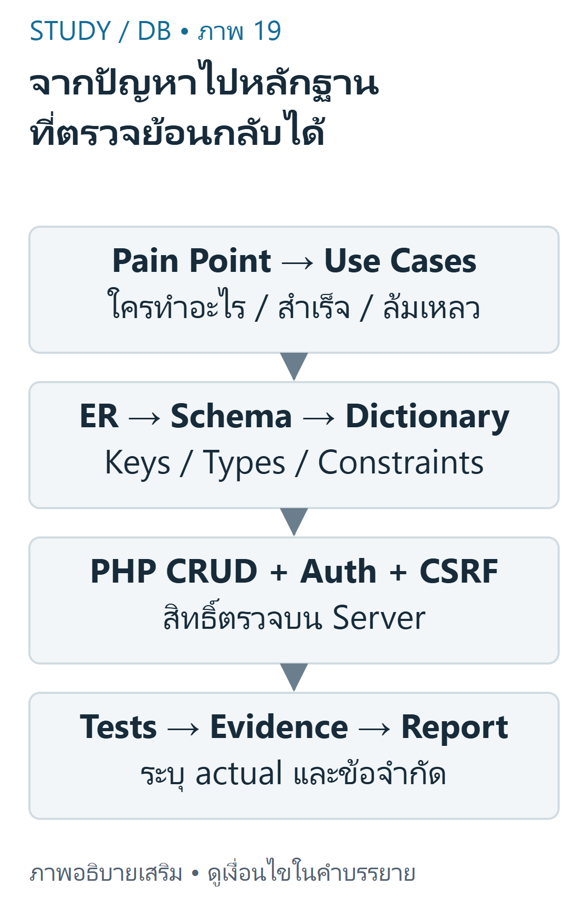
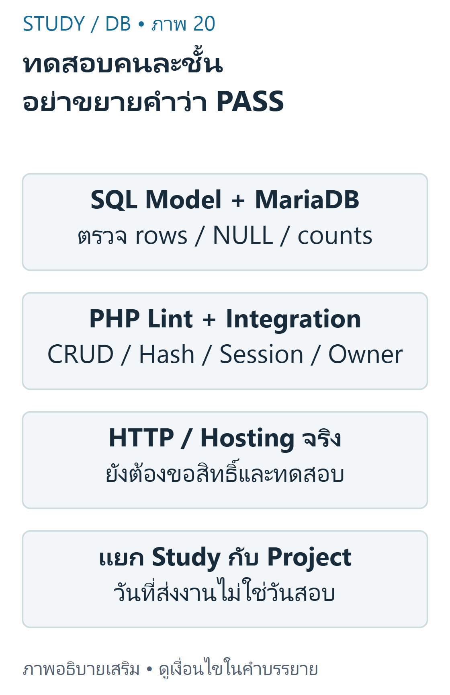

---
{"version":1,"id":"database-management-integrated-project","course":"database-management","category":"summaries","slug":"integrated-project","title":"DB 10 — โครงงานฐานข้อมูลแบบบูรณาการ","language":"th"}
---

> ใช้DB-S03หน้า29–36และResume/CRUD requirementsเป็นหลัก นี่คือแผนฝึกและตัวอย่างที่เรียบเรียง ไม่ใช่ข้อกำหนดFinalทั้งหมดของรายวิชา

## เป้าหมายการเรียนรู้ {#objectives}
- เชื่อมPainPoint,UseCase,ER,Schema,DataDictionaryและการทดสอบ
- วางsecureCRUD/Login/ownershipโดยใช้บทก่อนหน้า
- แยกstudychecklistจากprojectdeliveryและรายงานผลตามหลักฐานจริง

## จากปัญหาไปความต้องการ {#requirements}
ProblemStatementต้องระบุผู้ใช้และปัญหาที่พบ ไม่เริ่มจากรายการเทคโนโลยีอย่างเดียว ตัวอย่างเสริมคือผู้สมัครต้องอัปเดตทักษะResumeของตนโดยไม่แก้ข้อมูลคนอื่น UseCaseระบุactor/precondition/action/success/failure เช่นเจ้าของLoginแล้วเพิ่มskillที่ผ่านvalidation;ถ้าCSRFผิดต้องไม่เกิดการเขียน



ที่มา: [ภาพเขียนเสริม ตรวจตามบทเรียนและเอกสารเทคนิค](https://dev.mysql.com/doc/refman/8.4/en/join.html)

อ่านภาพ: เริ่ม PainPoint/Requirements/UseCases แล้วทำ ER Schema DataDictionary ลง PHP CRUD/auth และสร้าง testmatrix expected/actual ไม่อ้าง screenshotจำลองว่า deployจริง

DB-S03ระบุโครงงานและการนำเสนอ/รายงาน วันที่31ตุลาคม2026เป็นส่งproposalและ10พฤศจิกายน2026เป็นส่งงานโครงงานจากหน้า34,36 ไม่ใช่วันสอบFinalที่ยืนยันแล้ว ถ้ามีประกาศใหม่ต้องตรวจผู้สอน ไม่อนุมานน้ำหนักคะแนนหรือข้อสอบจากวันที่นี้

## แบบจำลองและDataDictionary {#schema}
ERDiagramแสดงentity/key/cardinality Schemaทำข้อจำกัดจริง และDataDictionaryอธิบายความหมาย/type/nullable/constraint แต่ละfield ทั้งสามต้องสอดคล้องกัน ตัวอย่างสอนต่อยอดpublicschema ไม่ได้แก้ไฟล์ต้นฉบับ

| ตาราง.field | ชนิดตัวอย่าง | ความหมาย/ข้อจำกัด |
|---|---|---|
| profile.id | INT PK | identityของResume |
| profile.email | VARCHAR(150) | emailในprofile;ไม่ใช่password |
| users.profile_id | INT UNIQUE FK | accountผูกหนึ่งprofileในschemaภายหลัง |
| users.password_hash | VARCHAR(255) | hashจากpassword_hash;ไม่ส่งออกหน้าเว็บ |
| skill.profile_id | INT FK | เจ้าของskillหนึ่งรายการ |
| skill.skill_level | VARCHAR(40) NULL | ระดับทักษะ;อย่าสับสนNULLกับmissingrow |

ตัวอย่างพื้นฐานคือprofile1มีskillหลายแถว ตัวอย่างท้าทายคือหนึ่งคนAพยายามแก้skillของB ConstraintFKกันownerที่ไม่มีจริง แต่ไม่รู้ว่าผู้ร้องขอเป็นAหรือB ต้องมีAuthorizationที่PHPด้วย

## ลงมือเป็นชั้นและตรวจผล {#implementation}
ลำดับฝึกที่แนะนำ: schema+fixture → SELECT/render → validation+preparedCRUD → Login/Session → ownership+CSRF → errorhandling+tests ลำดับนี้เป็นคำแนะนำเสริม ไม่อ้างว่าเป็นตารางสอนที่ยืนยัน

```sql
SELECT id,skill_name,skill_level FROM skill
WHERE profile_id=? ORDER BY id;
```

เครื่องหมาย?เป็นplaceholderของpreparedstatement ไม่ใช่SQLที่pasteรันตรงในphpMyAdminโดยไม่bind ค่าตัวอย่าง1ให้สามแถวตามfixtureทดสอบ ส่วนการอ่านprofile999ที่ไม่มีskillคืนarrayว่าง

```php
<?php
// ตัวอย่างcontrollerส่วนที่สำคัญ: helperนิยามในบทDB03/04/08
$owner = \StudyDatabase\actorProfile($_SESSION);
\StudyDatabase\checkCsrf($_SERVER['REQUEST_METHOD'], $_POST['csrf'] ?? null, $_SESSION);
$id = \StudyDatabase\positiveId($_POST['id'] ?? null);
$changed = \StudyDatabase\deleteSkill($conn, $owner, $id);
// ตอบกลับ/redirectโดยไม่เปิดเผยรายละเอียดDB; อย่าechoก่อนheader
```

ผลที่คาด:เจ้าของลบแถวตนได้1แถว ลบซ้ำได้0 และwrongownerได้0โดยข้อมูลเดิมไม่เปลี่ยน ต้องรับexceptionจากguardและแสดงข้อความทั่วไปด้วยHTTPstatusเหมาะสม Controllerย่อนี้ไม่ใช่แอปพร้อมdeployและไม่ควรถอดguardออกเพื่อให้demoผ่าน

## ออกแบบหลักฐานการทดสอบ {#testing}
TestCaseควรมีinput/precondition/expected/actual/evidence ไม่เขียนPASSก่อนรัน ตัวอย่างตารางต่อไปเป็นexpectedของระบบเสริม โดยส่วนhelper/SQLทดสอบอัตโนมัติในfixtureแล้ว ส่วนHTTPบนhostingจริงยังไม่ทำ



ที่มา: [ภาพเขียนเสริม ตรวจตามบทเรียนและเอกสารเทคนิค](https://dev.mysql.com/doc/refman/8.4/en/join.html)

อ่านภาพ: SQLrowmodel/engine,PHP lint,PHPintegration,HTTPบนhostingจริงและdeploymentเป็นคนละหลักฐาน ชุดนี้ทดสอบ MariaDBและPHPCLI แต่ไม่ทดสอบบัญชีหรือhostingจริงAngsila

| กรณี | Expected | ขอบเขตที่ตรวจในชุดนี้ |
|---|---|---|
| SELECT owner1 | skills3แถวเรียงid | PHP+MariaDBintegration |
| UPDATEowner2แก้ของ1 | แถวไม่เปลี่ยน | PHP+MariaDBintegration |
| emailซ้ำตอนสมัคร | rollbackprofileที่เพิ่งสร้าง | PHP+MariaDBintegration |
| passwordผิด | authenticateคืนNULL | PHPintegration |
| CSRFผิดหรือGET | guardปฏิเสธ | PHPCLI |
| Loginสำเร็จ | rotateID+newCSRF | PHPCLI session |
| Cookieผ่านHTTPSบนAngsila | Secure/HttpOnlyตามconfig | ยังไม่ทดสอบจริง |

การทดสอบqueryCampusทั้ง31casesใช้MariaDB11.4.9จริงบนisolatedserverและเทียบกับPythonrowmodel/SQLite3.53.1 แต่นี่ไม่ใช่การรับรองว่าMySQLทุกversionหรือAngsilaเหมือนกัน หากproductionต่างรุ่นต้องทดสอบซ้ำเฉพาะส่วนเกี่ยวข้อง

## แยกสิ่งที่ต้องทบทวนและสิ่งที่ต้องส่ง {#delivery}
**StudyChecklist:** อธิบายrequestflow,PK/FK,JOIN/NULL,CRUD/scopedWHERE,hash/session/CSRF,Gitstates และคำนวณresultrowsเองได้ แก้โจทย์ฝึกก่อนเปิดเฉลย ไม่ถือคะแนนPracticeเป็นคำทำนายสอบ

**ProjectChecklist:** ระบุปัญหา/requirements,usecases,ER/schema/dictionary,sourceversion,setupREADME,sanitizedfixture,testevidence,reportและข้อจำกัด ให้ผู้สอนอนุมัติการdeployAngsila/hostingที่รองรับPHPก่อน ไม่ใส่secret,photosส่วนตัวหรือdumpจริงในGitHub

READMEควรระบุเวอร์ชันruntime วิธีตั้งconfigผ่านช่องทางที่ไม่public วิธีใช้databaseทดสอบและสิ่งที่ยังไม่รัน อย่าอ้างภาพmockupเป็นหลักฐานdeploymentจริง การนำเสนอควรอธิบายว่าข้อมูลมาจากไหน ใครแก้ได้ และป้องกันผิดพลาดอย่างไร

## ข้อผิดพลาดและแบบฝึกคิด {#practice}
- **ข้อ1:** ERมีFKแล้วพอป้องกันแก้ข้อมูลคนอื่นหรือไม่? **เฉลย:** ไม่ FKเช็กreference ไม่เช็กidentityของผู้ร้องขอ
- **ข้อ2:** CLItestผ่านแปลว่าAngsilaHTTPcookieผ่านหรือไม่? **เฉลย:** ไม่ ต้องแยกขอบเขตทดสอบ
- **ข้อ3:** วันที่10พฤศจิกายนคือFinalexamหรือไม่? **เฉลย:** หลักฐานนี้ระบุprojectdelivery ไม่ยืนยันวันสอบ

## สรุปทบทวน {#summary}
- เชื่อมrequirements→schema→code→testแบบตรวจย้อนกลับได้
- ใช้fixtureจำลองและรายงานactualอย่างซื่อสัตย์ แยกSQL/PHPCLI/HTTP/deployment
- ส่งตามคำสั่งผู้สอนจริง แยกmilestonesจากexamและแยกStudyจากProject

เนื้อหาฝึกเขียนและเฉลยต่อไปนี้เรียบเรียงเพื่อการเรียน ไม่ใช่ข้อสอบจริงหรือเฉลยทางการของผู้สอน เว็บไซต์นี้แสดงตัวอย่างแบบ static; ไม่ส่ง SQL, PHP หรือข้อมูลบัญชีไปรันบนเซิร์ฟเวอร์มหาวิทยาลัย


## แหล่งข้อมูลและขอบเขต {#sources}
DB-S03 หน้า29–36 โดยmilestonesหน้า34,36; DB-Z01 LAB_INSTRUCTIONS.md และDB-Z02 README; schemaภายหลังจากDB-R01. [PHP mysqli](https://www.php.net/manual/en/mysqli.quickstart.prepared-statements.php) และ [Git documentation](https://git-scm.com/doc) เป็นเอกสารเสริมทางเทคนิค ไม่ใช่ข้อสอบของรายวิชา.

[บัญชีแหล่งข้อมูลและข้อจำกัด](../../../docs/database-source-coverage.md) ระบุเลขหน้ากายภาพของ PDF ทุกครั้ง เอกสารต้นฉบับที่ผู้ใช้ให้เป็นไฟล์ local-only และไม่ได้เผยแพร่ซ้ำ ภาพและโจทย์ฝึกเป็นงานเขียนเสริมที่แยกจากต้นฉบับ
