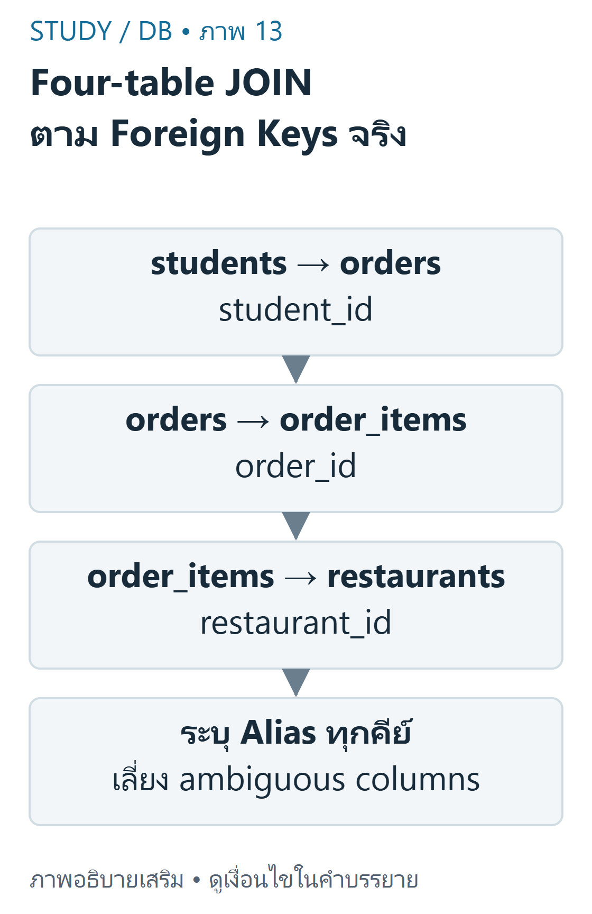
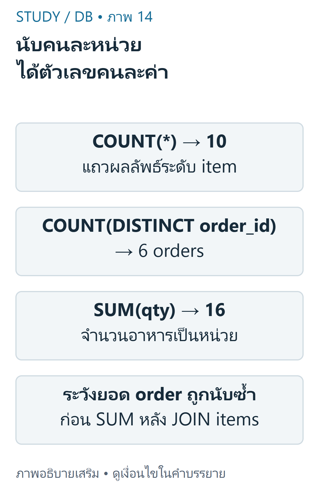

---
{"version":1,"id":"database-management-multi-table-join-debugging","course":"database-management","category":"summaries","slug":"multi-table-join-debugging","title":"DB 07 — เชื่อมหลายตารางและแก้ข้อผิดพลาด","language":"th"}
---

> ใช้ DB-D01 ชุดเดียวกับการบ้าน DB-H01 ข้อ1–13; คำตอบเป็นการคำนวณอิสระ ไม่ใช่เฉลยทางการ

## เป้าหมายการเรียนรู้ {#objectives}
- ต่อ JOIN ตาม Foreign Key ของสี่ตาราง และแยกจำนวนคน/ออเดอร์/รายการอาหาร
- ตรวจ ON, WHERE, aliases และ NULL ก่อนตีความผลลัพธ์
- อ่าน EXPLAIN เป็นแผนของ engine ไม่ใช่คำสั่งรับรองความเร็ว

## อ่านเส้นความสัมพันธ์ก่อนเขียน SQL {#relations}
Campus Delivery เชื่อม students.student_id → orders.student_id, orders.order_id → order_items.order_id และ restaurants.restaurant_id → order_items.restaurant_id ร้านอาหารไม่ได้ผูกโดยตรงกับ orders ใน schema นี้ ออเดอร์เดียวจึงอาจมีรายการจากหลายร้าน ต้องอ่าน schema จริงก่อนสมมติความสัมพันธ์



ที่มา: [ภาพเขียนเสริม ตรวจตามบทเรียนและเอกสารเทคนิค](https://dev.mysql.com/doc/refman/8.4/en/join.html)

อ่านภาพ: เชื่อม students→orders ด้วย student_id แล้ว orders→order_items ด้วย order_id และ items→restaurants ด้วย restaurant_id ร้านอยู่ที่ item จึงไม่เดาว่า order มี FK ร้านโดยตรง

ข้อมูลจำลองต้นฉบับมี8นิสิต,6ร้าน,10ออเดอร์,14รายการอาหาร ตารางนิสิตและออเดอร์อยู่ใน DB02/DB05 ต่อไปนี้คือร้านและรายการครบชุดเพื่อให้ตรวจผลสี่ตารางได้ด้วยตนเอง

| restaurant_id | restaurant_name | category |
|---|---|---|
| 201 | ครัวนมสด | Thai |
| 202 | Curry Lab | Japanese |
| 203 | หมูปิ้ง AI | Street Food |
| 204 | Green Bowl | Healthy |
| 205 | Midnight Toast | Dessert |
| 206 | NULL Cafe | Cafe |

| item_id | order_id | restaurant_id | menu_name | qty |
|---|---|---|---|---|
| 7001 | 5001 | 201 | ข้าวกะเพรา | 1 |
| 7002 | 5001 | 205 | โทสต์โกโก้ | 1 |
| 7003 | 5002 | 203 | หมูปิ้ง | 2 |
| 7004 | 5003 | 204 | ซีซาร์สลัด | 1 |
| 7005 | 5004 | 202 | แกงกะหรี่ญี่ปุ่น | 2 |
| 7006 | 5004 | 205 | โทสต์นมสด | 1 |
| 7007 | 5005 | 201 | ข้าวผัด | 1 |
| 7008 | 5006 | 203 | หมูปิ้ง | 4 |
| 7009 | 5006 | 204 | เบอร์รีสมูทตี | 2 |
| 7010 | 5007 | 202 | ข้าวแกงกะหรี่กะเพรา | 1 |
| 7011 | 5008 | 201 | ก๋วยเตี๋ยว | 1 |
| 7012 | 5009 | 204 | สลัดทูน่า | 2 |
| 7013 | 5009 | 205 | นมสด | 1 |
| 7014 | 5010 | 203 | หมูปิ้ง | 1 |

## ผลลัพธ์สี่ตาราง {#four-table}
เริ่มจากสองตารางแล้วเพิ่มตารางลูกทีละตัว จำนวนแถวของผลสุดท้ายเป็นจำนวนการจับคู่ ไม่ใช่จำนวนออเดอร์ distinct เมื่อเลือกเฉพาะ delivered จะได้10แถวจาก6ออเดอร์ รวม quantity16หน่วย การมีสองรายการในออเดอร์เดียวทำให้ order_id ซ้ำอย่างถูกต้อง

```sql
SELECT s.student_name,o.order_id,oi.menu_name,r.restaurant_name,oi.qty,o.status
FROM students s
JOIN orders o
ON o.student_id=s.student_id
JOIN order_items oi
ON oi.order_id=o.order_id
JOIN restaurants r
ON r.restaurant_id=oi.restaurant_id
WHERE o.status='delivered'
ORDER BY o.order_id,oi.item_id;
```

| student_name | order_id | menu_name | restaurant_name | qty | status |
|---|---|---|---|---|---|
| มีนา | 5001 | ข้าวกะเพรา | ครัวนมสด | 1 | delivered |
| มีนา | 5001 | โทสต์โกโก้ | Midnight Toast | 1 | delivered |
| ปอนด์ | 5004 | แกงกะหรี่ญี่ปุ่น | Curry Lab | 2 | delivered |
| ปอนด์ | 5004 | โทสต์นมสด | Midnight Toast | 1 | delivered |
| ฟ้า | 5005 | ข้าวผัด | ครัวนมสด | 1 | delivered |
| บีม | 5006 | หมูปิ้ง | หมูปิ้ง AI | 4 | delivered |
| บีม | 5006 | เบอร์รีสมูทตี | Green Bowl | 2 | delivered |
| ต้น | 5007 | ข้าวแกงกะหรี่กะเพรา | Curry Lab | 1 | delivered |
| ฟ้า | 5009 | สลัดทูน่า | Green Bowl | 2 | delivered |
| ฟ้า | 5009 | นมสด | Midnight Toast | 1 | delivered |

ตัวอย่างพื้นฐาน: order5001มีสองรายการจึงปรากฏสองแถว ตัวอย่างที่ท้าทาย: ถ้าต้องหายอดเงินออเดอร์หลัง JOIN items แล้ว SUM(total_amount) ตรงๆ ออเดอร์ที่มีหลายรายการจะถูกนับซ้ำ ควรรวมที่ระดับordersก่อน หรือใช้ตารางย่อยที่มีหนึ่งแถวต่อorder_id การใช้ SUM(DISTINCT total_amount) ไม่แก้ทั่วไป เพราะออเดอร์ต่างกันอาจมียอดเท่ากัน

## จำนวนแถวและหน่วยของการนับ {#cardinality}
COUNT(*) นับแถวผลลัพธ์ COUNT(column) ไม่นับNULL และ COUNT(DISTINCT key) นับidentityที่ต่างกัน การเลือกฟังก์ชันต้องตรงคำถาม มิฉะนั้นได้ตัวเลขจริงแต่ตอบผิดหน่วย



ที่มา: [ภาพเขียนเสริม ตรวจตามบทเรียนและเอกสารเทคนิค](https://dev.mysql.com/doc/refman/8.4/en/join.html)

อ่านภาพ: delivered four-table JOIN มี10 item rows จาก6 distinct orders รวมquantity16หน่วย COUNT rows,COUNT DISTINCT orders และ SUM(qty)ตอบคนละคำถาม

```sql
SELECT COUNT(*) AS rows_n,COUNT(DISTINCT o.order_id) AS orders_n,SUM(oi.qty) AS quantity
FROM orders o
JOIN order_items oi
ON oi.order_id=o.order_id
WHERE o.status='delivered';
```

| joined_rows | distinct_orders | total_quantity |
|---|---|---|
| 10 | 6 | 16 |

สำหรับ LEFT students→orders ทั้งชุด COUNT(*)=13, COUNT(o.order_id)=10, COUNT(DISTINCT s.student_id)=8 หากต้องการจำนวนออเดอร์ต่อคนต้องนับ o.order_id เพื่อให้คนไม่มีออเดอร์ได้0 ไม่ใช่1 จากแถวNULLที่เพิ่มมา

```sql
SELECT s.student_id,COUNT(o.order_id) AS orders_n
FROM students s
LEFT JOIN orders o
ON o.student_id=s.student_id
GROUP BY s.student_id
ORDER BY s.student_id;
```

| student_id | orders_count |
|---|---|
| 101 | 2 |
| 102 | 2 |
| 103 | 2 |
| 104 | 2 |
| 105 | 2 |
| 106 | 0 |
| 107 | 0 |
| 108 | 0 |

## ตรวจข้อผิดพลาดอย่างเป็นลำดับ {#debugging}
ก่อนแก้ query ให้ระบุหน่วยผลลัพธ์ ตรวจ PK/FK ดูตัวอย่างแถว และต่อJOINทีละตัว Wrong key s.student_id=o.order_id เปรียบเทียบ101–108กับ5001–5010จึงไม่จับคู่เลย แม้ชนิดข้อมูลเป็นเลขเหมือนกันก็ไม่ได้หมายถึงสิ่งเดียวกัน ละ ON ใน CROSS JOIN จะได้8×10=80แถว ไม่ใช่10ออเดอร์

| อาการ | สิ่งที่ต้องตรวจ | วิธีแก้ |
|---|---|---|
| ไม่มีแถว | คีย์คนละความหมาย,WHEREกรองหมด | ตรวจ FK และ queryแต่ละส่วน |
| แถวมากกว่าคาด | 1:N หรือเงื่อนไขJOINไม่ครบ | ระบุหน่วยแถวและคีย์ |
| Column ambiguous | student_id มีทั้งสองตาราง | ใส่ s.student_id หรือ o.student_id |
| คนไม่มีออเดอร์หาย | WHEREกรองคอลัมน์ฝั่งขวาหลังLEFT | เลือก ON หรือ WHERE ตามความต้องการ |
| ยอดเงินซ้ำ | SUMระดับออเดอร์บนแถวระดับitem | รวมที่ระดับที่ต้องการก่อน |

ON status='delivered' ในLEFTรักษานิสิตครบ8และให้9แถว ส่วน WHERE status='delivered' ให้6แถวและตัดนิสิตที่ไม่มีdeliveredออก ไม่ควรย้ายเงื่อนไขโดยคิดว่าเป็นเพียงการจัดรูปแบบ

ดัชนี (Index) บน FK/คอลัมน์ค้นหาอาจช่วยให้ engine หาคู่ได้เร็วขึ้น แต่ใช้พื้นที่และมีค่าใช้จ่ายตอนเขียน ตารางเล็กอาจสแกนทั้งตารางอย่างเหมาะสม จึงไม่ตัดสินว่า EXPLAIN แสดง ALL แล้วผิดเสมอ

```sql
EXPLAIN SELECT s.student_id,o.order_id
FROM students s
JOIN orders o
ON o.student_id=s.student_id;
```

EXPLAIN ให้แผนประมาณของMariaDB/MySQLรุ่นและสถิติที่ใช้อยู่ ไม่ใช่ผลเวลา queryจริง และ optimizer ไม่จำเป็นต้องทำตามลำดับlogicalที่สไลด์DB-S02หน้า13ใช้สอน

## เชื่อมกับการบ้านครบ13ข้อ {#homework}
ตารางนี้ชี้ไปยังคำสั่งที่ทดสอบใน scripts/database-queries.json และผลที่แสดงในบทDB05–07 นักศึกษาควรเขียนและอธิบายเอง ไม่คัดลอกเป็นคำตอบส่งงานโดยไม่เข้าใจ

| ข้ออ้างอิง DB-H01 | ประเด็น/วิธีตรวจ |
|---|---|
| 1 | INNER ใช้นิสิตที่มีคู่; inner10แถว/5คน |
| 2 | INNERต่างLEFTที่รักษาคนไม่มีออเดอร์ |
| 3 | LEFTและNULLของคนไม่มีออเดอร์ |
| 4 | homework4 แสดงชื่อคณะ/ออเดอร์/ยอด/statusครบ10แถว |
| 5 | homework5 deliveredยอดอย่างน้อย150 เรียงยอดมากไปน้อย ได้5006,5004,5009,5001 |
| 6 | homework6 LEFT13แถว พร้อมชื่อนิสิตและNULL |
| 7 | anti หา106,107,108 |
| 8 | RIGHTตามตารางที่ระบุในคำสั่ง ไม่จำด้านจากภาพ |
| 9 | สลับ RIGHTเป็นLEFT โดยรักษาoperandและprojection |
| 10 | multi เชื่อมสี่ตารางด้วยFKจริง |
| 11 | เปรียบเทียบON/WHEREและตัวอย่าง wrong-key |
| 12 | homework12 เลือกdelivered สี่ตาราง10แถว |
| 13 | homework13 เริ่มร้านLEFTรายการ:15แถว และNULL Cafeไม่มีรายการ |

## ฝึกคิดและข้อผิดพลาดที่พบบ่อย {#practice}
- **ข้อ1:** ผลJOINมี10แถวแปลว่ามี10ออเดอร์deliveredหรือไม่? **เฉลย:** ไม่ มี6ออเดอร์ใน10item rows ต้องCOUNT(DISTINCT order_id)
- **ข้อ2:** ร้าน206ชื่อNULL Cafeควรหาด้วยIS NULLหรือไม่? **เฉลย:** ไม่ ชื่อเป็นข้อความจริง ใช้='NULL Cafe'; missing itemเช็กi.item_id IS NULL
- **ข้อ3:** EXPLAINจะเท่ากันทุกเครื่องหรือไม่? **เฉลย:** ไม่ แผนขึ้นกับengine/version/index/statisticsและขนาดข้อมูล

## สรุปทบทวน {#summary}
- ไล่เส้นFKจริงและหน่วยแถว; อย่าDISTINCTกลบความผิดโดยไม่อธิบาย
- ONกับWHEREเปลี่ยนความหมายouter joinได้
- แยกCOUNTแถว,distinctorderและSUMquantity; EXPLAINใช้ตรวจแผนไม่ใช่การรับรองเวลา

เนื้อหาฝึกเขียนและเฉลยต่อไปนี้เรียบเรียงเพื่อการเรียน ไม่ใช่ข้อสอบจริงหรือเฉลยทางการของผู้สอน เว็บไซต์นี้แสดงตัวอย่างแบบ static; ไม่ส่ง SQL, PHP หรือข้อมูลบัญชีไปรันบนเซิร์ฟเวอร์มหาวิทยาลัย


## แหล่งข้อมูลและขอบเขต {#sources}
DB-S02 หน้า28–32 และข้อสังเกตหน้า13,22; DB-H01 ข้อ1–13; DB-D01. อ้างอิงเสริม [MySQL JOIN](https://dev.mysql.com/doc/refman/8.4/en/join.html), [aggregate functions](https://dev.mysql.com/doc/refman/8.4/en/aggregate-functions.html), [EXPLAIN](https://dev.mysql.com/doc/refman/8.4/en/explain.html).

[บัญชีแหล่งข้อมูลและข้อจำกัด](../../../docs/database-source-coverage.md) ระบุเลขหน้ากายภาพของ PDF ทุกครั้ง เอกสารต้นฉบับที่ผู้ใช้ให้เป็นไฟล์ local-only และไม่ได้เผยแพร่ซ้ำ ภาพและโจทย์ฝึกเป็นงานเขียนเสริมที่แยกจากต้นฉบับ
