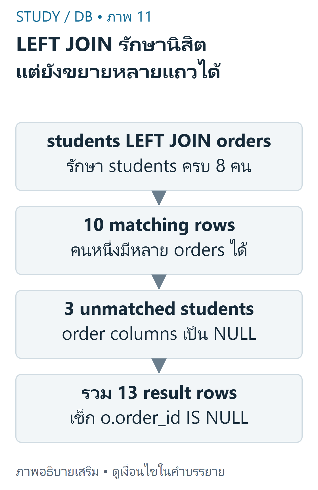
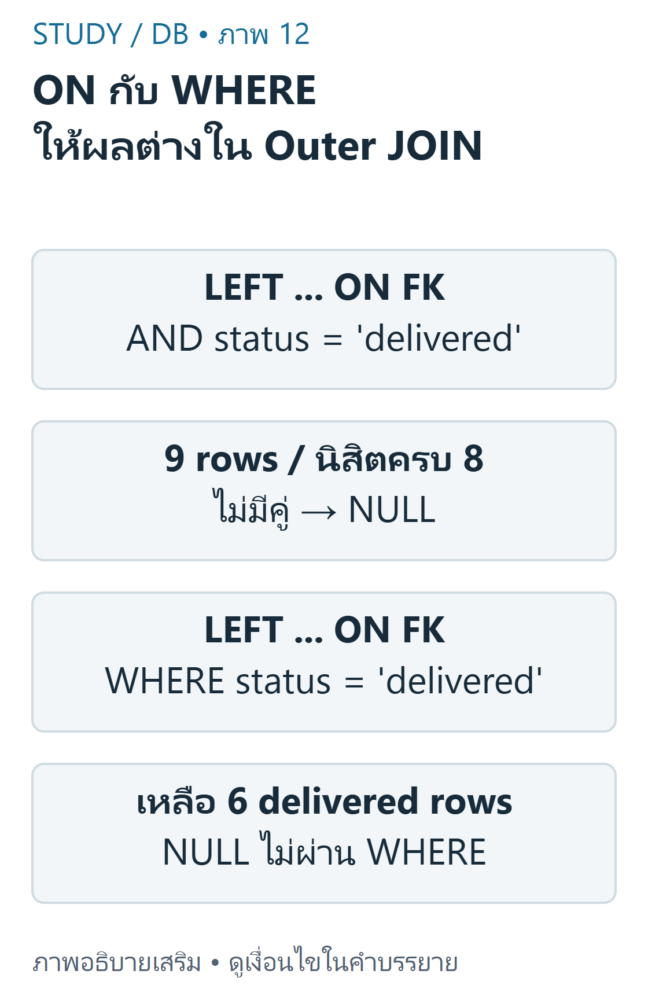

---
{"version":1,"id":"database-management-outer-join-null","course":"database-management","category":"summaries","slug":"outer-join-null","title":"DB 06 — LEFT JOIN, RIGHT JOIN และ NULL","language":"th"}
---

> ใช้DB-S02 หน้า17–27และhomeworkข้อ3,6–9,12 เพื่อแยกแถวที่ถูกเก็บไว้จากแถวที่มีคู่

## เป้าหมายการเรียนรู้ {#objectives}
- ระบุ preserved operand จากSQLจริง ไม่จำสีวงกลม
- ตรวจunmatchedด้วยคีย์NOT NULLและใช้IS NULLถูกต้อง
- แปลงRIGHTเป็นLEFTโดยรักษาprojection/เงื่อนไข และเห็นกับดักWHERE

## รักษาตารางฝั่งใด {#preserved}
LEFT JOIN รักษาแถวของตารางซ้าย ส่วนRIGHT JOINรักษาแถวของตารางขวา ถ้าแถวหนึ่งไม่มีคู่ จะมีแถวผลลัพธ์ที่เติมNULLให้คอลัมน์ฝั่งที่ไม่มีคู่ แต่ถ้ามีหลายคู่ก็ยังออกหลายแถว ไม่ได้บังคับให้ได้จำนวนแถวเท่าฝั่งที่รักษา



ที่มา: [ภาพเขียนเสริม ตรวจตามบทเรียนและเอกสารเทคนิค](https://dev.mysql.com/doc/refman/8.4/en/join.html)

อ่านภาพ: Campus students LEFT orders ได้10 matching rows และ3 null-extended rows ของ106107108 รวม13แถว ไม่ใช่หนึ่งแถวต่อนิสิตเสมอ

ตัวอย่างพื้นฐานของสไลด์มีstudents101–104และorders5001→101,5002→102,5003→101 จึงได้LEFT JOIN5แถว ไม่ใช่4: มีนา2,ต้น1,ปอนด์NULL1,ฟ้าNULL1

```sql
SELECT s.student_id,o.order_id
FROM slide_students s
LEFT JOIN slide_orders o
ON o.student_id=s.student_id
ORDER BY s.student_id,o.order_id;
```

| student_id | order_id |
|---|---|
| 101 | 5001 |
| 101 | 5003 |
| 102 | 5002 |
| 103 | NULL |
| 104 | NULL |

สำหรับCampusHW8students/10ordersมีนิสิต106,107,108ไม่มีคู่ และอีก5คนมี10orders รวมLEFT JOIN13แถวเมื่อไม่กรองเพิ่ม

## NULL ไม่ใช่ศูนย์หรือข้อความ {#null}
SQL NULLหมายถึงไม่มีค่าตามบริบท การเทียบด้วย `= NULL` ไม่ให้TRUEแม้ซ้ายเป็นNULL ต้องใช้IS NULL/IS NOT NULL การแสดงข้อความว่าNULLในหน้าจอไม่ใช่string `'NULL'` และร้านชื่อ `NULL Cafe` เป็นstringจริงหนึ่งชื่อในข้อมูลจำลอง

```sql
SELECT NULL = NULL AS equality_result,
       NULL IS NULL AS is_null_result;
```

ผลคือNULLและ1ตามลำดับ WHEREเก็บเฉพาะTRUE ไม่เก็บUNKNOWN ของการเปรียบเทียบNULL ในPHPการเช็กค่าที่fetchมาอาจใช้ `$row['order_id'] === null` ซึ่งเป็นoperatorของPHP ไม่ใช่syntaxSQL

กรณีcolumnที่อนุญาตNULLในrecordจริง เช่นskill_level จะเป็นNULLได้แม้JOINพบแถว จึงควรใช้คีย์ฝั่งขวาที่NOT NULL เช่นorders.order_idเพื่อตรวจว่าไม่มีmatching record

## หาแถวที่ไม่มีคู่ {#anti-join}
ตัวอย่างต่อยอดใช้CampusHWและตรวจ `o.order_id IS NULL` หลังstudents LEFT JOIN orders ได้106,107,108อย่างชัดเจน เป็นคำตอบที่เรียบเรียงสำหรับhomeworkข้อ7จากข้อมูลจำลอง ไม่ใช่การลบหรือแก้orders

```sql
SELECT s.student_id,s.student_name,s.faculty
FROM students s
LEFT JOIN orders o
ON o.student_id=s.student_id
WHERE o.order_id IS NULL
ORDER BY s.student_id;
```

| student_id | student_name | faculty |
|---|---|---|
| 106 | นิว | Informatics |
| 107 | ไอซ์ | Humanities |
| 108 | เจ | Science |

ถ้าเปลี่ยนIS NULLเป็น`= NULL` จะได้0แถวในfilterนี้ ไม่ใช่3แถว เพราะไม่มีcomparisonใดเป็นTRUE

## RIGHT เปลี่ยนเป็น LEFT {#right-left}
`orders RIGHT JOIN students` รักษาstudentsเหมือน `students LEFT JOIN orders` เมื่อตรึงSELECTคอลัมน์และONสัมพันธ์เดิม ผลที่เรียงด้วยs.student_id,o.order_idเหมือนกัน13แถว ส่วน `students RIGHT JOIN orders` รักษาordersและในCampusHWนี้ได้10แถว จึงสลับโดยดูแค่คำว่าRIGHTไม่ได้

```sql
SELECT s.student_id,o.order_id
FROM orders o
RIGHT JOIN students s
ON o.student_id=s.student_id
ORDER BY s.student_id,o.order_id;
```

```sql
SELECT s.student_id,o.order_id
FROM students s
LEFT JOIN orders o
ON o.student_id=s.student_id
ORDER BY s.student_id,o.order_id;
```

สไลด์หน้า22ยังใช้labelวงกลมstudents/ordersแบบคงที่ในภาพขณะตัวอย่างSQLสลับoperand จึงควรยึดFROM/JOINที่เขียนจริง ภาพเขียนเสริมของบทใช้ชื่อตารางในตำแหน่งตรงกับSQL การใช้SELECT *หลังสลับตารางอาจทำให้ลำดับคอลัมน์ต่างกัน จึงไม่เทียบเพียงชื่อชนิดJOIN

## กับดัก WHERE หลัง OUTER JOIN {#on-where}
CampusHWมีdelivered6orders เมื่อใช้ `WHERE o.status='delivered'` หลังLEFT JOIN แถวที่เติมNULLถูกกรองออก เหลือ6แถว หากต้องการทุกนิสิตแต่เฉพาะออเดอร์deliveredเมื่อมี ให้ย้ายเงื่อนไขนี้เข้ากับON ได้9แถวจาก6matchesและ3นิสิตที่ไม่มีคู่ตามเงื่อนไข



ที่มา: [ภาพเขียนเสริม ตรวจตามบทเรียนและเอกสารเทคนิค](https://dev.mysql.com/doc/refman/8.4/en/join.html)

อ่านภาพ: เมื่อ status=delivered อยู่ใน ON ของ students LEFT orders จะได้9แถวและรักษานิสิต8คน แต่ WHERE หลัง LEFT ตัด NULL rows ได้6แถวจาก delivered orders เท่านั้น

```sql
SELECT s.student_id,o.order_id
FROM students s
LEFT JOIN orders o
ON o.student_id=s.student_id
WHERE o.status='delivered'
ORDER BY s.student_id,o.order_id;
```

```sql
SELECT s.student_id,o.order_id
FROM students s
LEFT JOIN orders o
ON o.student_id=s.student_id AND o.status='delivered'
ORDER BY s.student_id,o.order_id;
```

| student_id | delivered order_id |
|---|---|
| 101 | 5001 |
| 102 | 5007 |
| 103 | 5004 |
| 104 | 5005 |
| 104 | 5009 |
| 105 | 5006 |
| 106 | NULL |
| 107 | NULL |
| 108 | NULL |

การเขียน `WHERE o.status='delivered' OR o.order_id IS NULL` ไม่ใช่คำตอบทั่วไปที่เทียบเท่าON เพราะคนที่มีเฉพาะออเดอร์ไม่deliveredอาจไม่มีแถวNULLถูกสร้างให้ตั้งแต่แรก ในdatasetปัจจุบันทุกคนที่มีorderมีอย่างน้อยหนึ่งdeliveredจึงอาจมองไม่เห็นกับดัก ต้องตรวจสมมติฐาน ไม่สร้างกฎจากตัวอย่างที่บังข้อแตกต่าง


เนื้อหาฝึกเขียนและเฉลยต่อไปนี้เรียบเรียงเพื่อการเรียน ไม่ใช่ข้อสอบจริงหรือเฉลยทางการของผู้สอน เว็บไซต์นี้แสดงตัวอย่างแบบ static; ไม่ส่ง SQL, PHP หรือข้อมูลบัญชีไปรันบนเซิร์ฟเวอร์มหาวิทยาลัย

## ข้อผิดพลาดที่พบบ่อย {#mistakes}
- จำLEFT=ทุกคนโดยไม่ดูว่าตารางใดอยู่ซ้าย หรือใช้Vennนับbag rows
- ใช้= NULLหรือคิดว่าNULL Cafeคือmissing restaurant
- เช็กnullablecolumnแล้วสรุปว่าไม่มีแถวเสมอ
- กรองคอลัมน์ขวาในWHEREแล้วแปลกใจที่แถวNULLหาย

## ฝึกคิดพร้อมเหตุผล {#practice}
- **ข้อ1:** ทำไมCampusLEFT13มากกว่านิสิต8? **เฉลย:** ผลจับคู่10แถวและunmatched3แถว ไม่ใช่หนึ่งแถวต่อคนเสมอ
- **ข้อ2:** RIGHTเทียบLEFTต้องรักษาอะไร? **เฉลย:** ตารางที่ต้องอยู่ครบ,ONและprojection รวมถึงORDER BYเมื่อจะเทียบลำดับ
- **ข้อ3:** skill_levelNULLพิสูจน์ว่าไม่มีskillหรือไม่? **เฉลย:** ไม่ เพราะsourceยอมให้skill_levelNULL ต้องเช็กPKที่ไม่เป็นNULL

## สรุปทบทวน {#summary}
- อ่านpreserved tableจากoperandจริง;multiplematchesยังขยายแถว
- NULLใช้IS NULL และแยกmissing rowจากnullablefield
- เงื่อนไขONกับWHEREมีผลต่างกันต่อouter rows

## แหล่งข้อมูลและขอบเขต {#sources}
DB-S02 หน้า17–27,29; DB-H01 ข้อ3,6–9,12; DB-D01 และ nullable skill_level จาก DB-Z02. อ้างอิงเสริม [MySQL JOIN rules](https://dev.mysql.com/doc/refman/8.4/en/join.html) และ [working with NULL](https://dev.mysql.com/doc/refman/8.4/en/working-with-null.html).

[บัญชีแหล่งข้อมูลและข้อจำกัด](../../../docs/database-source-coverage.md) ระบุเลขหน้ากายภาพของ PDF ทุกครั้ง เอกสารต้นฉบับที่ผู้ใช้ให้เป็นไฟล์ local-only และไม่ได้เผยแพร่ซ้ำ ภาพและโจทย์ฝึกเป็นงานเขียนเสริมที่แยกจากต้นฉบับ
