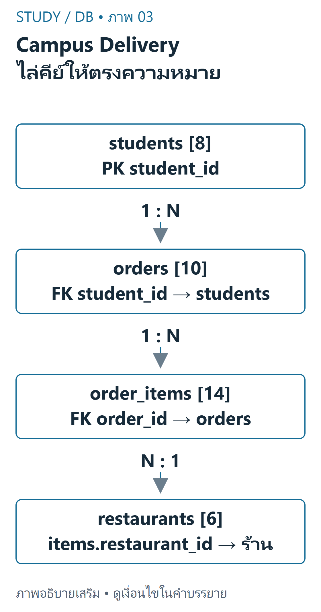
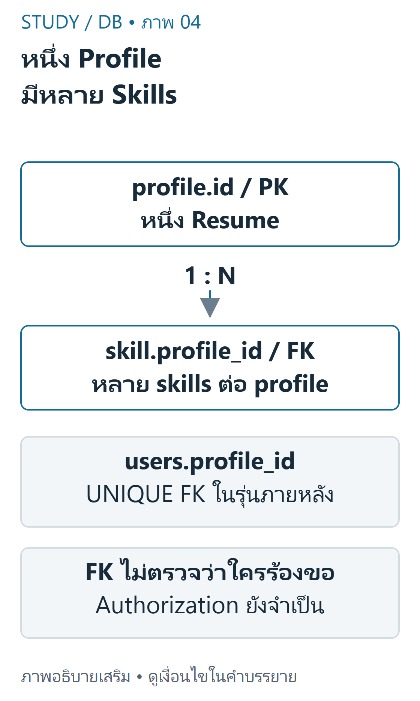

---
{"version":1,"id":"database-management-schema-relationships","course":"database-management","category":"summaries","slug":"schema-relationships","title":"DB 02 — ตาราง คีย์ และความสัมพันธ์","language":"th"}
---

> อิง DB-S01 หน้า14–17, DB-S02 หน้า3–7, schema ใน DB-D01 และ Resume starters โดยใช้ความสัมพันธ์ที่ตรวจจาก CREATE TABLE จริง

## เป้าหมายการเรียนรู้ {#objectives}
- ระบุ Table, Row, Column, Primary Key และ Foreign Key จาก schema
- อ่านความสัมพันธ์1:N ของ Resume และ Campus Delivery
- เลือกชนิดข้อมูลตามความหมาย และอธิบายการป้องกันข้อมูลอ้างอิงผิด

## ตารางและคีย์ {#tables-keys}
ตาราง (Table) ประกอบด้วยแถวข้อมูล (Row) และคอลัมน์ (Column) ภายใต้ข้อกำหนด schema Primary Key ระบุแถวได้ไม่ซ้ำและไม่เป็น NULL; Foreign Key กำหนดความสัมพันธ์การอ้างอิงกับคีย์ของตารางที่เกี่ยวข้อง ไม่ได้ทำให้ข้อมูลจากสองตารางแสดงรวมกันโดยอัตโนมัติ

คอลัมน์ที่ชนิดเป็น INT เหมือนกันอาจหมายถึงคนละสิ่ง `students.student_id` ต้องจับกับ `orders.student_id` ไม่ใช่ `orders.order_id` และ Foreign Key สามารถมีค่าซ้ำในตารางลูกได้เพราะพ่อหนึ่งแถวมีลูกหลายแถว

| ตัวอย่าง | ความหมาย | ข้อกำหนดที่สำคัญ |
|---|---|---|
| students.student_id | ระบุนิสิตหนึ่งแถว | PK INT |
| orders.order_id | ระบุออเดอร์หนึ่งแถว | PK INT |
| orders.student_id | เจ้าของออเดอร์ | FK NOT NULL อ้าง students |
| order_items.order_id | ออเดอร์ที่รายการนี้อยู่ | FK NOT NULL อ้าง orders |
| order_items.restaurant_id | ร้านของรายการอาหาร | FK NOT NULL อ้าง restaurants |

## Campus Delivery ที่ตรวจจากต้นฉบับ {#campus-schema}
ชุด homework DB-D01 มี8students,6restaurants,10orders,14order_items ทุกออเดอร์อ้างนิสิตที่มีจริงและทุกรายการอ้างออเดอร์/ร้านที่มีจริง ข้อกำหนดไม่ได้บังคับว่านิสิตทุกคนต้องมีออเดอร์หรือร้านทุกแห่งต้องเคยขาย



ที่มา: [ภาพเขียนเสริม ตรวจตามบทเรียนและเอกสารเทคนิค](https://dev.mysql.com/doc/refman/8.4/en/join.html)

อ่านภาพ: students มี8 records; orders10อ้าง student_id; order_items14อ้าง order_id และ restaurant_id; restaurants6 ไม่เชื่อม student_id กับ order_id แม้เป็นเลขทั้งคู่

ตัวอย่างพื้นฐาน: มีนา101มีออเดอร์5001และ5003 แสดงความสัมพันธ์1:N ส่วน106,107,108ไม่มีออเดอร์ก็ยังเป็นแถว students ที่ถูกต้องได้ ร้าน206ชื่อ `NULL Cafe` เป็นข้อความจริง ไม่ใช่ SQL NULL

```sql
CREATE TABLE students (
  student_id INT PRIMARY KEY,
  student_name VARCHAR(100) NOT NULL,
  faculty VARCHAR(100) NOT NULL
);
CREATE TABLE orders (
  order_id INT PRIMARY KEY,
  student_id INT NOT NULL,
  order_date DATE NOT NULL,
  total_amount DECIMAL(10,2) NOT NULL,
  status VARCHAR(30) NOT NULL,
  FOREIGN KEY (student_id) REFERENCES students(student_id)
);
```

รันเฉพาะฐานข้อมูลทดลองใหม่ที่ตั้งใจไว้ ไม่รันซ้ำทับงานเดิม `DATE` เก็บวันที่, `DECIMAL(10,2)` เก็บค่าฐานสิบที่มีสเกล2 ไม่ควรใช้ข้อความวันที่หรือจำนวนเงินชนิดลอยตัวเพียงเพราะแสดงผลได้ `status VARCHAR(30)` ในต้นฉบับไม่ได้มี CHECK/ENUM จึงต้องแยกสิ่งที่ dataset ใช้จากค่าที่ DB อนุญาตทั้งหมด

## Resume: จาก2ตารางไป4ตาราง {#resume-schema}
DB-Z01 เริ่มด้วย profile และ education; skill/training เป็นงานออกแบบเพิ่ม ขณะที่ DB-Z02 มี DDL ครบ4ตารางและ skill ตัวอย่าง3แถว อย่าอ้างว่า starter แรกมีคำตอบครบแล้วหรือเพิ่มตารางขึ้นในไฟล์ต้นฉบับโดยไม่แจ้ง



ที่มา: [ภาพเขียนเสริม ตรวจตามบทเรียนและเอกสารเทคนิค](https://dev.mysql.com/doc/refman/8.4/en/join.html)

อ่านภาพ: profile.id เป็น PK และ skill.profile_id เป็น FK หลาย skills จึงอ้าง profile เดียวได้ Users ที่เพิ่มภายหลังเชื่อม profile ผ่าน UNIQUE FK ไม่ใช่คอลัมน์ใน minimal slide schema

| ตาราง | PK | FK | ข้อมูลหลัก |
|---|---|---|---|
| profile | id | ไม่มีใน starter | full_name,email,headline และข้อมูล Resume |
| education | id | profile_id | degree,institution,start_year,end_year |
| skill | id | profile_id | skill_name,skill_level |
| training | id | profile_id | course_name,organization,training_year |

```sql
CREATE TABLE skill (
  id INT AUTO_INCREMENT PRIMARY KEY,
  profile_id INT NOT NULL,
  skill_name VARCHAR(120) NOT NULL,
  skill_level VARCHAR(50),
  FOREIGN KEY (profile_id) REFERENCES profile(id) ON DELETE CASCADE
);
```

หนึ่ง profile มีหลาย skill ได้ จึงไม่ตั้ง profile_id เป็น UNIQUE ใน skill การลบ profile จะลบ skill ตาม ON DELETE CASCADE ของ Resume schema นี้ แต่ Campus schema ไม่ได้ประกาศ CASCADE แบบเดียวกัน ต้องอ่านแต่ละ constraint ไม่เหมารวม

## Referential integrity และการทดสอบ {#integrity}
ใน fixture ที่เปิดใช้ Foreign Key การเพิ่มออเดอร์ที่อ้าง student999ซึ่งไม่มีอยู่ต้องถูกปฏิเสธ และการเพิ่ม student101ซ้ำต้องผิด PK การป้องกันนี้ทำงานที่ฐานข้อมูล แต่ยังต้องตรวจ input/สิทธิ์ใน PHP เพื่อให้ผู้ใช้ได้รับพฤติกรรมที่เหมาะสม

ตัวอย่างต่อยอด: หากแก้ skill.profile_id ให้เป็น UNIQUE จะทำให้นิสิตหนึ่งคนมีได้ไม่เกินหนึ่ง skill ซึ่งขัดโจทย์1:N ต่างจาก `users.profile_id UNIQUE` ใน migration ของ public repository ที่ตั้งใจผูกหนึ่งบัญชีกับหนึ่ง profile

## Data Dictionary และผลที่คาด {#examples}
Data Dictionary ควรระบุชื่อคอลัมน์ ชนิด ความหมาย nullability คีย์และข้อจำกัด ไม่ใช่รายการชื่อฟิลด์อย่างเดียว เช่น total_amount มีหน่วยบาท, qty คือจำนวนรายการอาหาร ไม่ใช่ราคา และ schema ของ Campus ไม่มีราคาต่อชิ้นให้คำนวณใบเสร็จใหม่จาก qty ได้

| การทดลองใน disposable fixture | ผลที่ตรวจได้ |
|---|---|
| นับ students/restaurants/orders/items | 8 / 6 / 10 / 14 |
| INSERT student_id101ซ้ำ | ถูกปฏิเสธด้วย PK |
| INSERT order ที่ student_id999 | ถูกปฏิเสธด้วย FK |
| นิสิต106ยังไม่มี order | แถว students ยังอยู่ตามปกติ |

การทำ normalization ขั้นสูงอยู่นอกหลักฐานแลปชุดนี้ สามารถศึกษาเพิ่มภายหลังได้ แต่ไม่ควรระบุว่าเป็นข้อสอบที่ผู้สอนรับรอง


เนื้อหาฝึกเขียนและเฉลยต่อไปนี้เรียบเรียงเพื่อการเรียน ไม่ใช่ข้อสอบจริงหรือเฉลยทางการของผู้สอน เว็บไซต์นี้แสดงตัวอย่างแบบ static; ไม่ส่ง SQL, PHP หรือข้อมูลบัญชีไปรันบนเซิร์ฟเวอร์มหาวิทยาลัย

## ข้อผิดพลาดที่พบบ่อย {#mistakes}
- คิดว่า FK ต้องไม่ซ้ำ หรือคิดว่าตารางพ่อทุกแถวต้องมีลูก
- ใช้คีย์คนละความหมายเพราะชนิด INT เหมือนกัน
- คิดว่า DEFAULT/NOT NULL หรือ CASCADE มีเหมือนกันทุก schema
- นำ script ที่มี DROP ไป import ลงฐานข้อมูลที่มีงานอยู่แล้ว

## ฝึกคิดพร้อมเหตุผล {#practice}
- **ข้อ1:** ต้องเก็บหลาย education ต่อ profile คีย์ใดซ้ำได้? **เฉลย:** profile_id ใน education ซ้ำได้ ส่วน education.id ต้องไม่ซ้ำ
- **ข้อ2:** ร้าน206ไม่มีรายการขาย ผิด FK หรือไม่? **เฉลย:** ไม่ผิด FK ตรวจลูกที่มีให้อ้างพ่อถูกต้อง ไม่ได้บังคับพ่อทุกแถวมีลูก
- **ข้อ3:** ทำไม total_amount และ qty รวมเป็นเงินด้วยกันไม่ได้? **เฉลย:** qty เป็นจำนวนและไม่มีราคาต่อชิ้นใน schema นี้ ต้องรู้ความหมาย/หน่วยและข้อมูลเพิ่มเติมก่อนคำนวณ

## สรุปทบทวน {#summary}
- PK ระบุแถว; FK กำหนดการอ้างอิง; JOIN เป็นคำสั่งดึงข้อมูลอีกเรื่องหนึ่ง
- อ่าน1:N, nullability และพฤติกรรม DELETE จาก DDL จริง
- แยกสอง Resume starters และสองชุด Campus ให้ถูกต้อง

## แหล่งข้อมูลและขอบเขต {#sources}
DB-S01 หน้า14–17; DB-S02 หน้า4–7; DB-D01 schema/indexes/38 simulated rows; DB-Z01 `database/starter.sql`; DB-Z02 `database/setup.sql`; DB-R01 `database/this_week_migration.sql`. อ้างอิงเสริม [MySQL foreign keys](https://dev.mysql.com/doc/refman/8.4/en/create-table-foreign-keys.html) และ [fixed-point types](https://dev.mysql.com/doc/refman/8.4/en/fixed-point-types.html).

[บัญชีแหล่งข้อมูลและข้อจำกัด](../../../docs/database-source-coverage.md) ระบุเลขหน้ากายภาพของ PDF ทุกครั้ง เอกสารต้นฉบับที่ผู้ใช้ให้เป็นไฟล์ local-only และไม่ได้เผยแพร่ซ้ำ ภาพและโจทย์ฝึกเป็นงานเขียนเสริมที่แยกจากต้นฉบับ
