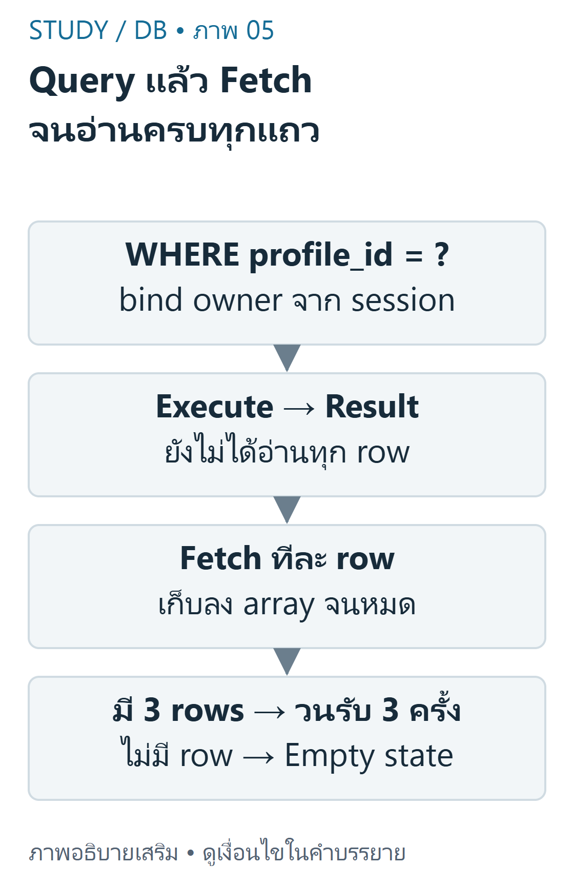
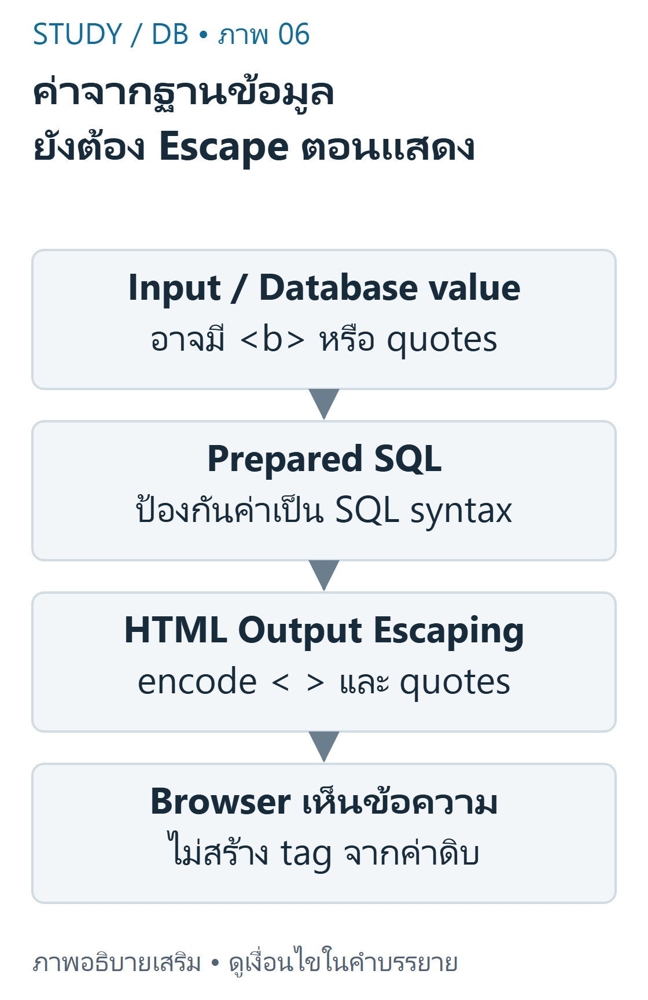

---
{"version":1,"id":"database-management-select-php-rendering","course":"database-management","category":"summaries","slug":"select-php-rendering","title":"DB 03 — SELECT, mysqli และการแสดงข้อมูล","language":"th"}
---

> ใช้ Resume Lab เป็นตัวอย่างหลักจาก DB-Z01 และ DB-S01 หน้า10–13,18–21 แยกข้อมูลที่ query จริงออกจาก array placeholder

## เป้าหมายการเรียนรู้ {#objectives}
- เขียน SELECT/WHERE/ORDER BY และอ่านผลหลายแถว
- ใช้ mysqli_query และ mysqli_fetch_assoc ตามบทบาทที่ต่างกัน
- แสดงผล HTML อย่างปลอดภัยและจำกัดข้อมูลตามเจ้าของเมื่อเป็นหลายผู้ใช้

## SELECT และลำดับผลลัพธ์ {#select}
SELECT เลือกคอลัมน์และแถวตามเงื่อนไข WHERE; ORDER BY กำหนดลำดับที่ต้องการ ถ้าไม่ระบุ ORDER BY ห้ามถือว่าฐานข้อมูลต้องคืนตามลำดับที่ INSERT หรือ PK เสมอ เมื่อค่าสำหรับ sort เท่ากัน ควรเพิ่มคีย์ที่ไม่ซ้ำเป็น tie-breaker ให้การทดสอบ deterministic

```sql
SELECT id, skill_name, skill_level
FROM skill
WHERE profile_id = 1
ORDER BY id;
```

สำหรับ3แถวตั้งต้นของ skill ใน DB-Z02 และไม่มีการแก้ไข ผลที่คาดเรียงตาม id คือ

| id | skill_name | skill_level |
|---|---|---|
| 1 | PHP | Intermediate |
| 2 | MySQL | Intermediate |
| 3 | Git | Beginner |

ค่า1ในตัวอย่างนี้คือ profile สาธิต ไม่ใช่สิทธิ์เข้าถึงของผู้ใช้ที่ล็อกอินทุกคน คำสั่ง SQL literal ที่ไม่มี user input เหมาะกับการเริ่มเรียน แต่เมื่อใช้ข้อมูลจาก request ต้องใช้ parameter binding

## Query กับ Fetch คนละขั้น {#fetch}
mysqli_query ส่ง SQL ไปยังการเชื่อมต่อ สำหรับ SELECT จะได้ result object เมื่อสำเร็จ ส่วน mysqli_fetch_assoc อ่านหนึ่งแถวเป็น associative array โดยชื่อคอลัมน์เป็น key เมื่ออ่านจนครบจะไม่คืนแถวให้วนต่อ จึงต้องมี loop ถ้าต้องการมากกว่าหนึ่งรายการ



ที่มา: [ภาพเขียนเสริม ตรวจตามบทเรียนและเอกสารเทคนิค](https://www.php.net/manual/en/mysqli-result.fetch-assoc.php)

อ่านภาพ: mysqli query ส่งคำสั่งและได้ result จากนั้น fetch_assoc อ่านทีละ row จนหมด ถ้าไม่มีแถวแสดง empty state ไม่สร้าง skill ปลอม

ตัวอย่างพื้นฐานนี้ใช้ SQL คงที่กับ fixture หนึ่ง profile; ต้องมี `$conn` ที่เชื่อมต่อสำเร็จแล้วและเปิด error handling ตามที่ตั้งใจ ไม่ใช่คำสั่งสร้างฐานข้อมูล

```php
<?php
$skills = [];
$result = mysqli_query($conn,
    'SELECT id,skill_name,skill_level FROM skill WHERE profile_id=1 ORDER BY id');
while ($row = mysqli_fetch_assoc($result)) {
    $skills[] = $row;
}
echo count($skills); // 3 ในข้อมูลตั้งต้นที่ระบุด้านบน
```

ถ้าไม่มีแถว `$skills` จะยังเป็น array ว่างและ countเป็น0 อย่าสับสน0แถวกับ query ที่ล้มเหลว เมื่อเปิด MYSQLI_REPORT_STRICT ข้อผิดพลาด SQL จะเป็น exception ต้องจัดการ error ฝั่งเซิร์ฟเวอร์โดยไม่เปิดเผยรายละเอียดการเชื่อมต่อ

## Escape ตามบริบท HTML {#escaping}
HTML escaping เปลี่ยนตัวอักษรพิเศษให้ Browser แสดงเป็นข้อความ ชื่อ skill เช่น `<b>SQL</b>` ต้องไม่กลายเป็นแท็กเมื่อแสดงเป็นชื่อธรรมดา การ escape HTML ไม่ได้ป้องกัน SQL injection และ prepared statements ไม่ได้ทำหน้าที่ escape HTML แทนกัน



ที่มา: [ภาพเขียนเสริม ตรวจตามบทเรียนและเอกสารเทคนิค](https://www.php.net/manual/en/function.htmlspecialchars.php)

อ่านภาพ: Prepared statement แยกค่าออกจาก SQL แต่ไม่ทำให้ HTML ปลอดภัยอัตโนมัติ ใช้ htmlspecialchars ตามบริบท HTML text หรือ quoted attribute ก่อนส่ง Browser

```php
<?php
function h(mixed $value): string {
    return htmlspecialchars((string)$value, ENT_QUOTES | ENT_SUBSTITUTE, 'UTF-8');
}
```

```php
<?php
foreach ($skills as $row) {
    echo '<li>' . h($row['skill_name']) . '</li>';
}
```

เมื่อ h รับ ` &` จะได้ `&lt;img src=x&gt; &amp;` เพื่อใส่ในบริบทข้อความ HTML ตัวอย่างนี้ไม่ใช่กฎสำหรับฝังใน JavaScript, CSS หรือ URL ทุกแบบ ซึ่งต้องใช้ encoding/validation ตามบริบทนั้น ๆ

## ตัวอย่างต่อยอด: อ่านเฉพาะเจ้าของ {#owner-read}
เมื่อมีหลายบัญชี ต้องใช้ profile_id ที่ตรวจจาก session ฝั่งเซิร์ฟเวอร์ ไม่ใช่ใช้ค่า1เสมอหรือเชื่อ hidden input ของผู้ใช้ ฟังก์ชันต่อไปนี้ใช้ prepared SELECT และแสดงวิธีอ่านหลายแถว; ผู้เรียกต้องตรวจ actor ก่อนเรียก

```php
<?php
function skills(\mysqli $conn, int $profileId): array {
    $stmt = mysqli_prepare($conn,
        'SELECT id,skill_name,skill_level FROM skill WHERE profile_id=? ORDER BY id');
    mysqli_stmt_bind_param($stmt, 'i', $profileId);
    mysqli_stmt_execute($stmt);
    $result = mysqli_stmt_get_result($stmt); // requires mysqlnd; available in the tested PHP build
    $rows = [];
    while ($row = mysqli_fetch_assoc($result)) {
        $rows[] = $row;
    }
    mysqli_stmt_close($stmt);
    return $rows;
}
```

ตัวอย่างใช้ mysqli_stmt_get_result ซึ่งต้องมี mysqlnd ใน PHP build ที่ใช้ตรวจมีความสามารถนี้ หากสภาพแวดล้อมไม่มี ให้ใช้ mysqli_stmt_bind_result/fetch ตามรูปแบบใน DB-Z02 แทน อย่าอ้างว่า extension ทุก build เหมือนกัน

## ทดสอบและตรวจผล {#examples}
ทำให้การอ่านข้อมูลพิสูจน์ได้: ตรวจ SQL ในฐานข้อมูลทดลอง ใช้ profile ที่ทราบ จำนวน/ชื่อรายการต้องตรงและเรียงตาม id ทดสอบ profile ที่ไม่มีรายการให้คืน array ว่าง แล้วทดสอบ string ที่มีเครื่องหมายพิเศษเพื่อแยกปัญหา SQL ออกจาก HTML

| เงื่อนไขใน fixture | ผล |
|---|---|
| อ่าน profile1 | PHP,MySQL,Git จำนวน3แถว |
| อ่าน profile999ที่ไม่มี skill | array ว่าง |
| เปลี่ยนข้อมูลใน DB แล้วอ่านใหม่ | ได้ค่าจาก DB ไม่ใช่ placeholder |
| ชื่อ skill มี quote/แท็ก | เก็บด้วย prepared input และแสดงเป็น escaped text |

DB-Z01 ยังมี `$skills`/`$trainings` เป็น array ตัวอย่าง งานของนิสิตคือแทนด้วย query จริง ไม่ใช่เพียงเปลี่ยนข้อความ array ให้เหมือนภาพหน้าจอ


เนื้อหาฝึกเขียนและเฉลยต่อไปนี้เรียบเรียงเพื่อการเรียน ไม่ใช่ข้อสอบจริงหรือเฉลยทางการของผู้สอน เว็บไซต์นี้แสดงตัวอย่างแบบ static; ไม่ส่ง SQL, PHP หรือข้อมูลบัญชีไปรันบนเซิร์ฟเวอร์มหาวิทยาลัย

## ข้อผิดพลาดที่พบบ่อย {#mistakes}
- เรียก fetch แค่ครั้งเดียวแล้วคิดว่ามีแถวเดียวใน DB
- เชื่อว่าลำดับแถวแน่นอนโดยไม่มี ORDER BY
- ใช้ htmlspecialchars แทน parameter binding หรือเอาชื่อ field ที่ไม่ตรงกับผล SELECT
- ไม่จำกัด profile เมื่อมีหลายผู้ใช้ หรือคิดว่า prepared statements ตรวจเจ้าของให้อัตโนมัติ

## ฝึกคิดพร้อมเหตุผล {#practice}
- **ข้อ1:** SELECT ไม่พบแถวเป็น error เสมอหรือไม่? **เฉลย:** ไม่ใช่ อาจเป็นผลถูกต้องตาม filter; ต้องแยกจาก SQL exception
- **ข้อ2:** จะพิสูจน์ว่าใช้ข้อมูลจริงอย่างไร? **เฉลย:** เปลี่ยนข้อมูลใน disposable DB แล้วอ่านใหม่และตรวจผลเทียบ query ไม่พึ่ง array สาธิต
- **ข้อ3:** ทำไมต้องมีทั้ง binding และ escaping? **เฉลย:** binding แยกข้อมูลจากโครงสร้าง SQL ขาเข้า ส่วน escaping ป้องกันการตีความเป็น HTML ขาออก

## สรุปทบทวน {#summary}
- SELECT ส่งคำถาม, fetch อ่านแต่ละแถว และ loop เก็บหลายแถว
- ใช้ ORDER BY พร้อม tie-breaker และตรวจผลว่างอย่างถูกต้อง
- อ่านข้อมูลตามเจ้าของและ escape ให้ตรงบริบท HTML

## แหล่งข้อมูลและขอบเขต {#sources}
DB-S01 หน้า10–13,18–21; DB-Z01 instructions/index.php และ DB-Z02 skills.php. ฟังก์ชันที่เขียนเสริมในบทตรวจด้วย PHP8.4/mysqli บน disposable MariaDB;ไม่ใช่ผลรันบน Angsila. อ้างอิง [mysqli_fetch_assoc](https://www.php.net/manual/en/mysqli-result.fetch-assoc.php), [mysqli_stmt_get_result](https://www.php.net/manual/en/mysqli-stmt.get-result.php) และ [htmlspecialchars](https://www.php.net/manual/en/function.htmlspecialchars.php).

[บัญชีแหล่งข้อมูลและข้อจำกัด](../../../docs/database-source-coverage.md) ระบุเลขหน้ากายภาพของ PDF ทุกครั้ง เอกสารต้นฉบับที่ผู้ใช้ให้เป็นไฟล์ local-only และไม่ได้เผยแพร่ซ้ำ ภาพและโจทย์ฝึกเป็นงานเขียนเสริมที่แยกจากต้นฉบับ
