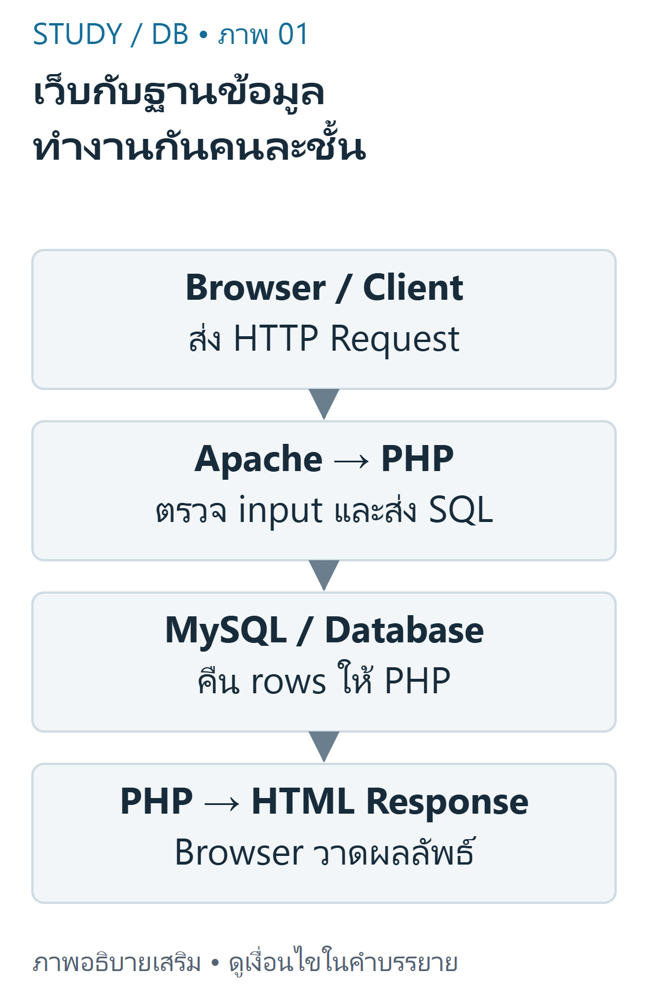
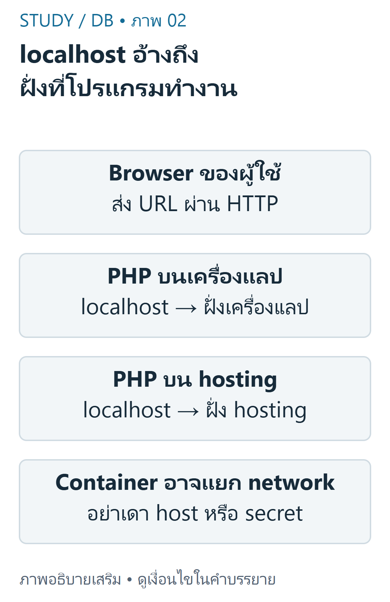

---
{"version":1,"id":"database-management-web-database-architecture","course":"database-management","category":"summaries","slug":"web-database-architecture","title":"DB 01 — เว็บ เซิร์ฟเวอร์ และฐานข้อมูล","language":"th"}
---

> บทนี้อธิบายระบบ PHP/MySQL ของแลปจาก DB-S01 หน้า3–13 และ DB-S03 หน้า3–6 โดยไม่อ้างว่า GitHub Pages ของ Study รัน PHP ได้

## เป้าหมายการเรียนรู้ {#objectives}
- แยกหน้าที่ Browser, Apache, PHP, MySQL และ phpMyAdmin
- ไล่ HTTP Request/Response ของหน้า Resume ได้ตั้งแต่ต้นจนจบ
- อธิบาย localhost ตามเครื่องที่โปรแกรมกำลังทำงาน และเก็บข้อมูลเชื่อมต่ออย่างเหมาะสม

## แต่ละส่วนมีหน้าที่อะไร {#roles}
Browser เป็นโปรแกรมฝั่งผู้ใช้ (Client) ที่ร้องขอ URL และแสดง HTML ส่วน Apache เป็น Web Server ที่รับ HTTP และส่งงาน PHP ไปประมวลผลฝั่ง Server ในการติดตั้งตามแลป MySQL เป็น Database Server ที่รับคำสั่ง SQL ผ่านการเชื่อมต่อของ PHP ไม่ใช่ JavaScript ใน Browser ที่เปิดการเชื่อมต่อ MySQL โดยตรง



ที่มา: [ภาพเขียนเสริม ตรวจตามบทเรียนและเอกสารเทคนิค](https://dev.mysql.com/doc/refman/8.4/en/join.html)

อ่านภาพ: Browser ส่ง HTTP ไป Apache/PHP; PHP ส่ง SQL ไป MySQL แล้วรับ rows กลับมาประกอบ HTML ไม่ให้ Browser ต่อ MySQL ด้วย secret ของแอป

| ส่วน | งานหลัก | สิ่งที่ไม่ควรสับสน |
|---|---|---|
| Browser | ส่ง HTTP และวาดผลลัพธ์ | ไม่ประมวลผล PHP source ของหน้านี้ |
| Apache | รับคำขอและเสิร์ฟผลลัพธ์ | ไม่ใช่ฐานข้อมูล |
| PHP | ตรวจ input, เรียก mysqli, ประกอบ HTML | เป็น runtime ฝั่งเซิร์ฟเวอร์ |
| MySQL | จัดเก็บข้อมูลและประมวลผล SQL | ไม่ได้วาดการ์ด Resume |
| phpMyAdmin | Web UI สำหรับจัดการ MySQL | ไม่ใช่ Database Engine และไม่จำเป็นต้องอยู่ในทุก request ของแอป |

คำว่า Client/Server เป็นบทบาท ไม่ได้บังคับว่าต้องใช้เครื่องจริงคนละเครื่อง บนเครื่องแลป Apache, PHP, MySQL และ Browser อาจอยู่เครื่องเดียวกัน แผนภาพเป็นสถาปัตยกรรมตัวอย่าง ไม่ใช่ผลสำรวจบริการจริงบน Angsila

## จาก Request ถึง Response {#http-flow}
ตัวอย่างพื้นฐานคือการเปิดหน้า Resume: Browser ส่ง GET → Apache เลือก PHP → PHP ส่ง SELECT ไป MySQL → MySQL คืน rows → PHP escape และประกอบ HTML → HTTP Response กลับ Browser การเชื่อมต่อนี้มีสองช่วง คือ HTTP ระหว่าง Browser/เว็บเซิร์ฟเวอร์ และ protocol ของ MySQL ระหว่าง PHP/ฐานข้อมูล

หาก PHP ส่งข้อความ `พบ 3 ทักษะ` กลับไป Browser จะเห็นข้อความนั้น ไม่ใช่ตัวแปร `$rows` หรือรหัสผ่านในไฟล์ config การกด View Source ของผลตอบกลับจึงไม่ได้แสดง PHP source ที่รันไปแล้ว เมื่อเซิร์ฟเวอร์ตั้งค่าถูกต้อง อย่างไรก็ดีการเผยแพร่ไฟล์ config หรือ repository เป็น public ยังเปิดเผยความลับได้

```php
<?php
header('Content-Type: text/html; charset=UTF-8');
$count = 3; // ตัวอย่างค่าที่ได้รับหลัง query ไม่ใช่การต่อฐานข้อมูลจริงใน Browser
echo '<p>พบ ' . (int)$count . ' ทักษะ</p>';
```

ผลลัพธ์ HTTP body ที่ Browser ได้คือ `<p>พบ 3 ทักษะ</p>` ไม่ใช่โค้ด PHP ด้านบน ตัวอย่างนี้สาธิตการแยก execution/output; จำนวน3อ้างอิง skill ตัวอย่างใน DB-Z02 แต่ยังต้อง query จริงเมื่อนำไปทำแอป

## Localhost และสิ่งแวดล้อม {#environment}
localhost ในการตั้งค่าฐานข้อมูลของ PHP หมายถึงเครื่องหรือ network namespace ที่ PHP process ทำงาน ถ้า PHP อยู่บนเครื่องนิสิตก็ชี้สภาพแวดล้อมท้องถิ่น ถ้าอยู่บน Angsila ก็อ้างอิงฝั่งเซิร์ฟเวอร์ตามการตั้งค่าของผู้ดูแล ไม่ได้หมายถึง Browser ของผู้ใช้ทุกคน และ container อาจมี namespace แยกต่างหาก



ที่มา: [ภาพเขียนเสริม ตรวจตามบทเรียนและเอกสารเทคนิค](https://www.php.net/manual/en/mysqli.quickstart.connections.php)

อ่านภาพ: localhost ของ PHP บนเครื่องแลปอ้างสิ่งแวดล้อมของ PHP เครื่องนั้น ส่วน PHP บน hosting อ้างสิ่งแวดล้อมฝั่ง hosting ไม่ใช่ Browser ของผู้ใช้ Container อาจมี namespace แยก

สำหรับ mysqli บางระบบ `localhost` เลือก Unix socket ขณะที่ `127.0.0.1` เป็น TCP ต้องตรวจ host/port/socket ตามระบบจริง ไม่คัดลอกค่า root/รหัสผ่านว่างจากแลปไปใช้บน shared server

```php
<?php
mysqli_report(MYSQLI_REPORT_ERROR | MYSQLI_REPORT_STRICT);
$conn = mysqli_connect(
    getenv('DB_HOST'), getenv('DB_USER'), getenv('DB_PASSWORD'),
    getenv('DB_NAME'), (int)(getenv('DB_PORT') ?: 3306)
);
mysqli_set_charset($conn, 'utf8mb4');
```

ตัวอย่าง connection แสดงรูปแบบการอ่าน Environment Variables; ต้องกำหนดค่าให้ครบก่อนใช้และไม่แสดง error/credentials แก่ผู้ชม ไฟล์ `.env` ไม่ถูก PHP โหลดอัตโนมัติเมื่อมีไฟล์เฉย ๆ การทดสอบจริงของบทใช้ฐานข้อมูล disposable แยกจากเครื่องผู้ใช้และ Angsila ไม่ใช่การยืนยันค่าข้างต้นบนมหาวิทยาลัย

## ตัวอย่างต่อยอดและการวินิจฉัย {#examples}
ถ้าเปิด HTML ได้แต่ไม่มีรายการ ให้แยกตรวจทีละช่วง: HTTP status ถูกหรือไม่, PHP รันหรือแสดงเป็นข้อความ, mysqli ต่อฐานข้อมูลที่ตั้งใจหรือไม่, SELECT คืน0แถวหรือเกิด exception, และ HTML loop ใช้ rows ถูกชุดหรือไม่ อย่าแก้ด้วยการฝัง array แล้วสรุปว่าฐานข้อมูลทำงานแล้ว

| อาการ | สมมติฐานที่ตรวจต่อ | หลักฐานที่ควรดู |
|---|---|---|
| Browser ดาวน์โหลด PHP เป็นข้อความ | host ไม่ประมวลผล PHP | การตั้งค่า Web Server/ชนิดไฟล์ |
| HTML ได้แต่รายการว่าง | query คืน0หรือ filter ไม่ตรง | รัน SELECT ในฐานข้อมูลทดสอบ/ตรวจผลลัพธ์ |
| แก้ข้อมูลแล้วหน้าไม่เปลี่ยน | ใช้ array ตัวอย่างหรือเชื่อมคนละ DB | ตรวจ query และชื่อ environment อย่างปลอดภัย |
| เปิด PHP บน GitHub Pages | เป็น static hosting | ต้องแยก deployment ไป host ที่รองรับ PHP ตามที่ผู้สอนอนุญาต |

ตัวอย่างที่ยากขึ้น: phpMyAdmin ใช้บัญชีหนึ่ง แต่ PHP ใช้อีก database/schema ทั้งสองหน้าจึงแสดงผลต่างกันได้โดยข้อมูลไม่ได้หาย ควรตรวจฐานข้อมูลที่เลือกด้วย `SELECT DATABASE()` บนการเชื่อมต่อทดสอบ ไม่ส่งรหัสผ่านลงรายงาน

```sql
SELECT DATABASE() AS current_database;
SELECT COUNT(*) AS skill_rows FROM skill;
```

ชื่อฐานข้อมูลขึ้นกับ environment ไม่ควรท่องชื่อที่ได้จากเครื่องอื่น ส่วน skill จาก DB-Z02 ก่อนแก้มี3แถว หากใช้ fixture คนละชุดต้องระบุให้ชัด

## ขอบเขตความปลอดภัย {#security}
จัดเก็บ secret นอก source ที่เผยแพร่ ตั้งสิทธิ์ไฟล์และบัญชีให้เหมาะสม ใช้ HTTPS ตามบริการจริง และตรวจ input ฝั่งเซิร์ฟเวอร์ `phpMyAdmin` มีไว้บริหารฐานข้อมูล ไม่ควรเอาบัญชีผู้ดูแลไปใช้เป็นสิทธิ์ปกติของแอป


เนื้อหาฝึกเขียนและเฉลยต่อไปนี้เรียบเรียงเพื่อการเรียน ไม่ใช่ข้อสอบจริงหรือเฉลยทางการของผู้สอน เว็บไซต์นี้แสดงตัวอย่างแบบ static; ไม่ส่ง SQL, PHP หรือข้อมูลบัญชีไปรันบนเซิร์ฟเวอร์มหาวิทยาลัย

## ข้อผิดพลาดที่พบบ่อย {#mistakes}
- บอกว่า phpMyAdmin เป็น MySQL Engine หรือ Browser รัน PHP เอง
- เข้าใจว่า localhost ของ PHP บนเซิร์ฟเวอร์คือคอมพิวเตอร์ของนิสิตเสมอ
- ใช้ข้อมูล hard-coded แล้วคิดว่าเป็นผล query
- นำ connection credentials ขึ้น public Git หรือทดลองกับฐานข้อมูลจริงที่มีงานสำคัญ

## ฝึกคิดพร้อมเหตุผล {#practice}
- **ข้อ1:** หน้าเว็บมี PHP แต่ Browser ควรได้รับอะไร? **เฉลย:** ผลลัพธ์ที่ PHP สร้าง เช่น HTML; PHP source และตัวแปรเป็นส่วนประมวลผลฝั่ง Server
- **ข้อ2:** สามารถมีสอง protocol ในหนึ่งการเปิดหน้าได้หรือไม่? **เฉลย:** ได้ HTTP ระหว่าง Browser/Apache และการเชื่อมต่อ MySQL ระหว่าง PHP/DB ทำหน้าที่ต่างกัน
- **ข้อ3:** ถ้าไฟล์ PHP บน GitHub Pages ไม่ทำงาน ต้องย้าย MySQL ไป Browser หรือไม่? **เฉลย:** ไม่ ต้องใช้สภาพแวดล้อม PHP/MySQL ที่ได้รับอนุญาต; Study ยังคง static เพื่อเรียนเท่านั้น

## สรุปทบทวน {#summary}
- แยก Web Server, PHP runtime, Database Server และเครื่องมือบริหาร
- ตรวจคำขอ การประมวลผล query และผลตอบกลับเป็นคนละช่วง
- ตรวจ environment จริงและไม่เผย secret; การ deploy ต้องได้รับอนุญาต

## แหล่งข้อมูลและขอบเขต {#sources}
DB-S01 หน้า3–13,33–36; DB-S03 หน้า3–6; DB-Z01 `LAB_INSTRUCTIONS.md`, `index.php` และโครงสร้าง config. อ้างอิงเสริม [PHP mysqli](https://www.php.net/manual/en/book.mysqli.php) และ [GitHub Pages limits](https://docs.github.com/en/pages/getting-started-with-github-pages/about-github-pages).

[บัญชีแหล่งข้อมูลและข้อจำกัด](../../../docs/database-source-coverage.md) ระบุเลขหน้ากายภาพของ PDF ทุกครั้ง เอกสารต้นฉบับที่ผู้ใช้ให้เป็นไฟล์ local-only และไม่ได้เผยแพร่ซ้ำ ภาพและโจทย์ฝึกเป็นงานเขียนเสริมที่แยกจากต้นฉบับ
