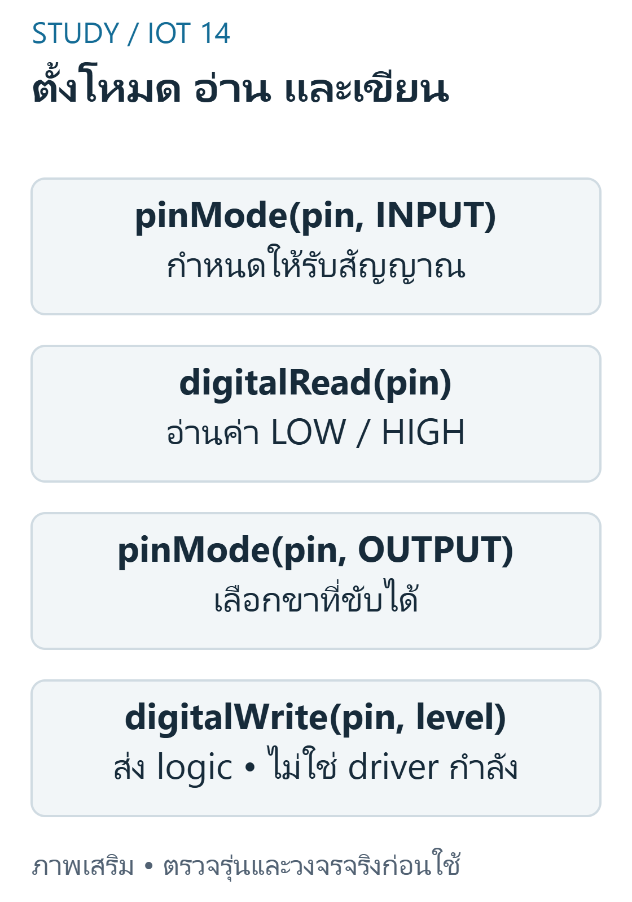
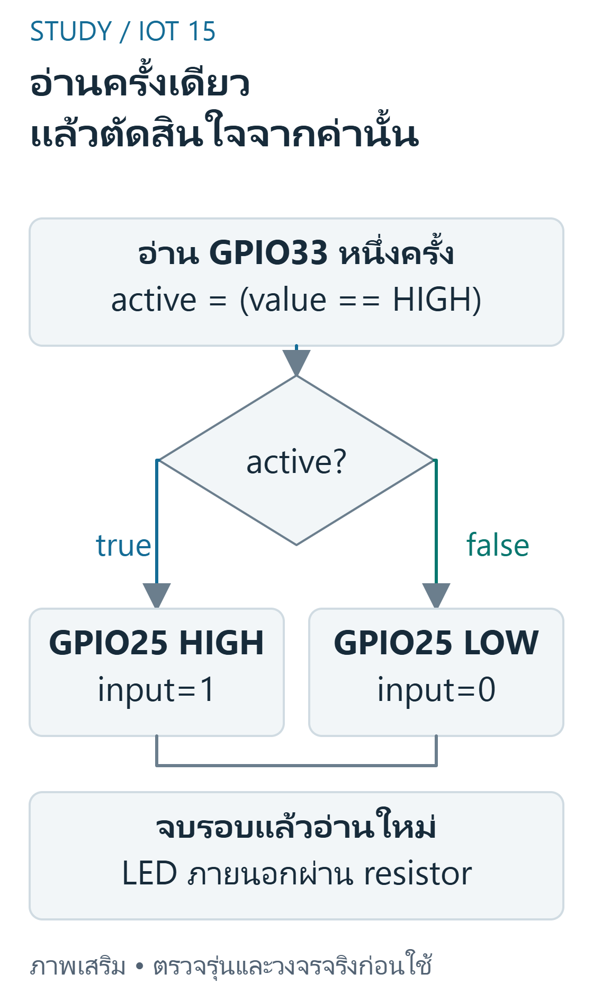

---
{"version":1,"id":"internet-of-things-final-arduino-cpp","course":"internet-of-things","category":"summaries","slug":"final-arduino-cpp","title":"FINAL 05 — Arduino IDE และ C++","language":"th"}
---

## เป้าหมายการเรียนรู้ {#objectives}

- อธิบาย lifecycle และขั้นตอน verify ก่อน upload
- อธิบาย polarity และอ่าน code ที่ใช้ ternary ควบคุม LED
- วางแผนข้อความ debugraw กับ convertedvalue ให้ไม่สับสน
- อธิบายข้อผิดพลาด assignment ใน if และ integerdivision
- ออกแบบ debug แยก compile,logic,protocol และ wiring

## ขอบเขต หลักฐาน และความปลอดภัย {#scope}

วิชา 89022567 เลือกศึกษา Week 9–12 โดยยังไม่ยืนยันว่าเป็นขอบเขตสอบ Final ทางการทั้งหมด หลักฐานต้นฉบับ: A10 tasks1–2; B pp.29–42,75–98. เลขหน้า PDF หมายถึงหน้าจริงของไฟล์ (physical page); เอกสาร Word อ้างหัวข้องานและหน้าแปลงส่วนตัวตาม [บัญชีแหล่งที่มา](../../../docs/iot-final-source-coverage.md). ไม่เผยแพร่ต้นฉบับหรือข้อมูลส่วนตัวของผู้เรียน

ตัวอย่างและเฉลยต่อไปนี้จัดทำเสริม ไม่ใช่เฉลยทางการ ใช้บอร์ด classic ESP32-WROOM กับ Arduino-ESP32 core 3.3.11 เป็นเป้าหมาย ตัวเลขขา ระดับสัญญาณ (polarity) เกณฑ์ช่วง (threshold) และที่อยู่จอ OLED เป็นสมมติฐานที่ประกาศ ห้ามเหมารวมกับ ESP32 ทุกรุ่น

ใช้เฉพาะ LED หรือโหลดแรงดันต่ำผ่านโมดูล/วงจรขับที่เข้ากันได้ ห้ามขับขดลวดรีเลย์จาก GPIO โดยตรง และห้ามต่อไฟบ้านบน breadboard ตรวจ Echo 5V กับ GPIO 3.3V วงจรแปลงระดับ กราวด์ และตัวต้านทานก่อนจ่ายไฟ การคอมไพล์และการจำลองไม่พิสูจน์ความถูกต้องของวงจรหรือความแม่นยำเซนเซอร์จริง

## setup(), loop() และ Build {#lifecycle}

Arduino core เรียก setup หนึ่งครั้งต่อ boot / reset แล้วเรียก loop ซ้ำหลังคืนจากรอบก่อน A10 ขอคำสั่งพื้นฐานอย่างน้อย 10 และตัวอย่าง 3sensor พร้อมอธิบายด้วยลายมือ ข้อความเว็บใช้สำหรับศึกษา ไม่แทนข้อกำหนดส่งงาน เลือก FQBN / port ให้ถูกและแยก Compile จาก Upload / physicaltest

 ครั้งเดียวต่อ boot/reset; loop() ซ้ำตามงานที่ทำ")
ที่มา: [ภาพเขียนเสริม ตรวจตามเอกสารเทคนิค](https://docs.arduino.cc/language-reference/)

อ่านภาพ: ลูกศรวนหมายถึงloopถูกเรียกซ้ำหลังรอบก่อนคืนการทำงาน ไม่ได้หมายถึงทำงานพร้อมกันหรือมีคาบเวลาคงที่

ข้อควรระวัง: compile สำเร็จไม่ได้หมายความว่าได้อัปโหลดหรือเสียบวงจรถูก

ตัวอย่างการให้เหตุผลที่จัดทำเสริม:

setup ทำงานอย่างไรตาม Arduino lifecycle ปกติ?

แนวคำตอบ: หนึ่งครั้งต่อboot/resetก่อนloop — core เรียก setup ใหม่หลัง reset

## pinMode, digitalRead และ digitalWrite {#digital-api}

กำหนดโหมดก่อนใช้ input / output อย่างสอดคล้อง อ่าน input ผ่าน digitalRead ให้ HIGH / LOW ส่ง output ด้วย digitalWrite บนขาที่ขับได้ ต้องทราบ polarity จริง INPUT_PULLUP มี pressedLOW เมื่อสวิตช์ต่อลง GND ตามวงจรตัวอย่าง ไม่เหมารวมทุก sensor


ที่มา: [ภาพเขียนเสริม ตรวจตามเอกสารเทคนิค](https://docs.espressif.com/projects/arduino-esp32/en/latest/api/gpio.html)

อ่านภาพ: ใช้GPIOที่รองรับโหมดนั้นก่อนอ่าน/เขียน digitalWriteเปลี่ยนlogic ไม่ได้จ่ายกำลังให้โหลดทุกชนิด และactiveLOWต้องแปลงON/OFFให้ถูก

ข้อควรระวัง: HIGH ไม่ได้หมายถึงเปิดอุปกรณ์ในทุกโมดูล

ตัวอย่างการให้เหตุผลที่จัดทำเสริม:

ต้องการตั้ง pin เป็น output ควรใช้คำสั่งใด?

แนวคำตอบ: pinMode(pin, OUTPUT); — signaturepinMode รับ pin กับ mode

## Analog และ Serial Monitor {#analog-serial}

analogRead ให้ rawcount ตาม resolution;analogReadMilliVolts ให้ผล mV ตาม core Serial.begin ตั้ง baudrate และ Serial.print ไม่เพิ่ม newline ส่วน println เพิ่ม newline Monitor ต้องตรง baud เพื่ออ่านข้อความได้ การส่งตัวเลขทาง Serial ไม่พิสูจน์ว่า sensorcalibrate แล้ว

ข้อควรระวัง: pinMode ไม่ใช่คำสั่งอ่านค่า และ Serial ไม่ใช่ sensorinterface ทั้งหมด

ตัวอย่างการให้เหตุผลที่จัดทำเสริม:

Serialprintln(raw)แสดงค่าจาก analogRead; การเพิ่มคำว่า percent หลังตัวเลขทำให้เกิดอะไร?

แนวคำตอบ: เปลี่ยนเพียงlabel ไม่ได้ทำcalibration — หน่วยเชิงกายภาพต้องมีการแปลงและหลักฐาน calibration จริง

## C++ เงื่อนไข ชนิด และ Syntax {#cpp-semantics}

ใช้==เปรียบเทียบและ=กำหนดค่า {}กำหนด block ;ปิด statement ระวัง integerdivision และการ overflow ของ signedinteger ใช้ floatconstant เช่น 0.0343f เมื่อคำนวณ cm และ uint32_t กับ millis; map คำนวณ integer แม้ผลถูกเก็บ float ตัวอย่าง 10 คำสั่งหลักได้แก่ pinMode,digitalRead,digitalWrite,analogRead,Serial.begin,print,println,if / else,delay,millis


ที่มา: [ภาพเขียนเสริม ตรวจตามเอกสารเทคนิค](https://docs.espressif.com/projects/arduino-esp32/en/latest/api/gpio.html)

อ่านภาพ: เส้นทางนี้ใช้sampleเดียวร่วมกันทั้งdecisionและlog ไม่เรียกdigitalReadใหม่ระหว่างสองงาน การเปลี่ยนthemeของเว็บไม่เกี่ยวกับสถานะGPIO

ข้อควรระวัง: ตัวแปร float รับผล integerdivision ไม่ได้ย้อนคืนเศษที่หาย

ตัวอย่างการให้เหตุผลที่จัดทำเสริม:

C++intresult=7 / 2; result เท่าใด?

แนวคำตอบ: 3 — integerdivision ตัดเศษ

## delay, millis และ Debug {#timing}

delay หยุดการดำเนินต่อของ loop ส่วนนี้ตามช่วงกำหนด จึงไม่เหมาะกับ inactivitytimer ที่ต้องอ่าน motion ซ้ำใช้ millis และ state แทน แต่ I2C / pulseIn ยังอาจรอแบบ bounded ได้ ใช้ inputtrace และ expectedstate ก่อนเสียบ hardware ไม่ใช้ delay10000 แล้วอ้างว่ารับ retrigger ตลอด 10s

ข้อควรระวัง: nonblockingtimer ไม่ใช่รับรองว่าทุก API ในโปรแกรมไม่ block

ตัวอย่างการให้เหตุผลที่จัดทำเสริม:

delay(2000) ตั้งเวลารอประมาณกี่วินาที?

แนวคำตอบ: 2 — delay รับ milliseconds

## โปรแกรม C++ ที่เขียนเสริม {#program-code}

สเก็ตช์ C++ นี้เขียนเสริมสำหรับเป้าหมายที่ระบุ คอมเมนต์อธิบาย API และสมมติฐาน มีการตรวจคอมไพล์จริง แต่ไม่มีการอัปโหลดหรือวัดผลฮาร์ดแวร์ ห้ามนำไปต่ออุปกรณ์ที่ยังไม่ทราบสเปกโดยตรง

```cpp
#include <Arduino.h>
constexpr uint8_t INPUT_PIN=33, LED_PIN=25; // inputต้องมี3.3V-compatiblelogicที่นิ่ง
void setup() {
  Serial.begin(115200);
  pinMode(INPUT_PIN, INPUT);
  pinMode(LED_PIN, OUTPUT);
  digitalWrite(LED_PIN, LOW);
}
void loop() {
  const bool active=digitalRead(INPUT_PIN)==HIGH;
  digitalWrite(LED_PIN,active?HIGH:LOW); // LEDภายนอกผ่านresistor
  Serial.print("input="); Serial.println(active?1:0);
  delay(100); // ตัวอย่างbasicpolling ไม่ใช่โปรแกรมinactivitytimer
}
```

## อ่าน Expected Behavior และกรณีขอบ {#expected}

INPUT_PIN33 ต้องมี logic3.3V ที่นิ่ง:HIGH ทำให้ LED_PIN25 HIGH และพิมพ์ input=1;LOW ทำให้ LED LOW และพิมพ์ input=0 ทุกประมาณ100ms;โค้ดนี้ใช้INPUTไม่ได้เปิดpullup และไม่ได้อ่านADC

- compile สำเร็จไม่ได้หมายความว่าได้อัปโหลดหรือเสียบวงจรถูก
- HIGH ไม่ได้หมายถึงเปิดอุปกรณ์ในทุกโมดูล
- pinMode ไม่ใช่คำสั่งอ่านค่า และ Serial ไม่ใช่ sensorinterface ทั้งหมด
- ตัวแปร float รับผล integerdivision ไม่ได้ย้อนคืนเศษที่หาย
- nonblockingtimer ไม่ใช่รับรองว่าทุก API ในโปรแกรมไม่ block

## ฝึกอธิบายพร้อมแนวประเมิน {#practice}

โจทย์เหล่านี้จัดทำเสริมเพื่อทบทวน ไม่ใช่ข้อสอบมหาวิทยาลัยที่ยืนยันแล้ว โหมดฝึกและคลังข้อสอบด้านล่างแสดงคำอธิบายหลังส่งคำตอบตามระบบเดิม เมื่อปิด JavaScript ยังอ่านเฉลยในส่วนพับได้ คำอธิบายและโค้ดอิสระใช้เกณฑ์ประเมินตนเอง (rubric) ไม่ตรวจคะแนนอัตโนมัติ

### 1. setup(), loop() และ Build {#review-lifecycle}

อธิบาย lifecycle และขั้นตอน verify ก่อน upload

แนวคำตอบ: ระบุ setup / loop,target / version และยังต้องตรวจฮาร์ดแวร์จริง

### 2. pinMode, digitalRead และ digitalWrite {#review-digital-api}

อธิบาย polarity และอ่าน code ที่ใช้ ternary ควบคุม LED

แนวคำตอบ: แยกค่าพินกับ meaning และระบุ activehigh / low ให้ครบ

### 3. Analog และ Serial Monitor {#review-analog-serial}

วางแผนข้อความ debugraw กับ convertedvalue ให้ไม่สับสน

แนวคำตอบ: labelunit / baud ให้ชัดและเก็บ raw ก่อนแปลงเพื่อ debug

### 4. C++ เงื่อนไข ชนิด และ Syntax {#review-cpp-semantics}

อธิบายข้อผิดพลาด assignment ใน if และ integerdivision

แนวคำตอบ: แสดง expectedbehavior ก่อน / หลังแก้พร้อมระบุชนิดและขอบเขต

### 5. delay, millis และ Debug {#review-timing}

ออกแบบ debug แยก compile,logic,protocol และ wiring

แนวคำตอบ: ใช้ syntax / buildlog,controlledinputs,protocolchecks และ physicalmeasurement โดยไม่สับสนหลักฐาน

## สรุปก่อนสอบ {#summary}

- setup(), loop() และ Build: compile สำเร็จไม่ได้หมายความว่าได้อัปโหลดหรือเสียบวงจรถูก
- pinMode, digitalRead และ digitalWrite: HIGH ไม่ได้หมายถึงเปิดอุปกรณ์ในทุกโมดูล
- Analog และ Serial Monitor: pinMode ไม่ใช่คำสั่งอ่านค่า และ Serial ไม่ใช่ sensorinterface ทั้งหมด
- C++ เงื่อนไข ชนิด และ Syntax: ตัวแปร float รับผล integerdivision ไม่ได้ย้อนคืนเศษที่หาย
- delay, millis และ Debug: nonblockingtimer ไม่ใช่รับรองว่าทุก API ในโปรแกรมไม่ block

## อ้างอิงและข้อจำกัด {#sources}

- ต้นฉบับส่วนตัว: A10 tasks1–2; B pp.29–42,75–98; ไม่แนบสำเนา ไม่อ้างว่ามีsourceอื่นที่ยังไม่เปิด
- [Source coverage](../../../docs/iot-final-source-coverage.md), [Academic verification](../../../docs/iot-final-academic-verification.md), [Exam verification](../../../docs/iot-final-exam-verification.md), [QA](../../../docs/iot-final-qa.md)
- [ESP32 datasheet](https://www.espressif.com/sites/default/files/documentation/esp32_datasheet_en.pdf) — ตรวจ2026-10-29;ใช้target/core3.3.11สำหรับcompileและอย่าสมมติว่าlatestdocsตรงกับทุกcoreเก่า
- [GPIO API](https://docs.espressif.com/projects/arduino-esp32/en/latest/api/gpio.html) — ตรวจ2026-10-29;ใช้target/core3.3.11สำหรับcompileและอย่าสมมติว่าlatestdocsตรงกับทุกcoreเก่า
- [ADC API](https://docs.espressif.com/projects/arduino-esp32/en/latest/api/adc.html) — ตรวจ2026-10-29;ใช้target/core3.3.11สำหรับcompileและอย่าสมมติว่าlatestdocsตรงกับทุกcoreเก่า

ข้อจำกัดที่ยังไม่ยืนยัน: แรงดัน ระดับกระตุ้น ที่อยู่ และการต่อสายของโมดูลจริง ความแม่นยำ สภาพแวดล้อม และวิดีโอทดลอง การตรวจเว็บ/คอมไพล์/จำลองไม่เท่ากับผ่านการทดสอบฮาร์ดแวร์ และไม่ยืนยันขอบเขตข้อสอบจริง
