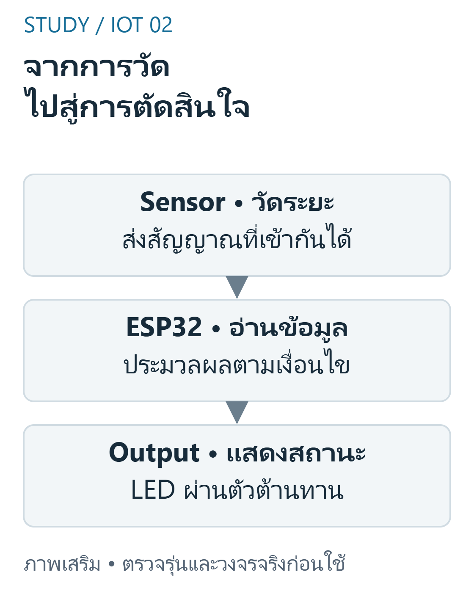
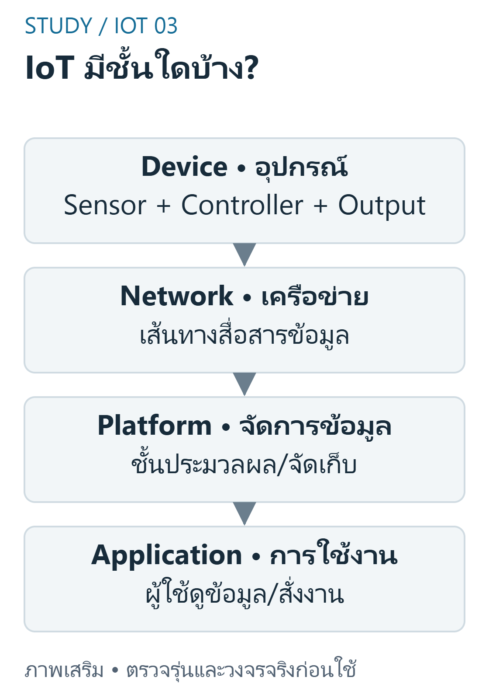
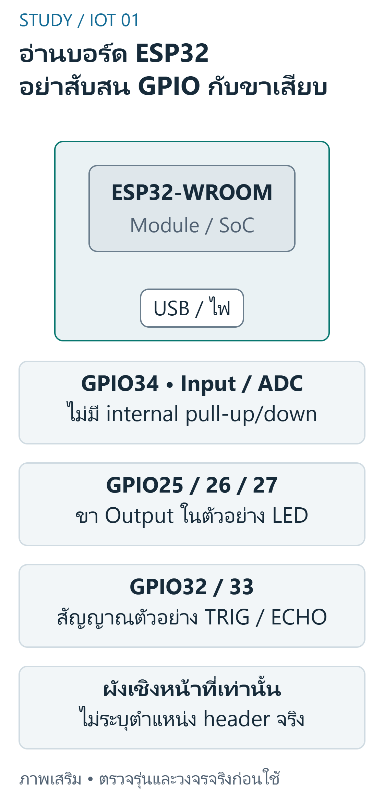

---
{"version":1,"id":"internet-of-things-final-esp32-foundations","course":"internet-of-things","category":"summaries","slug":"final-esp32-foundations","title":"FINAL 01 — ESP32 และพื้นฐาน IoT","language":"th"}
---

## เป้าหมายการเรียนรู้ {#objectives}

- อธิบายชั้น Sensor / Controller / Output / Network จากระบบระดับน้ำ
- อธิบายเหตุที่รูปบอร์ดอย่างเดียวไม่เพียงพอต่อการเลือก pin
- วางแผนตรวจความเข้ากันได้ก่อนต่อเซนเซอร์ 5V เข้าบอร์ด 3.3V
- ออกแบบการทดสอบ sensor→controller→LED ทีละส่วน
- ออกแบบรายงานที่ไม่สับสน simulation กับ hardware PASS

## ขอบเขต หลักฐาน และความปลอดภัย {#scope}

วิชา 89022567 เลือกศึกษา Week 9–12 โดยยังไม่ยืนยันว่าเป็นขอบเขตสอบ Final ทางการทั้งหมด หลักฐานต้นฉบับ: B pp.5–16,19–27; W09 slides2–3. เลขหน้า PDF หมายถึงหน้าจริงของไฟล์ (physical page); เอกสาร Word อ้างหัวข้องานและหน้าแปลงส่วนตัวตาม [บัญชีแหล่งที่มา](../../../docs/iot-final-source-coverage.md). ไม่เผยแพร่ต้นฉบับหรือข้อมูลส่วนตัวของผู้เรียน

ตัวอย่างและเฉลยต่อไปนี้จัดทำเสริม ไม่ใช่เฉลยทางการ ใช้บอร์ด classic ESP32-WROOM กับ Arduino-ESP32 core 3.3.11 เป็นเป้าหมาย ตัวเลขขา ระดับสัญญาณ (polarity) เกณฑ์ช่วง (threshold) และที่อยู่จอ OLED เป็นสมมติฐานที่ประกาศ ห้ามเหมารวมกับ ESP32 ทุกรุ่น

ใช้เฉพาะ LED หรือโหลดแรงดันต่ำผ่านโมดูล/วงจรขับที่เข้ากันได้ ห้ามขับขดลวดรีเลย์จาก GPIO โดยตรง และห้ามต่อไฟบ้านบน breadboard ตรวจ Echo 5V กับ GPIO 3.3V วงจรแปลงระดับ กราวด์ และตัวต้านทานก่อนจ่ายไฟ การคอมไพล์และการจำลองไม่พิสูจน์ความถูกต้องของวงจรหรือความแม่นยำเซนเซอร์จริง

## ระบบ IoT และเส้นทางข้อมูล {#iot-chain}

ระบบ IoT เชื่อมอุปกรณ์ทางกายภาพกับการประมวลผลและการสื่อสาร ไม่ใช่เพียงมีเซนเซอร์หรือเปิด LED เท่านั้น แยกเส้นทาง Sensor → Controller → Decision → Output ออกจากการส่งข้อมูลผ่านเครือข่าย ระบบควบคุมในพื้นที่ยังทำงานได้แม้เครือข่ายล่ม หากออกแบบเช่นนั้น; ตัวอย่างบทเรียนยังไม่ติดตั้งบริการ cloud


ที่มา: [ภาพเขียนเสริม ตรวจตามเอกสารเทคนิค](https://docs.espressif.com/projects/arduino-esp32/en/latest/api/gpio.html)

อ่านภาพ: ติดตามข้อมูลจาก Sensor ไปยัง ESP32 แล้วจึงเลือก Output การควบคุมในพื้นที่ยังไม่พิสูจน์ว่าต่อ Internet แล้ว


ที่มา: [ภาพเขียนเสริม ตรวจตามเอกสารเทคนิค](https://www.espressif.com/sites/default/files/documentation/esp32_datasheet_en.pdf)

อ่านภาพ: Device วัด/ควบคุมในพื้นที่ ส่วน Network ส่งข้อมูลไปยัง Platform และ Application ได้เมื่อมีการออกแบบและเชื่อมต่อจริง

ข้อควรระวัง: การอ่าน GPIO แล้วเปิดไฟยังไม่ยืนยันว่ามีการเชื่อมต่อ Internet

ตัวอย่างการให้เหตุผลที่จัดทำเสริม:

ระบบใดมี Controller ทำหน้าที่ตัดสินใจ ไม่ใช่ตัว Sensor โดยตรง?

แนวคำตอบ: ESP32 อ่านระยะแล้วเลือกสี LED — การอ่านและจัดประเภทเป็นงานประมวลผลของ Controller

## แยก SoC, Module และ Development Board {#board-module}

ESP32 เป็นตระกูลชิป (SoC) ส่วนโมดูลและบอร์ดพัฒนาประกอบวงจร / อุปกรณ์เพิ่ม รุ่นย่อยมี CPU, GPIO และฟังก์ชันต่างกัน บทนี้เลือก classic ESP32-WROOM development board และ Arduino FQBN esp32:esp32:esp32 เป็นตัวอย่าง ไม่เหมารวม S2 / S3 / C3 หรือบอร์ด 30 / 38 ขาว่าต่อเหมือนกันทุกขา


ที่มา: [ภาพเขียนเสริม ตรวจตามเอกสารเทคนิค](https://www.espressif.com/sites/default/files/documentation/esp32_datasheet_en.pdf)

อ่านภาพ: ดูภาพแล้วตรวจ pinout ของบอร์ดจริงก่อนเลือกขา GPIO34 รับข้อมูลได้แต่ไม่ใช้ขับ LED; VIN/USB ไม่ทำให้ GPIO รับ5Vได้

ข้อควรระวัง: จำนวนขาบนแถว header ไม่เท่ากับจำนวน GPIO ที่ใช้ได้อย่างอิสระ

ตัวอย่างการให้เหตุผลที่จัดทำเสริม:

เมื่อย้าย sketch จาก classic ESP32-WROOM ไป ESP32-C3 สิ่งใดต้องตรวจใหม่?

แนวคำตอบ: pin map และความสามารถของรุ่น SoC/board — รุ่น SoC และบอร์ดมี pin / peripheral ต่างกัน

## ไฟเลี้ยง Logic และ Ground {#electrical}

พอร์ต USB / VIN อาจรับ 5V ตามวงจรบอร์ด แต่ไม่ได้ทำให้ GPIO รับ 5V ได้ GPIO ของ classic ESP32 ใช้ logic ประมาณ 3.3V ต้องตรวจค่าทางไฟฟ้าจาก datasheet และวงจรจริง สาย GND เป็น reference ของสัญญาณในตัวอย่าง nonisolated; ห้ามใช้ข้ออ้างเรื่อง optocoupler เพื่อสรุปว่าทุกโมดูลแยกกราวด์แล้วปลอดภัย

ข้อควรระวัง: ไฟเลี้ยงบอร์ดกับแรงดันสัญญาณเป็นคนละข้อกำหนด

ตัวอย่างการให้เหตุผลที่จัดทำเสริม:

VIN รับ 5V ตาม schematic ของบอร์ด ข้อใดตามมาได้อย่างปลอดภัย?

แนวคำตอบ: ยังต้องตรวจ GPIO limits แยก ไม่ต่อ5V Echo โดยอนุมานจาก VIN — power input กับ I / O domain ไม่ใช่ข้อกำหนดเดียวกัน

## เลือกขาและตรวจการทำงานทีละส่วน {#workflow}

อ่าน pinout ของรุ่นที่เลือก ใช้ GPIO34 สำหรับ analog input ตัวอย่างของ A11 แต่ไม่ใช้เป็น LED output เพราะขานี้ input-only บน classic ESP32 หลีกเลี่ยง GPIO6–11 ที่เกี่ยวข้องกับ flash ของโมดูลทั่วไป และตรวจ strapping pins อย่าอนุมานจากเลข D บนบอร์ดต่างรุ่น

ข้อควรระวัง: โค้ด compile ผ่านไม่ได้พิสูจน์ขาที่เสียบจริงหรือไฟเลี้ยงถูกต้อง

ตัวอย่างการให้เหตุผลที่จัดทำเสริม:

A11 ตัวอย่าง soil sensor ใช้ GPIO34 สำหรับหน้าที่ใด?

แนวคำตอบ: รับ analog input ของ classic ESP32 — อ่าน analogRead บนขา input-only ได้ แต่ไม่ใช้เป็น output

## หลักฐาน การทดสอบ และขอบเขต {#evidence}

B ให้ภาพรวม IoT / ESP32 ส่วน W09 ใช้ ultrasonic เป็นกรณีศึกษา ตัวอย่างโค้ดที่นี่เขียนเสริมและไม่เชื่อม Wi-Fi จริง ค่าที่แสดงใน trace เป็น input ที่กำหนด ไม่ใช่การวัดฮาร์ดแวร์ แยก source review, mathematical oracle, compile, simulation และ physical test ในรายงานเสมอ

ข้อควรระวัง: อย่าใช้ screenshot Serial ที่สร้างขึ้นเป็นหลักฐานการทดลองจริง

ตัวอย่างการให้เหตุผลที่จัดทำเสริม:

trace ที่ป้อน distance=20,40,60 จากโปรแกรมทดสอบควรเรียกว่าอะไร?

แนวคำตอบ: ผล simulation จาก input ที่กำหนด — ห้ามอ้าง simulation เป็นการวัดจริง

## โปรแกรม C++ ที่เขียนเสริม {#program-code}

สเก็ตช์ C++ นี้เขียนเสริมสำหรับเป้าหมายที่ระบุ คอมเมนต์อธิบาย API และสมมติฐาน มีการตรวจคอมไพล์จริง แต่ไม่มีการอัปโหลดหรือวัดผลฮาร์ดแวร์ ห้ามนำไปต่ออุปกรณ์ที่ยังไม่ทราบสเปกโดยตรง

```cpp
#include <Arduino.h>
constexpr uint8_t LED_PIN = 25; // ขาตัวอย่าง ไม่ใช่ pinout ของทุกบอร์ด
void setup() {
  Serial.begin(115200);
  pinMode(LED_PIN, OUTPUT);  // LED ภายนอกผ่าน330โอห์มไป GND
}
void loop() {
  constexpr int sampleCm = 20; // ข้อมูลสมมติ ไม่ใช่การวัดจริง
  const bool warning = sampleCm <= 30;
  digitalWrite(LED_PIN, warning ? HIGH : LOW);
  Serial.println(warning ? "WARNING" : "NORMAL");
  delay(1000); // ตัวอย่างเบื้องต้น ไม่ใช้กับตัวจับเวลาไม่บล็อก
}
```

## อ่าน Expected Behavior และกรณีขอบ {#expected}

sampleCm=20 ทำให้ warning=true และพิมพ์ WARNING ซ้ำประมาณทุก1s;เป็นข้อมูลสมมติไม่ใช่ sensor measurement

- การอ่าน GPIO แล้วเปิดไฟยังไม่ยืนยันว่ามีการเชื่อมต่อ Internet
- จำนวนขาบนแถว header ไม่เท่ากับจำนวน GPIO ที่ใช้ได้อย่างอิสระ
- ไฟเลี้ยงบอร์ดกับแรงดันสัญญาณเป็นคนละข้อกำหนด
- โค้ด compile ผ่านไม่ได้พิสูจน์ขาที่เสียบจริงหรือไฟเลี้ยงถูกต้อง
- อย่าใช้ screenshot Serial ที่สร้างขึ้นเป็นหลักฐานการทดลองจริง

## ฝึกอธิบายพร้อมแนวประเมิน {#practice}

โจทย์เหล่านี้จัดทำเสริมเพื่อทบทวน ไม่ใช่ข้อสอบมหาวิทยาลัยที่ยืนยันแล้ว โหมดฝึกและคลังข้อสอบด้านล่างแสดงคำอธิบายหลังส่งคำตอบตามระบบเดิม เมื่อปิด JavaScript ยังอ่านเฉลยในส่วนพับได้ คำอธิบายและโค้ดอิสระใช้เกณฑ์ประเมินตนเอง (rubric) ไม่ตรวจคะแนนอัตโนมัติ

### 1. ระบบ IoT และเส้นทางข้อมูล {#review-iot-chain}

อธิบายชั้น Sensor / Controller / Output / Network จากระบบระดับน้ำ

แนวคำตอบ: ระบุการวัด การตัดสินใจและการแสดงผล แยกเครือข่ายที่ยังไม่ใช้งานจากความสามารถของ ESP32

### 2. แยก SoC, Module และ Development Board {#review-board-module}

อธิบายเหตุที่รูปบอร์ดอย่างเดียวไม่เพียงพอต่อการเลือก pin

แนวคำตอบ: ตรวจชื่อชิป โมดูล รุ่นบอร์ด schematic และข้อจำกัดขาก่อนต่อสาย

### 3. ไฟเลี้ยง Logic และ Ground {#review-electrical}

วางแผนตรวจความเข้ากันได้ก่อนต่อเซนเซอร์ 5V เข้าบอร์ด 3.3V

แนวคำตอบ: ตรวจ VCC, logic output, input limits, GND และ driver / level shifter โดยไม่ใช้ GPIO จ่ายกำลังให้โหลด

### 4. เลือกขาและตรวจการทำงานทีละส่วน {#review-workflow}

ออกแบบการทดสอบ sensor→controller→LED ทีละส่วน

แนวคำตอบ: ตรวจไฟเลี้ยงและชนิดขา อ่าน Serial ด้วยข้อมูลสมมติ แล้วแยกทดสอบ sensor / output ก่อนรวมระบบ

### 5. หลักฐาน การทดสอบ และขอบเขต {#review-evidence}

ออกแบบรายงานที่ไม่สับสน simulation กับ hardware PASS

แนวคำตอบ: บอกเวอร์ชันและ input ของ simulation แยกภาพ / measurement จากฮาร์ดแวร์ที่ยังไม่มี

## สรุปก่อนสอบ {#summary}

- ระบบ IoT และเส้นทางข้อมูล: การอ่าน GPIO แล้วเปิดไฟยังไม่ยืนยันว่ามีการเชื่อมต่อ Internet
- แยก SoC, Module และ Development Board: จำนวนขาบนแถว header ไม่เท่ากับจำนวน GPIO ที่ใช้ได้อย่างอิสระ
- ไฟเลี้ยง Logic และ Ground: ไฟเลี้ยงบอร์ดกับแรงดันสัญญาณเป็นคนละข้อกำหนด
- เลือกขาและตรวจการทำงานทีละส่วน: โค้ด compile ผ่านไม่ได้พิสูจน์ขาที่เสียบจริงหรือไฟเลี้ยงถูกต้อง
- หลักฐาน การทดสอบ และขอบเขต: อย่าใช้ screenshot Serial ที่สร้างขึ้นเป็นหลักฐานการทดลองจริง

## อ้างอิงและข้อจำกัด {#sources}

- ต้นฉบับส่วนตัว: B pp.5–16,19–27; W09 slides2–3; ไม่แนบสำเนา ไม่อ้างว่ามีsourceอื่นที่ยังไม่เปิด
- [Source coverage](../../../docs/iot-final-source-coverage.md), [Academic verification](../../../docs/iot-final-academic-verification.md), [Exam verification](../../../docs/iot-final-exam-verification.md), [QA](../../../docs/iot-final-qa.md)
- [ESP32 datasheet](https://www.espressif.com/sites/default/files/documentation/esp32_datasheet_en.pdf) — ตรวจ2026-10-29;ใช้target/core3.3.11สำหรับcompileและอย่าสมมติว่าlatestdocsตรงกับทุกcoreเก่า
- [GPIO API](https://docs.espressif.com/projects/arduino-esp32/en/latest/api/gpio.html) — ตรวจ2026-10-29;ใช้target/core3.3.11สำหรับcompileและอย่าสมมติว่าlatestdocsตรงกับทุกcoreเก่า

ข้อจำกัดที่ยังไม่ยืนยัน: แรงดัน ระดับกระตุ้น ที่อยู่ และการต่อสายของโมดูลจริง ความแม่นยำ สภาพแวดล้อม และวิดีโอทดลอง การตรวจเว็บ/คอมไพล์/จำลองไม่เท่ากับผ่านการทดสอบฮาร์ดแวร์ และไม่ยืนยันขอบเขตข้อสอบจริง
