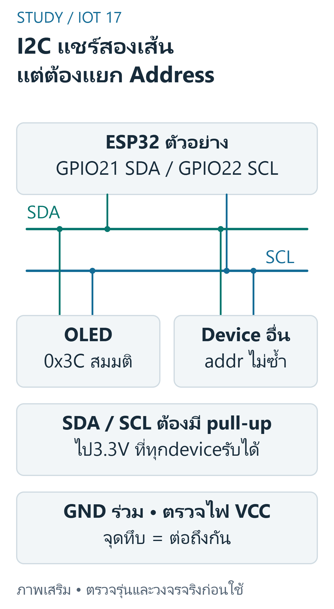
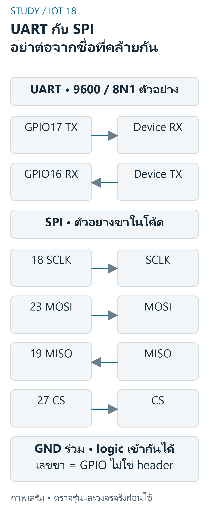
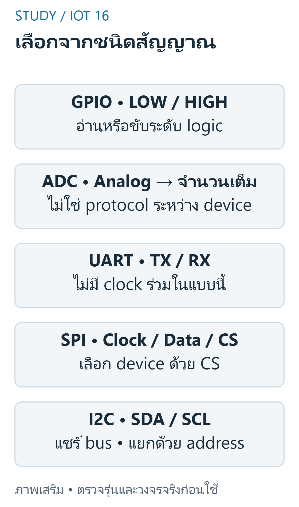

---
{"version":1,"id":"internet-of-things-final-interfaces","course":"internet-of-things","category":"summaries","slug":"final-interfaces","title":"FINAL 06 — I2C, SPI, UART, GPIO และ ADC","language":"th"}
---

## เป้าหมายการเรียนรู้ {#objectives}

- ออกแบบตรวจ OLEDI2C ก่อนต่อและก่อนเริ่ม library
- วาง wiringtableSPI สำหรับ device ที่ระบุ mode
- อธิบายการต่อ UART สองอุปกรณ์ 3.3V อย่างมีเงื่อนไข
- จัดกลุ่ม soilAO / DO,ultrasonic,PIR และ OLED ที่กำหนด
- ออกแบบ debug เมื่อ I2C ไม่ ACK หรือ Serial อ่านไม่ออก

## ขอบเขต หลักฐาน และความปลอดภัย {#scope}

วิชา 89022567 เลือกศึกษา Week 9–12 โดยยังไม่ยืนยันว่าเป็นขอบเขตสอบ Final ทางการทั้งหมด หลักฐานต้นฉบับ: A11 pp.1–3; B pp.24–27,81–87; S12 pp.20–23. เลขหน้า PDF หมายถึงหน้าจริงของไฟล์ (physical page); เอกสาร Word อ้างหัวข้องานและหน้าแปลงส่วนตัวตาม [บัญชีแหล่งที่มา](../../../docs/iot-final-source-coverage.md). ไม่เผยแพร่ต้นฉบับหรือข้อมูลส่วนตัวของผู้เรียน

ตัวอย่างและเฉลยต่อไปนี้จัดทำเสริม ไม่ใช่เฉลยทางการ ใช้บอร์ด classic ESP32-WROOM กับ Arduino-ESP32 core 3.3.11 เป็นเป้าหมาย ตัวเลขขา ระดับสัญญาณ (polarity) เกณฑ์ช่วง (threshold) และที่อยู่จอ OLED เป็นสมมติฐานที่ประกาศ ห้ามเหมารวมกับ ESP32 ทุกรุ่น

ใช้เฉพาะ LED หรือโหลดแรงดันต่ำผ่านโมดูล/วงจรขับที่เข้ากันได้ ห้ามขับขดลวดรีเลย์จาก GPIO โดยตรง และห้ามต่อไฟบ้านบน breadboard ตรวจ Echo 5V กับ GPIO 3.3V วงจรแปลงระดับ กราวด์ และตัวต้านทานก่อนจ่ายไฟ การคอมไพล์และการจำลองไม่พิสูจน์ความถูกต้องของวงจรหรือความแม่นยำเซนเซอร์จริง

## I2C: SDA, SCL และ Address {#i2c}

I2C เป็นบัสข้อมูลอนุกรมมี SDA / SCL ต้องมี pullups ไปแรงดันที่ปลอดภัยกับทุกอุปกรณ์ master เริ่ม transaction และอุปกรณ์ใช้ address ต้องหลีกเลี่ยง address ชนกัน 7bit มี 128 รหัสแต่มี reservedaddresses จึงไม่อ้างว่าเสียบได้ 128devices จริงเสมอ Wire.begin(21,22)เป็นตัวอย่าง classicESP32 ที่ประกาศ ไม่ใช่ pin ทุกบอร์ด


ที่มา: [ภาพเขียนเสริม ตรวจตามเอกสารเทคนิค](https://docs.espressif.com/projects/arduino-esp32/en/latest/api/i2c.html)

อ่านภาพ: แต่ละdeviceแชร์SDA/SCLและต้องไม่ชนaddress ตรวจpull-upรวม/แรงดันและข้อจำกัดbus ไม่ต่อpull-up5Vเข้าขา3.3Vโดยอนุมานจากชื่อI2C

**ตารางตรวจสายของภาพนี้ — ไม่ใช่ลำดับขา header**

| จาก | ถึง | ชนิด / เงื่อนไข |
|---|---|---|
| ESP32 GPIO21 | OLED SDA / bus SDA | I2C data |
| ESP32 GPIO22 | OLED SCL / bus SCL | I2C clock |
| SDA / SCL | pull-upไป3.3Vที่เข้ากันได้ | ตรวจR/bus/deviceจริง |
| ESP32 / OLED / device | GNDร่วม | Ground |
| OLED VCC | ไฟตามสเปกmoduleที่ตรวจแล้ว | Power: ไม่สรุปทุกmoduleใช้ไฟเดียวกัน |

ข้อควรระวัง: pullup บน OLEDmodule อาจดึงไป 5V แม้ MCU เป็น 3.3V

ตัวอย่างการให้เหตุผลที่จัดทำเสริม:

สายสัญญาณหลักสองเส้นของ I2C คืออะไร?

แนวคำตอบ: SDA และ SCL — ชื่อบอก data และ clock ของ I2C

## SPI: Clock, Data และ Chip Select {#spi}

SPI ทั่วไปใช้ SCLK,MOSI,MISO และ CS ต่อ device ใช้ clockmode / polarity / phase ตาม datasheet อุปกรณ์บางตัวเป็น writeonly ไม่ใช้ MISO จึงไม่บังคับว่าสายข้อมูลต้องครบทุก module sharedbus ต้องจัด CS ไม่ให้ conflict บทนี้ไม่ถือว่า SPI มี 7bitaddress แบบ I2C

ข้อควรระวัง: อย่าสลับความหมาย MOSI กับ TX ของ UART โดยดูชื่อใกล้กัน

ตัวอย่างการให้เหตุผลที่จัดทำเสริม:

ขาใดมักใช้เลือก device บน SPIbus?

แนวคำตอบ: CS/SS — chipselect เลือก device บน bus ตามการออกแบบ

## UART: TX/RX, Baud และ Logic {#uart}

UARTasynchronous ใช้ TX ไป RX ฝั่งตรงข้ามและ RX รับจาก TX ของอีกฝั่ง ต้องมี GNDreference สำหรับ TTL วงจรไม่ isolate baud / data / parity / stop ให้ตรง UARTTTL ไม่ใช่ RS232±voltage;ESP32HardwareSerial เลือก RX / TXpins ได้ตามข้อจำกัด target


ที่มา: [ภาพเขียนเสริม ตรวจตามเอกสารเทคนิค](https://docs.espressif.com/projects/arduino-esp32/en/latest/api/serial.html)

อ่านภาพ: ทั้งสองแบบต้องตรวจระดับไฟและGNDร่วม UARTตัวอย่างใช้9600 8N1 ส่วนSPIต้องตรวจCPOL/CPHAของdevice;ไม่ต่อRS-232แรงดันต่างมาตรฐานเข้าขาโดยตรง

**ตารางตรวจสายของภาพนี้ — ไม่ใช่ลำดับขา header**

| จาก | ถึง | ชนิด / เงื่อนไข |
|---|---|---|
| ESP32 GPIO17 TX | Device RX | UART Signal |
| ESP32 GPIO16 RX | Device TX | UART Signal |
| ESP32 / UARTdevice | GNDร่วม | Ground |
| ESP32 GPIO18 SCLK | SPIdevice SCLK | SPI Clock |
| ESP32 GPIO23 MOSI | SPIdevice MOSI | SPI TX |
| ESP32 GPIO19 MISO | SPIdevice MISO | SPI RX |
| ESP32 GPIO27 CS | SPIdevice CS | SPI Select |
| ESP32 / SPIdevice | GNDร่วม | Ground |

ข้อควรระวัง: ชื่อ TX หมายถึงผู้ส่งของแต่ละอุปกรณ์ ไม่ใช่ต้องต่อ TX กับ TX

ตัวอย่างการให้เหตุผลที่จัดทำเสริม:

UARTTTL สองอุปกรณ์ที่ compatible ควรต่อทิศใด?

แนวคำตอบ: TXของAไปRXของB และTXของBไปRXของA — ต้องไขว้ผู้ส่งกับผู้รับ

## เลือก Interface จากสัญญาณจริง {#select-interface}

A11 ให้จัดกลุ่ม I2C,SPI,UART,GPIO,ADC ไม่ใช่แบ่งตามรูปร่างตัว sensor โมดูลหนึ่งอาจมี AO+DO หรือรุ่น I2C / SPI ต่างกัน;ดู datasheet ขาและ protocol HC-SR04trigger / echo ใช้ GPIOpulse ไม่ใช่ ADC เพื่อวัด Echo width;PIRmoduleDO ใช้ digitalinput


ที่มา: [ภาพเขียนเสริม ตรวจตามเอกสารเทคนิค](https://docs.espressif.com/projects/arduino-esp32/en/latest/api/i2c.html)

อ่านภาพ: อ่านสเปกขาและinterfaceจริง:AOเลือกADC,DOเลือกdigitalGPIO,UARTต้องตรงformat,SPIต้องตรงmode,และI2Cต้องตรวจaddress/pullups

ข้อควรระวัง: ชื่อ sensor ไม่บอก protocol ได้แน่นอนโดยไม่ดูรุ่น

ตัวอย่างการให้เหตุผลที่จัดทำเสริม:

soilAO ควรอยู่กลุ่มใดเมื่ออ่านแรงดันด้วย ESP32?

แนวคำตอบ: ADC — AO ระบุ analogoutput

## ตรวจ Bus และ Code โดยไม่เดา {#bus-debug}

ตรวจ power / GND / voltage ก่อน protocol จากนั้น mapping,pullups / address สำหรับ I2C,CS / mode สำหรับ SPI,baud / crossTXRX สำหรับ UART ACK สำเร็จไม่ยืนยัน display ทั้งจอหรือ sensorcalibration โปรแกรมที่นี่แสดงตัวอย่าง API ที่ compile ได้ ไม่ต่อทุก bus ลง hardware พร้อมกัน

ข้อควรระวัง: อย่าเปลี่ยนสายแบบสุ่มขณะจ่ายไฟหรือสรุป address จากภาพอย่างเดียว

ตัวอย่างการให้เหตุผลที่จัดทำเสริม:

I2C ไม่มี ACK ควรเริ่มตรวจชุดใด?

แนวคำตอบ: ไฟ/GND/logic/pins/pullups/address — แยกความผิดพลาด electrical และ protocol

## โปรแกรม C++ ที่เขียนเสริม {#program-code}

สเก็ตช์ C++ นี้เขียนเสริมสำหรับเป้าหมายที่ระบุ คอมเมนต์อธิบาย API และสมมติฐาน มีการตรวจคอมไพล์จริง แต่ไม่มีการอัปโหลดหรือวัดผลฮาร์ดแวร์ ห้ามนำไปต่ออุปกรณ์ที่ยังไม่ทราบสเปกโดยตรง

```cpp
#include <Arduino.h>
#include <Wire.h>
#include <SPI.h>
void setup() {
  Serial.begin(115200);
  Wire.begin(21,22); // authoredmapping classic ESP32; pullupsต้องปลอดภัย
  Wire.beginTransmission(0x3C); // addressสมมติ ต้องตรวจdisplayจริง
  const uint8_t error=Wire.endTransmission();
  Serial.println(error==0?"I2C ACK":"NO ACK");
  // SPI/UARTแสดงการตั้งAPI ไม่ได้อ้างว่าต่อสามbusพร้อมกันแล้วผ่านhardware
  SPI.begin(18,19,23,27); // SCLK,MISO,MOSI,CSตัวอย่าง
  Serial2.begin(9600,SERIAL_8N1,16,17); // RX16,TX17 ตรวจโมดูลจริงก่อนใช้
}
void loop() {}
```

## อ่าน Expected Behavior และกรณีขอบ {#expected}

setupตรวจI2C0x3Cแล้วพิมพ์ I2C ACK หรือ NO ACK ตามผล Wire.endTransmission;ตั้ง SPI และ Serial2 9600 8N1 ที่RX16/TX17 แล้วloopว่าง ไม่มีการส่งข้อมูลต่อเนื่อง;ต้องตรวจmoduleจริงและcompileไม่ยืนยันbusที่ต่อจริง

- pullup บน OLEDmodule อาจดึงไป 5V แม้ MCU เป็น 3.3V
- อย่าสลับความหมาย MOSI กับ TX ของ UART โดยดูชื่อใกล้กัน
- ชื่อ TX หมายถึงผู้ส่งของแต่ละอุปกรณ์ ไม่ใช่ต้องต่อ TX กับ TX
- ชื่อ sensor ไม่บอก protocol ได้แน่นอนโดยไม่ดูรุ่น
- อย่าเปลี่ยนสายแบบสุ่มขณะจ่ายไฟหรือสรุป address จากภาพอย่างเดียว

## ฝึกอธิบายพร้อมแนวประเมิน {#practice}

โจทย์เหล่านี้จัดทำเสริมเพื่อทบทวน ไม่ใช่ข้อสอบมหาวิทยาลัยที่ยืนยันแล้ว โหมดฝึกและคลังข้อสอบด้านล่างแสดงคำอธิบายหลังส่งคำตอบตามระบบเดิม เมื่อปิด JavaScript ยังอ่านเฉลยในส่วนพับได้ คำอธิบายและโค้ดอิสระใช้เกณฑ์ประเมินตนเอง (rubric) ไม่ตรวจคะแนนอัตโนมัติ

### 1. I2C: SDA, SCL และ Address {#review-i2c}

ออกแบบตรวจ OLEDI2C ก่อนต่อและก่อนเริ่ม library

แนวคำตอบ: ตรวจ pins / voltage / address / pullups และใช้ ACK เป็นหลักฐาน communication ไม่ใช่รับรองทุก pixel

### 2. SPI: Clock, Data และ Chip Select {#review-spi}

วาง wiringtableSPI สำหรับ device ที่ระบุ mode

แนวคำตอบ: อ้าง datasheet ทั้งสองฝั่ง ระบุ SCLK,data และ CS และไม่ใช้ GPIOflash โดยเดา

### 3. UART: TX/RX, Baud และ Logic {#review-uart}

อธิบายการต่อ UART สองอุปกรณ์ 3.3V อย่างมีเงื่อนไข

แนวคำตอบ: TX→RX ทั้งสองทิศ ตรวจ GND / logiclevel / format และห้ามต่อ RS232 ตรง

### 4. เลือก Interface จากสัญญาณจริง {#review-select-interface}

จัดกลุ่ม soilAO / DO,ultrasonic,PIR และ OLED ที่กำหนด

แนวคำตอบ: แยก outputformat และโปรโตคอลของโมดูลจากปริมาณที่วัด

### 5. ตรวจ Bus และ Code โดยไม่เดา {#review-bus-debug}

ออกแบบ debug เมื่อ I2C ไม่ ACK หรือ Serial อ่านไม่ออก

แนวคำตอบ: แยกไฟฟ้า / สาย / protocol / software และไม่แปล noresponse เป็น physicalmeasurement0

## สรุปก่อนสอบ {#summary}

- I2C: SDA, SCL และ Address: pullup บน OLEDmodule อาจดึงไป 5V แม้ MCU เป็น 3.3V
- SPI: Clock, Data และ Chip Select: อย่าสลับความหมาย MOSI กับ TX ของ UART โดยดูชื่อใกล้กัน
- UART: TX/RX, Baud และ Logic: ชื่อ TX หมายถึงผู้ส่งของแต่ละอุปกรณ์ ไม่ใช่ต้องต่อ TX กับ TX
- เลือก Interface จากสัญญาณจริง: ชื่อ sensor ไม่บอก protocol ได้แน่นอนโดยไม่ดูรุ่น
- ตรวจ Bus และ Code โดยไม่เดา: อย่าเปลี่ยนสายแบบสุ่มขณะจ่ายไฟหรือสรุป address จากภาพอย่างเดียว

## อ้างอิงและข้อจำกัด {#sources}

- ต้นฉบับส่วนตัว: A11 pp.1–3; B pp.24–27,81–87; S12 pp.20–23; ไม่แนบสำเนา ไม่อ้างว่ามีsourceอื่นที่ยังไม่เปิด
- [Source coverage](../../../docs/iot-final-source-coverage.md), [Academic verification](../../../docs/iot-final-academic-verification.md), [Exam verification](../../../docs/iot-final-exam-verification.md), [QA](../../../docs/iot-final-qa.md)
- [ESP32 datasheet](https://www.espressif.com/sites/default/files/documentation/esp32_datasheet_en.pdf) — ตรวจ2026-10-29;ใช้target/core3.3.11สำหรับcompileและอย่าสมมติว่าlatestdocsตรงกับทุกcoreเก่า
- [GPIO API](https://docs.espressif.com/projects/arduino-esp32/en/latest/api/gpio.html) — ตรวจ2026-10-29;ใช้target/core3.3.11สำหรับcompileและอย่าสมมติว่าlatestdocsตรงกับทุกcoreเก่า
- [I2C API](https://docs.espressif.com/projects/arduino-esp32/en/latest/api/i2c.html) — ตรวจ2026-10-29;ใช้target/core3.3.11สำหรับcompileและอย่าสมมติว่าlatestdocsตรงกับทุกcoreเก่า
- [SPI API](https://docs.espressif.com/projects/arduino-esp32/en/latest/api/spi.html) — ตรวจ2026-10-29;ใช้target/core3.3.11สำหรับcompileและอย่าสมมติว่าlatestdocsตรงกับทุกcoreเก่า
- [UART API](https://docs.espressif.com/projects/arduino-esp32/en/latest/api/serial.html) — ตรวจ2026-10-29;ใช้target/core3.3.11สำหรับcompileและอย่าสมมติว่าlatestdocsตรงกับทุกcoreเก่า

ข้อจำกัดที่ยังไม่ยืนยัน: แรงดัน ระดับกระตุ้น ที่อยู่ และการต่อสายของโมดูลจริง ความแม่นยำ สภาพแวดล้อม และวิดีโอทดลอง การตรวจเว็บ/คอมไพล์/จำลองไม่เท่ากับผ่านการทดสอบฮาร์ดแวร์ และไม่ยืนยันขอบเขตข้อสอบจริง
