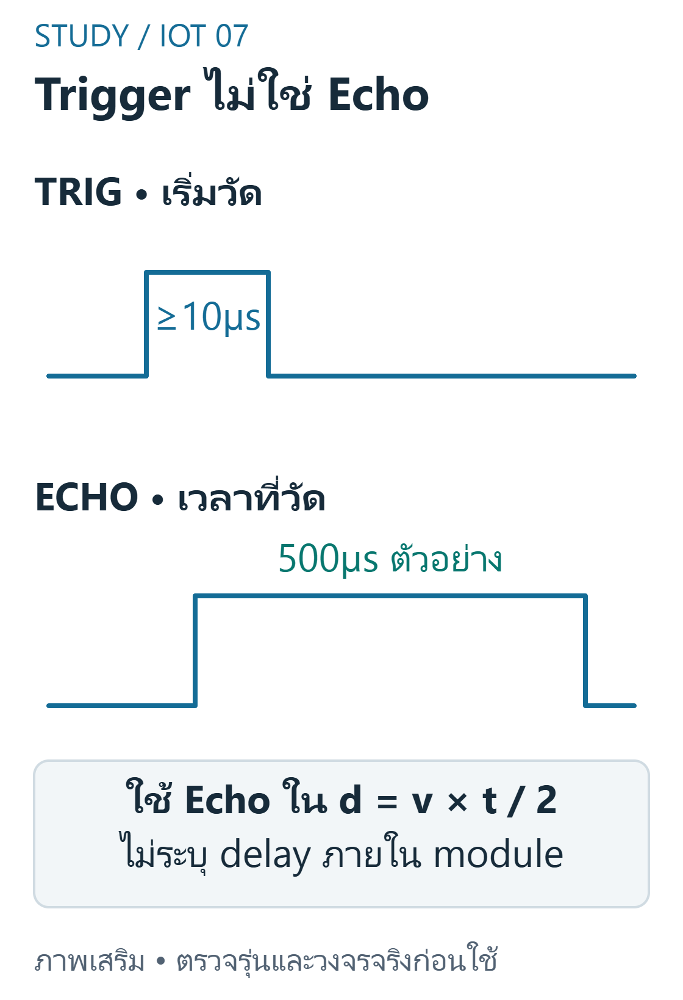
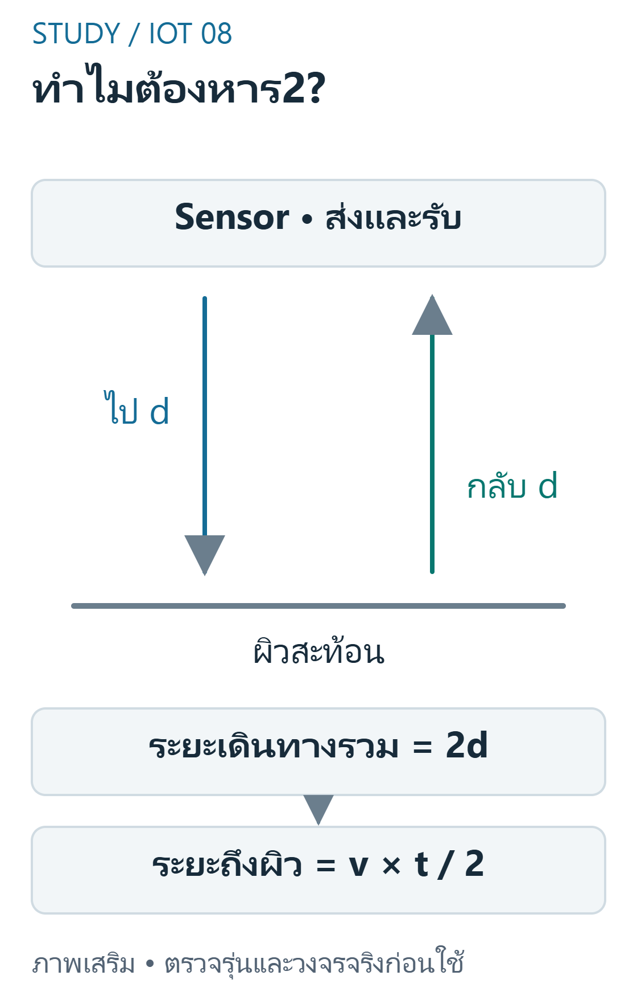
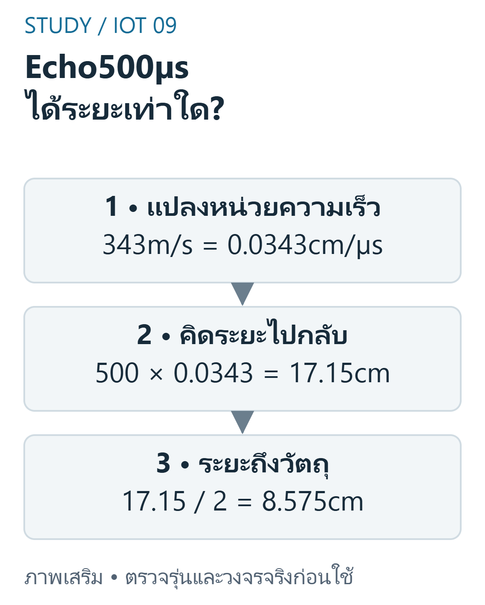

---
{"version":1,"id":"internet-of-things-final-ultrasonic","course":"internet-of-things","category":"summaries","slug":"final-ultrasonic","title":"FINAL 03 — Ultrasonic และการคำนวณระยะ","language":"th"}
---

## เป้าหมายการเรียนรู้ {#objectives}

- อธิบายเวลา Trigger เทียบกับ Echo และ timeout
- พิสูจน์สูตรและตรวจหน่วยของ 500µs
- แปลงระยะเป็นเวลาไปกลับและแสดงหน่วย
- ออกแบบ validation ก่อนส่งค่าถึง classification
- ออกแบบ testcase เมื่อ Echo หายหรือผิวเอียง

## ขอบเขต หลักฐาน และความปลอดภัย {#scope}

วิชา 89022567 เลือกศึกษา Week 9–12 โดยยังไม่ยืนยันว่าเป็นขอบเขตสอบ Final ทางการทั้งหมด หลักฐานต้นฉบับ: W09 slides3–16; A09 requirement2. เลขหน้า PDF หมายถึงหน้าจริงของไฟล์ (physical page); เอกสาร Word อ้างหัวข้องานและหน้าแปลงส่วนตัวตาม [บัญชีแหล่งที่มา](../../../docs/iot-final-source-coverage.md). ไม่เผยแพร่ต้นฉบับหรือข้อมูลส่วนตัวของผู้เรียน

ตัวอย่างและเฉลยต่อไปนี้จัดทำเสริม ไม่ใช่เฉลยทางการ ใช้บอร์ด classic ESP32-WROOM กับ Arduino-ESP32 core 3.3.11 เป็นเป้าหมาย ตัวเลขขา ระดับสัญญาณ (polarity) เกณฑ์ช่วง (threshold) และที่อยู่จอ OLED เป็นสมมติฐานที่ประกาศ ห้ามเหมารวมกับ ESP32 ทุกรุ่น

ใช้เฉพาะ LED หรือโหลดแรงดันต่ำผ่านโมดูล/วงจรขับที่เข้ากันได้ ห้ามขับขดลวดรีเลย์จาก GPIO โดยตรง และห้ามต่อไฟบ้านบน breadboard ตรวจ Echo 5V กับ GPIO 3.3V วงจรแปลงระดับ กราวด์ และตัวต้านทานก่อนจ่ายไฟ การคอมไพล์และการจำลองไม่พิสูจน์ความถูกต้องของวงจรหรือความแม่นยำเซนเซอร์จริง

## Trigger, Echo และ Pulse {#trigger-echo}

HC-SR04 แบบอ้างอิงรับ triggerHIGH อย่างน้อย 10µs และส่ง burstultrasound Echo width ใช้คำนวณระยะ ไม่ใช้ความยาว trigger แทน time-of-flight `pulseIn(pin,HIGH,timeout)` รอ pulse และคืนหน่วยµs;คืน 0เมื่อไม่ได้ completepulse ภายใน timeout ตาม API ที่เลือก จึงอาจ block แต่มีขอบเวลา


ที่มา: [ภาพเขียนเสริม ตรวจตามเอกสารเทคนิค](https://cdn.sparkfun.com/datasheets/Sensors/Proximity/HCSR04.pdf)

อ่านภาพ: Trigger กระตุ้นการวัด ส่วน Echo แทนเวลาไปกลับ ในตัวอย่าง500µsต้องใช้500เข้าสูตร ไม่ใช้10; pulseInคืน0ให้จัดการ invalid ก่อน

ข้อควรระวัง: การลด delay ไม่ทำให้ pulseIn กลายเป็น nonblocking

ตัวอย่างการให้เหตุผลที่จัดทำเสริม:

กำหนด Trigger10µs,Echo500µs; วิธีคำนวณใดผิดเพราะเลือกช่วงเวลาผิด?

แนวคำตอบ: ใช้10µsเข้าสูตรdistanceแทนEcho — Trigger กระตุ้น sensor แต่ Echo เป็น measurementtime

## สูตร Time-of-Flight และไปกลับ {#time-of-flight}

W09 slides14–16 ใช้เสียง 343m / s ที่ประมาณ 20°C เป็นสมมติฐาน ไม่ใช่ค่าคงที่ทุกสภาพ ระยะทางไปกลับเท่ากับ v×t จึงระยะ sensor ถึงผิวสะท้อน d=v×t / 2 เมื่อ tเป็นµs ใช้ v=0.0343cm / µs เอกสาร HC-SR04 บางฉบับใช้ 340m / s หรือ t / 58 เป็นค่าประมาณ ต้องไม่ผสมโดยไม่บอก


ที่มา: [ภาพเขียนเสริม ตรวจตามเอกสารเทคนิค](https://cdn.sparkfun.com/datasheets/Sensors/Proximity/HCSR04.pdf)

อ่านภาพ: เวลาที่วัดครอบคลุมการไปและกลับ จึงคูณความเร็วด้วยเวลาก่อนได้ระยะรวม แล้วหาร2เพื่อหาระยะจาก Sensor ถึงผิวสะท้อน

ข้อควรระวัง: ลืมหาร 2ทำให้คำตอบเป็นระยะไปกลับ

ตัวอย่างการให้เหตุผลที่จัดทำเสริม:

ใช้ v=0.0343cm / µs, Echo500µs ระยะ one-way กี่ cm?

แนวคำตอบ: 8.575 — 500×0.0343 / 2=8.575cm ตาม W09slide16

## หน่วย การปัด และตัวอย่าง {#units}

แปลงµs เป็น sด้วย 10^-6 และ mเป็น cm ด้วย 100 คำนวณก่อนปัดเพียงตอนแสดงผล ข้อฝึกระบุหน่วยและค่าความเร็วที่ใช้ทุกครั้ง ค่า 60 / 40 / 20cm ใน A09 เป็น sampledistance ไม่ใช่ Echo duration และไม่ใช่ระดับน้ำที่อ้าง datum โดยตรง

ข้อควรระวัง: ใช้ 343 กับµs โดยไม่แปลงหน่วยทำให้ผิดหลายลำดับขนาด

ตัวอย่างการให้เหตุผลที่จัดทำเสริม:

หากบันทึก Echo แต่ไม่ทราบหน่วยเวลา จะอ้างระยะจากสูตรอย่างไรถูกต้อง?

แนวคำตอบ: ยังหาค่าที่มีหน่วยcmอย่างน่าเชื่อถือไม่ได้ ต้องตรวจหน่วยและspeedก่อน — dimensionalanalysis ต้องมีหน่วยและ speed ที่เข้ากัน;หาร 2แก้ roundtrip ไม่แก้ uniterror

## Timeout, Blind Zone และ Validity {#invalid}

ตั้ง timeout เช่น 30000µs และตรวจ duration0 ก่อนคำนวณ จากนั้นตรวจช่วงของโมดูลที่อ้างอิง เช่นประมาณ 2..400cm;ขอบนี้เป็น specreference ไม่ใช่รับรองทุกผิว น้ำกระเพื่อม สิ่งกีดขวางและอุณหภูมิทำให้วัดคลาดเคลื่อน ค่าหายต้องมีสถานะ error ไม่ตีความเป็น 0cm ระดับสูงทันที

ข้อควรระวัง: 0 จาก timeout ไม่ใช่การยืนยันว่าวัตถุสัมผัสหัว sensor

ตัวอย่างการให้เหตุผลที่จัดทำเสริม:

ใช้ policyvalid2..400cm รวมขอบ ค่าใดต้องเป็น out-of-range?

แนวคำตอบ: 1.5cm — 1.5 ต่ำกว่าขอบที่ระบุ;นี่คือ policy ตาม reference ที่เลือก

## มุมสะท้อน ผิววัตถุ และการติดตั้ง {#limitations}

W09 slides5–11 แสดง reflection,softtargets,angle และ liquidlevel วัตถุเอียงอาจสะท้อนเสียงออกจากตัวรับ วัสดุดูดซับอาจให้ Echo อ่อน ต้องติดตั้งเหนือผิวน้ำโดยรู้ referenceheight และ blindzone ระยะ soundpath ไม่ใช่ความสูงน้ำโดยตรง

ข้อควรระวัง: อย่าฉายความแม่นยำ datasheet ไปใช้ทุกแม่น้ำหรือทุกมุม

ตัวอย่างการให้เหตุผลที่จัดทำเสริม:

พื้นผิวเอียงอาจทำให้ Echo หายเพราะอะไร?

แนวคำตอบ: คลื่นสะท้อนออกจากทิศตัวรับ — geometry ของ reflection สำคัญ

## สูตรพร้อมหน่วย {#formula}

สมมติv343m/s≈0.0343cm/µsตามW09slides14–16:


ที่มา: [ภาพเขียนเสริม ตรวจตามเอกสารเทคนิค](https://cdn.sparkfun.com/datasheets/Sensors/Proximity/HCSR04.pdf)

อ่านภาพ: ตรวจหน่วยทุกขั้น:343m/s=0.0343cm/µs แล้ว500×0.0343/2=8.575cm ความเร็วในบางdatasheetใช้340m/sเป็นอีกสมมติฐาน

$$
d_{cm}=\frac{t_{\mu s}\times0.0343}{2},\quad t_{\mu s}=\frac{2d_{cm}}{0.0343}
$$

Echo500µs:ไปกลับ17.15cmจึงระยะถึงวัตถุ8.575cm ตัวอย่างเสียง340m/sในdatasheetบางฉบับให้ค่าอื่นเล็กน้อย ไม่สลับสมมติฐานระหว่างวิธี; t/58เป็นอีกapproximationไม่ใช่exact343m/s

## โปรแกรม C++ ที่เขียนเสริม {#program-code}

สเก็ตช์ C++ นี้เขียนเสริมสำหรับเป้าหมายที่ระบุ คอมเมนต์อธิบาย API และสมมติฐาน มีการตรวจคอมไพล์จริง แต่ไม่มีการอัปโหลดหรือวัดผลฮาร์ดแวร์ ห้ามนำไปต่ออุปกรณ์ที่ยังไม่ทราบสเปกโดยตรง

```cpp
#include <Arduino.h>
constexpr uint8_t TRIG = 32, ECHO = 33; // ขาตัวอย่างของclassic ESP32
void setup() {
  Serial.begin(115200);
  pinMode(TRIG, OUTPUT); pinMode(ECHO, INPUT);
  digitalWrite(TRIG, LOW);
}
void loop() {
  digitalWrite(TRIG, LOW); delayMicroseconds(2);
  digitalWrite(TRIG, HIGH); delayMicroseconds(10);
  digitalWrite(TRIG, LOW);
  const unsigned long us = pulseIn(ECHO, HIGH, 30000UL);
  const float cm = us * 0.0343f / 2.0f;
  if (us == 0 || cm < 2.0f || cm > 400.0f) Serial.println("INVALID");
  else Serial.println(cm, 3);
  delay(70); // อ้างอิงโมดูลที่ต้องเว้นcycleเกิน60ms
}
```

## อ่าน Expected Behavior และกรณีขอบ {#expected}

Echo500µs ภายใต้343m/s ให้8.575cm;duration0 หรือคำนวณนอก2..400cm พิมพ์ INVALID;delay70msเพิ่มเติมจากเวลารอ pulse

- การลด delay ไม่ทำให้ pulseIn กลายเป็น nonblocking
- ลืมหาร 2ทำให้คำตอบเป็นระยะไปกลับ
- ใช้ 343 กับµs โดยไม่แปลงหน่วยทำให้ผิดหลายลำดับขนาด
- 0 จาก timeout ไม่ใช่การยืนยันว่าวัตถุสัมผัสหัว sensor
- อย่าฉายความแม่นยำ datasheet ไปใช้ทุกแม่น้ำหรือทุกมุม

## ฝึกอธิบายพร้อมแนวประเมิน {#practice}

โจทย์เหล่านี้จัดทำเสริมเพื่อทบทวน ไม่ใช่ข้อสอบมหาวิทยาลัยที่ยืนยันแล้ว โหมดฝึกและคลังข้อสอบด้านล่างแสดงคำอธิบายหลังส่งคำตอบตามระบบเดิม เมื่อปิด JavaScript ยังอ่านเฉลยในส่วนพับได้ คำอธิบายและโค้ดอิสระใช้เกณฑ์ประเมินตนเอง (rubric) ไม่ตรวจคะแนนอัตโนมัติ

### 1. Trigger, Echo และ Pulse {#review-trigger-echo}

อธิบายเวลา Trigger เทียบกับ Echo และ timeout

แนวคำตอบ: แยกสิ่งที่เราส่งกับความกว้าง pulse ที่วัดและจัดการ return0 ก่อนคำนวณ

### 2. สูตร Time-of-Flight และไปกลับ {#review-time-of-flight}

พิสูจน์สูตรและตรวจหน่วยของ 500µs

แนวคำตอบ: 34300cm / s หาร 1e6 ได้ 0.0343cm / µs;500×0.0343 / 2=8.575cm

### 3. หน่วย การปัด และตัวอย่าง {#review-units}

แปลงระยะเป็นเวลาไปกลับและแสดงหน่วย

แนวคำตอบ: ใช้ t=2d / v ในหน่วยเดียวกันและระบุ precision ที่ต้องการ

### 4. Timeout, Blind Zone และ Validity {#review-invalid}

ออกแบบ validation ก่อนส่งค่าถึง classification

แนวคำตอบ: แยก missing / invalid / outofrange จาก measurement และออกแบบ failstate ชัดเจน

### 5. มุมสะท้อน ผิววัตถุ และการติดตั้ง {#review-limitations}

ออกแบบ testcase เมื่อ Echo หายหรือผิวเอียง

แนวคำตอบ: ตรวจ fixture / geometry หลายระยะ บันทึก invalid และไม่แต่ง measurement ที่ไม่มี

## สรุปก่อนสอบ {#summary}

- Trigger, Echo และ Pulse: การลด delay ไม่ทำให้ pulseIn กลายเป็น nonblocking
- สูตร Time-of-Flight และไปกลับ: ลืมหาร 2ทำให้คำตอบเป็นระยะไปกลับ
- หน่วย การปัด และตัวอย่าง: ใช้ 343 กับµs โดยไม่แปลงหน่วยทำให้ผิดหลายลำดับขนาด
- Timeout, Blind Zone และ Validity: 0 จาก timeout ไม่ใช่การยืนยันว่าวัตถุสัมผัสหัว sensor
- มุมสะท้อน ผิววัตถุ และการติดตั้ง: อย่าฉายความแม่นยำ datasheet ไปใช้ทุกแม่น้ำหรือทุกมุม

## อ้างอิงและข้อจำกัด {#sources}

- ต้นฉบับส่วนตัว: W09 slides3–16; A09 requirement2; ไม่แนบสำเนา ไม่อ้างว่ามีsourceอื่นที่ยังไม่เปิด
- [Source coverage](../../../docs/iot-final-source-coverage.md), [Academic verification](../../../docs/iot-final-academic-verification.md), [Exam verification](../../../docs/iot-final-exam-verification.md), [QA](../../../docs/iot-final-qa.md)
- [ESP32 datasheet](https://www.espressif.com/sites/default/files/documentation/esp32_datasheet_en.pdf) — ตรวจ2026-10-29;ใช้target/core3.3.11สำหรับcompileและอย่าสมมติว่าlatestdocsตรงกับทุกcoreเก่า
- [GPIO API](https://docs.espressif.com/projects/arduino-esp32/en/latest/api/gpio.html) — ตรวจ2026-10-29;ใช้target/core3.3.11สำหรับcompileและอย่าสมมติว่าlatestdocsตรงกับทุกcoreเก่า
- [HC-SR04 reference](https://cdn.sparkfun.com/datasheets/Sensors/Proximity/HCSR04.pdf) — ตรวจ2026-10-29;ใช้target/core3.3.11สำหรับcompileและอย่าสมมติว่าlatestdocsตรงกับทุกcoreเก่า

ข้อจำกัดที่ยังไม่ยืนยัน: แรงดัน ระดับกระตุ้น ที่อยู่ และการต่อสายของโมดูลจริง ความแม่นยำ สภาพแวดล้อม และวิดีโอทดลอง การตรวจเว็บ/คอมไพล์/จำลองไม่เท่ากับผ่านการทดสอบฮาร์ดแวร์ และไม่ยืนยันขอบเขตข้อสอบจริง
