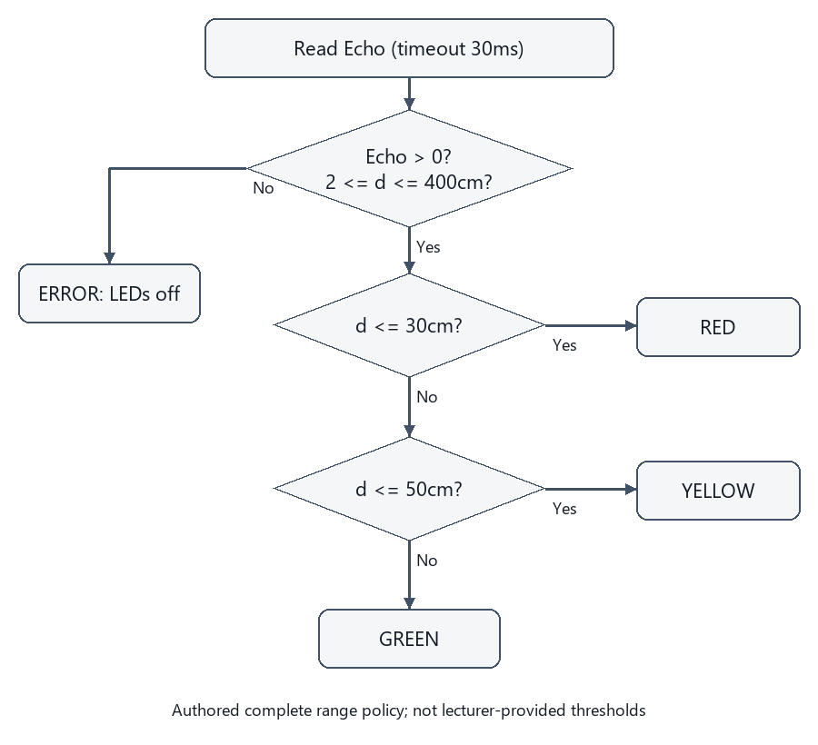

---
{"version":1,"id":"internet-of-things-final-water-level","course":"internet-of-things","category":"summaries","slug":"final-water-level","title":"FINAL 04 — ระบบวัดระดับน้ำด้วย ESP32","language":"th"}
---

## เป้าหมายการเรียนรู้ {#objectives}

- แยก sample,requirement และ authoredthreshold ของระบบน้ำ
- สร้างตาราง partition และทดสอบ 29.9,30,30.1,50,50.1
- เขียน flowchart ที่รักษา measurementinvalid และวนต่ออย่างชัดเจน
- วาด wiringtable ที่แยก VCC,GND,Trigger,Echo และ LEDresistor
- วางแผน test สี่ stateGREEN / YELLOW / RED / ERROR

## ขอบเขต หลักฐาน และความปลอดภัย {#scope}

วิชา 89022567 เลือกศึกษา Week 9–12 โดยยังไม่ยืนยันว่าเป็นขอบเขตสอบ Final ทางการทั้งหมด หลักฐานต้นฉบับ: A09 requirement1–2; W09 slides11,14–19. เลขหน้า PDF หมายถึงหน้าจริงของไฟล์ (physical page); เอกสาร Word อ้างหัวข้องานและหน้าแปลงส่วนตัวตาม [บัญชีแหล่งที่มา](../../../docs/iot-final-source-coverage.md). ไม่เผยแพร่ต้นฉบับหรือข้อมูลส่วนตัวของผู้เรียน

ตัวอย่างและเฉลยต่อไปนี้จัดทำเสริม ไม่ใช่เฉลยทางการ ใช้บอร์ด classic ESP32-WROOM กับ Arduino-ESP32 core 3.3.11 เป็นเป้าหมาย ตัวเลขขา ระดับสัญญาณ (polarity) เกณฑ์ช่วง (threshold) และที่อยู่จอ OLED เป็นสมมติฐานที่ประกาศ ห้ามเหมารวมกับ ESP32 ทุกรุ่น

ใช้เฉพาะ LED หรือโหลดแรงดันต่ำผ่านโมดูล/วงจรขับที่เข้ากันได้ ห้ามขับขดลวดรีเลย์จาก GPIO โดยตรง และห้ามต่อไฟบ้านบน breadboard ตรวจ Echo 5V กับ GPIO 3.3V วงจรแปลงระดับ กราวด์ และตัวต้านทานก่อนจ่ายไฟ การคอมไพล์และการจำลองไม่พิสูจน์ความถูกต้องของวงจรหรือความแม่นยำเซนเซอร์จริง

## อ่าน Requirement โดยไม่สร้างเกณฑ์ปลอม {#requirements}

A09 กำหนด sample60cm→เขียว,40cm→เหลือง,20cm→แดง และให้ส่ง flowchart / คำอธิบาย / wiring / video ไม่ได้บอก threshold สำหรับทุกระยะ บทนี้ใช้ policy เสริม d<=30 แดง,30<d<=50 เหลือง,d>50 เขียวหลัง validation2..400cm เท่านั้น ไม่ใช้แทนคำสั่งผู้สอนที่อาจมีเพิ่มเติม

ข้อควรระวัง: samplepoint ไม่ใช่การประกาศช่วงทั้งหมด

ตัวอย่างการให้เหตุผลที่จัดทำเสริม:

A09 ให้ตัวอย่างเรียงระยะ 20,40,60cm คู่สีตามลำดับคือข้อใด?

แนวคำตอบ: แดง,เหลือง,เขียว — สาม sample เป็นข้อกำหนด source โดยไม่กำหนด range ระหว่างจุด

## ออกแบบ Classification ที่ครบและไม่ทับ {#classification}

ใช้ if / else if / else ให้ validdistance หนึ่งค่าเลือกสีเดียว ค่า 30 อยู่แดง ค่า 50 อยู่เหลือง แยก ERROR เมื่อไม่มี Echo หรือ outofrange W09slide19 มีช่อง 100..200 ที่ไม่เข้าเงื่อนไขในรูปและหน่วยไม่ชัด จึงไม่คัดเป็น universalclassifier

ข้อควรระวัง: ตรวจเงื่อนไขแต่ละสีแยก if อาจทำให้เปิดหลายดวงเมื่อช่วงทับ

ตัวอย่างการให้เหตุผลที่จัดทำเสริม:

ตาม policy เสริมของบท d=30cm valid เลือก state ใด?

แนวคำตอบ: RED — policy เสริมใช้ d<=30 เป็น RED จึง 30 รวมขอบแดง;ค่าถัดไปมากกว่า 30 จึงเข้าช่วงเหลือง

## Flowchart และ Reference Height {#flow}

Start→configure→measure→validate→classify→writeoneLED→report→wait→repeat เมื่อ invalid ให้ปิด LED ระดับทั้งสามและรายงาน ERROR ตาม policy เสริม อย่าให้ 0cm ปลอมเป็น highwater ถ้าต้องการความสูงจริงให้กำหนด Hและใช้ h=H−d พร้อม geometry / หน่วย

ข้อควรระวัง: ระยะถึงน้ำลดลงเมื่อระดับน้ำสูงขึ้น ไม่ได้เพิ่มตามชื่อ high

ตัวอย่างการให้เหตุผลที่จัดทำเสริม:

ใช้ H100cm คงที่และ d60cm ความสูงน้ำ hกี่ cm?

แนวคำตอบ: 40 — h=H−d ตาม datum ที่กำหนด

## วงจร Low-Voltage ตัวอย่าง {#circuit}

ตัวอย่าง classicESP32 ใช้ TRIG32,ECHO33 ผ่าน levelinterface ที่ตรวจแล้ว;LED เขียว 25 เหลือง 26 แดง 27 แต่ละดวงมี 330Ωอนุกรมสู่ GND เลขเหล่านี้เป็น authoredpinassignment ไม่ใช่ยืนยันสายจาก W09slide18 ไฟ 5V ของ HC-SR04classic ไม่ควรเข้าขา GPIO โดยตรง ตรวจ GND / ไฟเลี้ยง / logiccompatibility ก่อนจ่ายไฟ

ข้อควรระวัง: ห้ามคัดภาพวงจรที่ไม่แสดง resistor / levelshift มาเป็นใบรับรองความปลอดภัย

ตัวอย่างการให้เหตุผลที่จัดทำเสริม:

Echo ของ module5V กับ GPIO3.3V ควรเชื่อมอย่างไรเมื่อยังไม่ได้ตรวจ logicoutput?

แนวคำตอบ: ตรวจสเปก/ระดับแล้วใช้levelinterfaceที่เหมาะก่อนต่อ — powerdomain กับ GPIOdomain ต่างกัน อย่าถือว่ารูปวงจรย่อเป็นการรับรอง electrical

## โปรแกรมและ Fail State {#program}

อ่าน pulse โดยมี timeout แล้วคำนวณ cm ตรวจ validity ก่อนเลือกสี ฟังก์ชัน classification บริสุทธิ์สามารถทดสอบด้วยค่าจำลองได้ แต่ไม่ได้พิสูจน์ accuracy ของ hardware ค่า trigger10µs กับ sampling70ms มีคนละหน้าที่ program พิมพ์ state ให้ trace ได้และยังไม่ส่ง network

ข้อควรระวัง: การค้างไฟแดง / เขียวจากค่าครั้งก่อนหลัง sensor เสียต้องเป็นนโยบายที่ประกาศไม่ใช่บั๊กซ่อน

ตัวอย่างการให้เหตุผลที่จัดทำเสริม:

policyERROR เมื่อ Echo หายควรทำอะไรกับ output เพื่อไม่แอบรายงานสถานะเก่า?

แนวคำตอบ: ปิดLEDระดับทั้งสามและรายงานERRORตามนโยบายบท — เป็น authoredfailstate ไม่อ้างว่า sensor ยังวัดสำเร็จ

## Flowchart และตารางต่อสายตัวอย่าง {#flowchart}

ตารางต่อไปนี้อธิบายส่วนตัดสินใจเดียวกับภาพ อ่านได้บนจอเล็กและใช้เป็นเกณฑ์ทดสอบ: ตรวจ invalid ก่อนทุกช่วง

| เงื่อนไข | สถานะ |
|---|---|
| ไม่มี Echo หรือระยะนอก2..400cm | ERROR ปิดLEDระดับทั้งสาม |
| valid และd<=30cm | RED |
| valid และ30<d<=50cm | YELLOW |
| valid และ50<d<=400cm | GREEN |



| บทบาท | GPIO/การต่อสมมติ | ข้อกำหนด |
|---|---|---|
| TRIG |32→moduletrigger|ตรวจVIHของmodule|
| ECHO |module→levelinterface→33|ไม่ป้อน5Vตรง|
| LEDเขียว/เหลือง/แดง |25/26/27|resistor330Ωแยกแต่ละดวงไปGND|
| VCC/GND |ตามmoduleและcommonreference|ไม่ใช้GPIOจ่ายกำลังcoil|

## โปรแกรม C++ ที่เขียนเสริม {#program-code}

สเก็ตช์ C++ นี้เขียนเสริมสำหรับเป้าหมายที่ระบุ คอมเมนต์อธิบาย API และสมมติฐาน มีการตรวจคอมไพล์จริง แต่ไม่มีการอัปโหลดหรือวัดผลฮาร์ดแวร์ ห้ามนำไปต่ออุปกรณ์ที่ยังไม่ทราบสเปกโดยตรง

```cpp
#include <Arduino.h>
constexpr uint8_t TRIG=32, ECHO=33, GREEN=25, YELLOW=26, RED=27;
// ขาทั้งหมดเป็นตัวอย่าง; Echoต้องผ่านlevelinterface, LEDแต่ละดวงผ่าน330โอห์ม
int classify(float cm, bool valid) {
  if (!valid) return -1; // ERROR ไม่ใช่0cm
  if (cm <= 30.0f) return 2;
  if (cm <= 50.0f) return 1;
  return 0;
}
void setup() {
  Serial.begin(115200);
  pinMode(TRIG,OUTPUT); pinMode(ECHO,INPUT);
  pinMode(GREEN,OUTPUT); pinMode(YELLOW,OUTPUT); pinMode(RED,OUTPUT);
  digitalWrite(GREEN,LOW); digitalWrite(YELLOW,LOW); digitalWrite(RED,LOW);
}
void loop() {
  digitalWrite(TRIG,LOW); delayMicroseconds(2);
  digitalWrite(TRIG,HIGH); delayMicroseconds(10); digitalWrite(TRIG,LOW);
  const unsigned long us=pulseIn(ECHO,HIGH,30000UL);
  const float cm=us*0.0343f/2.0f;
  const bool valid=us>0 && cm>=2.0f && cm<=400.0f;
  const int state=classify(cm,valid);
  digitalWrite(GREEN,state==0?HIGH:LOW);
  digitalWrite(YELLOW,state==1?HIGH:LOW);
  digitalWrite(RED,state==2?HIGH:LOW);
  Serial.println(state<0?"ERROR":state==2?"RED":state==1?"YELLOW":"GREEN");
  delay(70);
}
```

## อ่าน Expected Behavior และกรณีขอบ {#expected}

ข้อมูลทดสอบ60/40/20cm ให้ GREEN/YELLOW/RED ตามลำดับ;ขอบ30=RED,50=YELLOW;invalid ปิดLEDทั้งสามและพิมพ์ ERROR ไม่ใช้สีเดิมต่อโดยเงียบ

- samplepoint ไม่ใช่การประกาศช่วงทั้งหมด
- ตรวจเงื่อนไขแต่ละสีแยก if อาจทำให้เปิดหลายดวงเมื่อช่วงทับ
- ระยะถึงน้ำลดลงเมื่อระดับน้ำสูงขึ้น ไม่ได้เพิ่มตามชื่อ high
- ห้ามคัดภาพวงจรที่ไม่แสดง resistor / levelshift มาเป็นใบรับรองความปลอดภัย
- การค้างไฟแดง / เขียวจากค่าครั้งก่อนหลัง sensor เสียต้องเป็นนโยบายที่ประกาศไม่ใช่บั๊กซ่อน

## ฝึกอธิบายพร้อมแนวประเมิน {#practice}

โจทย์เหล่านี้จัดทำเสริมเพื่อทบทวน ไม่ใช่ข้อสอบมหาวิทยาลัยที่ยืนยันแล้ว โหมดฝึกและคลังข้อสอบด้านล่างแสดงคำอธิบายหลังส่งคำตอบตามระบบเดิม เมื่อปิด JavaScript ยังอ่านเฉลยในส่วนพับได้ คำอธิบายและโค้ดอิสระใช้เกณฑ์ประเมินตนเอง (rubric) ไม่ตรวจคะแนนอัตโนมัติ

### 1. อ่าน Requirement โดยไม่สร้างเกณฑ์ปลอม {#review-requirements}

แยก sample,requirement และ authoredthreshold ของระบบน้ำ

แนวคำตอบ: รักษาสาม sample และติดป้ายช่วง 30 / 50 ว่าเขียนเสริม ทดสอบขอบและ invalid

### 2. ออกแบบ Classification ที่ครบและไม่ทับ {#review-classification}

สร้างตาราง partition และทดสอบ 29.9,30,30.1,50,50.1

แนวคำตอบ: กำหนด inclusivity ครบ ไม่มี gap และ error แยกจาก physicallevel

### 3. Flowchart และ Reference Height {#review-flow}

เขียน flowchart ที่รักษา measurementinvalid และวนต่ออย่างชัดเจน

แนวคำตอบ: แยก validbranch กับ errorbranch และระบุ output ทุกครั้งไม่ค้างสีเดิมโดยไม่ตั้งใจ

### 4. วงจร Low-Voltage ตัวอย่าง {#review-circuit}

วาด wiringtable ที่แยก VCC,GND,Trigger,Echo และ LEDresistor

แนวคำตอบ: กำหนดรุ่น / แรงดัน / pins;แสดงการลดระดับ Echo และไม่ต่อไฟบ้าน

### 5. โปรแกรมและ Fail State {#review-program}

วางแผน test สี่ stateGREEN / YELLOW / RED / ERROR

แนวคำตอบ: ทดสอบสาม sourcepoints ขอบ 30 / 50,outofrange และ duration0 โดยระบุ expectedLED ครบ

## สรุปก่อนสอบ {#summary}

- อ่าน Requirement โดยไม่สร้างเกณฑ์ปลอม: samplepoint ไม่ใช่การประกาศช่วงทั้งหมด
- ออกแบบ Classification ที่ครบและไม่ทับ: ตรวจเงื่อนไขแต่ละสีแยก if อาจทำให้เปิดหลายดวงเมื่อช่วงทับ
- Flowchart และ Reference Height: ระยะถึงน้ำลดลงเมื่อระดับน้ำสูงขึ้น ไม่ได้เพิ่มตามชื่อ high
- วงจร Low-Voltage ตัวอย่าง: ห้ามคัดภาพวงจรที่ไม่แสดง resistor / levelshift มาเป็นใบรับรองความปลอดภัย
- โปรแกรมและ Fail State: การค้างไฟแดง / เขียวจากค่าครั้งก่อนหลัง sensor เสียต้องเป็นนโยบายที่ประกาศไม่ใช่บั๊กซ่อน

## อ้างอิงและข้อจำกัด {#sources}

- ต้นฉบับส่วนตัว: A09 requirement1–2; W09 slides11,14–19; ไม่แนบสำเนา ไม่อ้างว่ามีsourceอื่นที่ยังไม่เปิด
- [Source coverage](../../../docs/iot-final-source-coverage.md), [Academic verification](../../../docs/iot-final-academic-verification.md), [Exam verification](../../../docs/iot-final-exam-verification.md), [QA](../../../docs/iot-final-qa.md)
- [ESP32 datasheet](https://www.espressif.com/sites/default/files/documentation/esp32_datasheet_en.pdf) — ตรวจ2026-10-29;ใช้target/core3.3.11สำหรับcompileและอย่าสมมติว่าlatestdocsตรงกับทุกcoreเก่า
- [GPIO API](https://docs.espressif.com/projects/arduino-esp32/en/latest/api/gpio.html) — ตรวจ2026-10-29;ใช้target/core3.3.11สำหรับcompileและอย่าสมมติว่าlatestdocsตรงกับทุกcoreเก่า
- [HC-SR04 reference](https://cdn.sparkfun.com/datasheets/Sensors/Proximity/HCSR04.pdf) — ตรวจ2026-10-29;ใช้target/core3.3.11สำหรับcompileและอย่าสมมติว่าlatestdocsตรงกับทุกcoreเก่า

ข้อจำกัดที่ยังไม่ยืนยัน: แรงดัน ระดับกระตุ้น ที่อยู่ และการต่อสายของโมดูลจริง ความแม่นยำ สภาพแวดล้อม และวิดีโอทดลอง การตรวจเว็บ/คอมไพล์/จำลองไม่เท่ากับผ่านการทดสอบฮาร์ดแวร์ และไม่ยืนยันขอบเขตข้อสอบจริง
