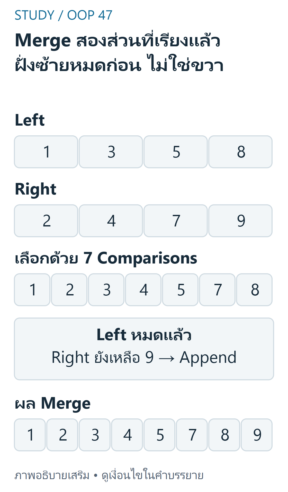
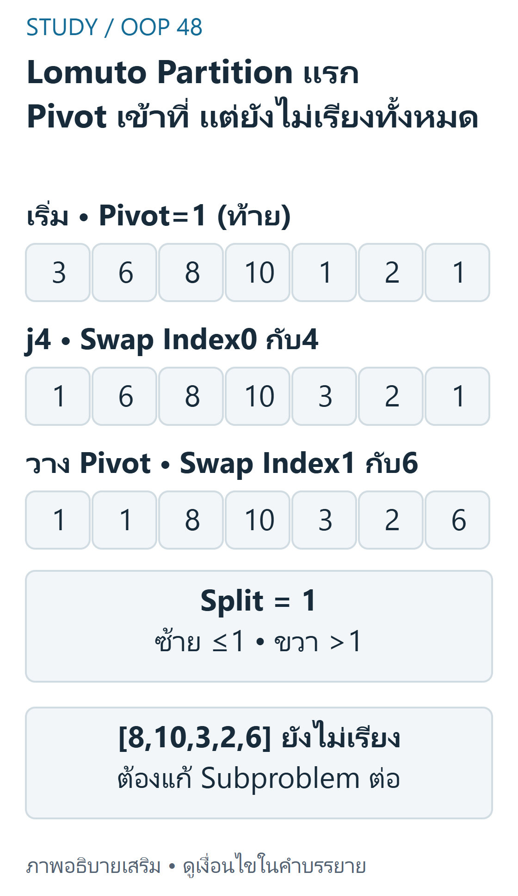

> FINAL: Week14 physical pp.3–35 อธิบาย Divide and Conquer,Merge/Quick และ Python Timsort โดยคำนวณ trace ใหม่จาก source arrays ไม่คัดลอก caption/benchmark ผิดบริบท โค้ดและแบบฝึกผู้เขียนตรวจอิสระ

## เป้าหมายการเรียนรู้ {#objectives}
- อ่าน recursiontree/recurrence พร้อม base case และต้นทุนต่อระดับ
- ทำ stablemerge และ Lomutopartition โดยรักษา invariant
- แยก average/balanced/worst case และ memory ของ arraycopy/recursion/trace
- ใช้ Python stableadaptive sorting โดยไม่อ้าง toyimplementation เป็น Timsort จริง

## Divide and Conquer และ Recursion Tree {#concepts}
Week14 pp.3–11:divide แบ่งปัญหา,conquer แก้ย่อย,combine รวม สำหรับมาตรฐาน mergesort แบ่งครึ่งโดย index ไม่ขึ้นกับค่าข้อมูล T(n)=2T(n/2)+Θ(n) เมื่อ n เป็นกำลังสอง มี log2n ระดับที่งานรวมระดับละΘ(n) จึงΘ(nlogn) ถ้า n ไม่เป็นกำลังสองใช้ floor/ceil และ height ใกล้ ceil(log2n) ไม่ถือว่า recursion ทุกแบบต้องสมดุลหรือมีงานต่อระดับเท่ากันโดยไม่พิสูจน์

Basecase0/1 ต้องคืนได้ทันที ไม่เรียกแบ่ง array ว่างไปเรื่อยๆ การเลือก pivot ใน quick ต่างจากแบ่งครึ่งตาม index จึงอาจไม่ให้สองปัญหาขนาดใกล้กัน

## Python สำหรับตรวจ Trace {#python}
Merge ใช้≤ให้ฝั่งซ้ายก่อนเมื่อ key เท่ากัน;Quick แบบ Lomuto ใช้ pivot ท้ายและ≤ตาม source มี optionmedian-of-three คัด 3 ตำแหน่งเท่านั้น ไม่ใช้ builtin เรียง array ทั้งชุดแทน algorithm ทุก functioncopyinput จึงไม่อ้าง O(1)space ของ function ทั้งหมด

```python
def merge(left,right,key=lambda x:x):
    out,i,j = [],0,0
    while i<len(left) and j<len(right):
        if key(left[i]) <= key(right[j]):
            out.append(left[i]);i += 1
        else:
            out.append(right[j]);j += 1
    out.extend(left[i:]);out.extend(right[j:])
    return out


def merge_sort(data,key=lambda x:x,trace=False):
    events=[]
    def sort(a):
        if len(a)<=1:return a
        mid=len(a)//2
        left,right=sort(a[:mid]),sort(a[mid:])
        result=merge(left,right,key)
        if trace:events.append((left.copy(),right.copy(),result.copy()))
        return result
    return sort(list(data)),events


def quick_sort(data,key=lambda x:x,median=False,trace=False):
    a=list(data);events=[];stats={'comparisons':0,'swaps':0}
    def swap(i,j):
        if i!=j:
            a[i],a[j]=a[j],a[i];stats['swaps']+=1
    def sort(lo,hi):
        if lo>=hi:return
        if median:
            mid=(lo+hi)//2
            chosen=sorted([lo,mid,hi],key=lambda i:key(a[i]))[1]
            swap(chosen,hi)  # median selection cost not included in partition comparisons
        pivot=a[hi];i=lo-1
        for j in range(lo,hi):
            stats['comparisons']+=1
            if key(a[j])<=key(pivot):
                i+=1;swap(i,j)
        split=i+1;swap(split,hi)
        if trace:events.append((lo,hi,split,pivot,a.copy()))
        sort(lo,split-1);sort(split+1,hi)
    sort(0,len(a)-1)
    return a,stats,events


print(merge([1,3,5,8],[2,4,7,9]))  # [1,2,3,4,5,7,8,9]
print(merge_sort([8,3,5,1,9,2,7,4])[0])
print(quick_sort([3,6,8,10,1,2,1],trace=True))
records=[('A',2),('B',1),('C',2)]
print(sorted(records,key=lambda r:r[1]))  # [('B',1),('A',2),('C',2)]
copy=records.copy()
print(copy.sort(key=lambda r:r[1]),copy) # None, sorted list
```

## Merge ทุกระดับ {#merge}
Week14 pp.13–18,31 ใช้ input[8,3,5,1,9,2,7,4]:แบ่งซ้าย[8,3,5,1]และขวา[9,2,7,4] แบ่งจน singleton แล้วรวม



ที่มา: [ภาพเขียนเสริม ตรวจตามบทเรียนและเอกสารเทคนิค](https://docs.python.org/3.12/howto/sorting.html)

อ่านภาพ: Finalmergeของบทใช้left[1,3,5,8]และright[2,4,7,9] เลือก1,2,3,4,5,7,8ด้วย7comparisonsแล้วleftหมดจึงappend9จากright คงcaptionที่บทแก้ไว้ไม่คัดsourcecaptionที่บอกrightหมดก่อน ใช้≤เลือกซ้ายก่อนเมื่อkeyเท่ากัน

| left ที่เรียงแล้ว | right ที่เรียงแล้ว | merge result |
|---|---|---|
| [8] | [3] | [3, 8] |
| [5] | [1] | [1, 5] |
| [3, 8] | [1, 5] | [1, 3, 5, 8] |
| [9] | [2] | [2, 9] |
| [7] | [4] | [4, 7] |
| [2, 9] | [4, 7] | [2, 4, 7, 9] |
| [1, 3, 5, 8] | [2, 4, 7, 9] | [1, 2, 3, 4, 5, 7, 8, 9] |

สำหรับ finalmerge left[1,3,5,8],right[2,4,7,9] เลือก 1,2,3,4,5,7,8 จาก comparisons ตามลำดับ แล้ว left หมดจึง append9 ที่ right ยังเหลือ รวม[1,2,3,4,5,7,8,9] **คำบรรยาย sourcep.14–15 ที่ว่า right หมดก่อน/เทียบ 8 กับ 7 แล้วหมดไม่ตรงกับ right ที่ยังมี 9** บทนี้ใช้ state จริง ไม่เปลี่ยนข้อมูลเพื่อให้ตรง caption

Invariant:ผลลัพธ์ที่สร้างเรียงแล้วและยังไม่ทำ element หาย;ส่วน left/right ที่เหลือเรียงภายใน เมื่อหมดฝั่งหนึ่งจึง append อีกฝั่งได้โดยไม่เปรียบเทียบซ้ำ การเทียบ≤ทำให้ซ้ายก่อนขวาเมื่อ tie จึง stable ถ้าสองส่วนย่อย stable ด้วย

## Quick Sort และ Lomuto ทีละขั้น {#quick}
Week14 pp.20–22:array[3,6,8,10,1,2,1],lo0,hi6,pivot1,i เริ่ม−1



ที่มา: [ภาพเขียนเสริม ตรวจตามบทเรียนและเอกสารเทคนิค](https://docs.python.org/3.12/howto/sorting.html)

อ่านภาพ: Input[3,6,8,10,1,2,1]เลือกpivotท้าย1และ≤ จนj4สลับ1ไปindex0 จากนั้นวางpivotที่split1 ได้[1,1,8,10,3,2,6] ซ้าย≤1และขวา>1 แต่ขวายังต้องrecursion ไม่เรียกpartitionเดียวว่าfullsortหรือstable

| ขั้น | การตัดสิน | สถานะสำคัญ |
|---|---|---|
|j0..3|3,6,8,10>1|i ยัง−1 ไม่ swap|
|j4|1≤1|i0,swap0กับ4→[1,6,8,10,3,2,1]|
|j5|2>1|i ยัง0|
|วาง pivot|swap1กับ6|[1,1,8,10,3,2,6],split1|

ระหว่าง loop ส่วน lo..i≤pivot และส่วน i+1..j−1>pivot หลังจบวาง pivot ที่ split ทำให้ตำแหน่งมันถูกต้อง แต่ทั้ง array ยังไม่เรียง ต้อง recursions องช่วงโดยไม่รวม pivot ซ้ำ Trace ทุก partition ของ input นี้:

| lo..hi | split | pivot | array หลัง partition |
|---|---:|---:|---|
| 0..6 | 1 | 1 | [1, 1, 8, 10, 3, 2, 6] |
| 2..6 | 4 | 6 | [1, 1, 3, 2, 6, 10, 8] |
| 2..3 | 2 | 2 | [1, 1, 2, 3, 6, 10, 8] |
| 5..6 | 5 | 8 | [1, 1, 2, 3, 6, 8, 10] |

Partition เดียวไม่ใช่ full sort;การ swap ไกลทำให้ Quick ไม่ stable โดยทั่วไป เช่น[(2,A),(2,B),(1,C)]ได้ C,B,A หลัง pivot1 และ tie ไม่กลับเป็น A,B อย่างรับประกัน

## Pivot, Stability และ Space {#tradeoffs}
pp.23–27:last pivot บน sorted/reverse/ค่าเท่ากันมากอาจแบ่ง n−1 กับ 0 ซ้ำ ทำ comparisonsn(n−1)/2 และ call stackO(n)

Median-of-three หรือ randompivot ช่วยหลายกรณี แต่ไม่รับรองทุก input เป็น O(nlogn) หรือป้องกัน worst case ของ Lomutoduplicates ได้ Randompivotexpectedbound ต้องบอกสมมติฐาน randomness ไม่ใช้ benchmark หนึ่งชุดเป็นข้อพิสูจน์

| Algorithm/version | เวลา | พื้นที่ auxiliary/stack | Stability |
|---|---|---|---|
|StandardMerge ด้านบน|Θ(nlogn)เมื่อ n โต|O(n)peak รวม slices/merge,stackO(logn)|stable ใช้≤|
|Quickbalanced/expected ที่มี assumptions|O(nlogn)|corearrayinplace+stackO(logn);wrappercopyO(n)|ไม่ stable|
|Quickworst|O(n²)|stackO(n)และ wrappercopyO(n)|ไม่ stable|

trace=True เก็บ copies ของ subproblems หรือ array หลายครั้งจึงใช้พื้นที่มากกว่าตาราง core เช่น Quickworst อาจเก็บ O(n²) ไม่มีการแอบเพิ่ม tracingcost แล้วอ้าง samebenchmark Sourcebenchmarkn800 ที่รายงาน 37.4x เป็นผลรายงานของ run นั้น ไม่ใช่ผลวัดเครื่องผู้เรียนหรือคำรับรองในบทนี้ และ recursionlimit อาจทำให้ input ใหญ่ล้ม

## Timsort และ Python Sorting {#timsort}
Week14p.29 อธิบาย stable adaptive hybrid ที่ใช้ runs/insertion และ merge เหมาะข้อมูลที่มีช่วงเรียงอยู่แล้ว แต่ไม่ใช่แบ่งทุก array เป็น run32/64 คงที่อย่างเดียว:แนวคิด naturalruns และการปรับ run/mergepolicy เป็น implementationdetails ที่เปลี่ยนตาม version ไม่เขียน toyhybrid แล้วอ้างเป็น Timsort ของ Python จริง

สิ่งที่ใช้เป็น interface ได้จากเอกสาร Python:sorted คืน list ใหม่,list.sort แก้ list เดิมและคืน None;ทั้งคู่ stable และใช้ key ได้ ข้อมูล recordsA2,B1,C2 ได้ B1,A2,C2 รักษา A ก่อน C แม้ใช้ reverse ก็ยังรักษา relativeorder ของ ties ไม่จำเป็นต้องเขียน Quick ใหม่ใน production เพียงเพราะ coreinplace

## ข้อผิดพลาดที่พบบ่อย {#mistakes}
ไม่มี base case;เลือกฝั่งขวาก่อนเมื่อ tie แล้วอ้าง stable;รวม pivot ซ้ำจน recursion ไม่เล็กลง;เข้าใจ partition ว่าเรียงหมด;อ้าง QuickspaceO(logn) ทุกกรณี;ลืม slice/copy;พิมพ์ data.sort แล้วคิดว่า None คือ array หาย;จำ timing จากสไลด์เป็นค่าคงที่

## แบบฝึกพร้อมเฉลย (ผู้เขียนจัดทำและตรวจอิสระ) {#practice}

### ข้อ1 Finalmerge source

**เฉลย:** left[1,3,5,8]right[2,4,7,9]เปรียบ7ครั้งเพื่อเลือก1,2,3,4,5,7,8 แล้ว left หมด append9จาก right Captionright หมดก่อนจึงไม่ถูกตามข้อมูลที่แสดง

### ข้อ2 Partition แรก

**เฉลย:** [3,6,8,10,1,2,1]pivot ท้าย1ได้[1,1,8,10,3,2,6],split1 ส่วนซ้าย≤1 ขวา>1 แต่ยังต้องเรียงขวา ไม่สรุป full sort จากขั้นนี้

### ข้อ3 Recursion tree

**เฉลย:** n8แบ่งครึ่งมี3ระดับแบ่งจน singleton งาน combine รวมระดับละ O(8);มาตรฐาน Merge เป็นΘ(nlogn) ไม่ใช่ T(n)=T(n−1)+n ของ Quickdegenerate

### ข้อ4 Worstcase และ duplicates

**เฉลย:** Quicklast pivot บน[1,2,3,4,5]เปรียบ4+3+2+1=10;ข้อมูลเท่ากันหมดเมื่อใช้≤ก็อาจแตก n−1/0 แม้ median เลือกค่ากลางเท่ากัน จึงไม่รับรอง worstcase ดีขึ้น

### ข้อ5 Stable และ Pythoninterface

**เฉลย:** Merge≤และ sortedkey รักษา A ก่อน C เมื่อ key2เท่ากัน;Quick/Selection ไม่รับรอง list.sort คืน None แต่ list ถูกแก้ ส่วน sorted ไม่แก้ input

### ข้อ6 Memory และ benchmark

**เฉลย:** Merge เวอร์ชัน copy/slices ใช้ O(n)peak ไม่ใช่ O(1);Quickrecursiveworst ใช้ stackO(n) ส่วน trace อาจเพิ่มมากกว่า core Source37.4x เป็น run รายงาน ไม่ใช่คำตอบ benchmark ที่ยืนยันได้ทุกเครื่อง

## สรุปทบทวน {#summary}
Merge แบ่งตาม index แล้วรวมด้วย tiepolicy;Quick แบ่งตาม pivot แล้ว recursions ่วนที่เล็กลง;ตรวจทั้ง shape ของ tree และพื้นที่ stack/copies;ใช้ Python stableadaptive sorter เมื่อเหมาะกับงาน อย่าสับสน caption/benchmark กับข้อพิสูจน์

## แหล่งอ้างอิงและขอบเขต {#sources}
- [Week14 physical pp.3–35](../slides/Week14.pdf#page=3) — divideconquer/recursion,merge,quick/pivots,Timsort/code/benchmark
- [แผนผังแหล่งสอน](../../../docs/oop-curriculum-map.md). คำอธิบาย/โค้ดที่ปรับให้รันเดี่ยวและเฉลยในบทเป็นงานผู้เขียน ไม่ใช่เฉลยข้อสอบทางการ ไม่มี prerequisite gating; เลือกบทจากแคตตาล็อกได้โดยตรง

- [Python Sorting HOWTO](https://docs.python.org/3/howto/sorting.html) — เอกสารทางการเสริมเรื่อง stable/key/list.sort และ sorted ไม่ใช่การอ้างว่า lecture แจก implementationdetails ครบ
