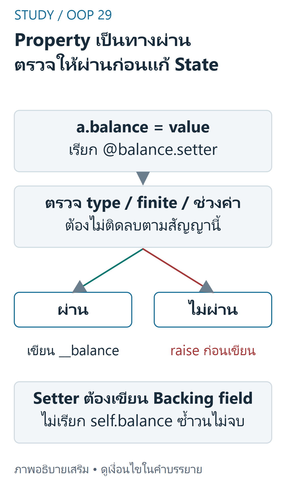
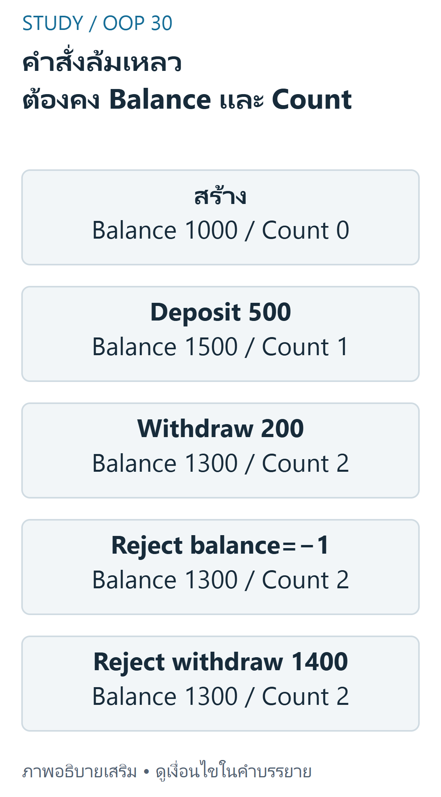

---
{"version":1,"id":"oop-python-encapsulation-properties","course":"oop-python","category":"summaries","slug":"encapsulation-properties","title":"Encapsulation และ Properties","language":"th"}
---

> Week2: อธิบายการควบคุม interface ของ BankAccount และตัวอย่าง labCar/Student/Product โดยไม่คัดลอกไฟล์ส่งงาน โค้ด/เฉลยปรับเพื่อให้ทดสอบอิสระและระบุนโยบายเพิ่มจาก source

## เป้าหมายการเรียนรู้ {#objectives}
- ออกแบบ public interface และ invariant ไม่ใช้คำว่า private เป็นหลักประกันความปลอดภัย
- เขียน property/getter/setter/read-only และใช้ validation ตั้งแต่ __init__
- แยก TypeError,ValueError,AttributeError และการเปลี่ยน state ที่สำเร็จ

## Access และ Name Mangling {#concepts}
Week2 pp.3–7: public `balance` เข้าถึงตรง; `_balance` เป็นสัญญาณ non-public ตาม convention; `__balance` ใน Account ถูก mangle เป็น `_Account__balance` เพื่อลดชื่อชนกับ subclass

ไม่ใช่ encryption/accesscontrol ภายนอกยังเข้าถึงชื่อที่ mangle ได้ จึงไม่ใช้เก็บ secrets โดยหวังว่าคนอ่านไม่ได้

## Property เป็นช่องทางของ Invariant {#properties}
pp.9–19: `@property` ทำ method ให้เรียกอ่านด้วย syntax attribute; `@balance.setter` ต้องใช้ชื่อ property ที่ประกาศแล้ว เมื่อเขียน `a.balance=500` Python ส่ง 500 ให้ setter ไม่ต้องเรียก `a.balance()` หากไม่มี setter การ assign ชื่อ property นั้นจะ AttributeError แต่ object ไม่ได้ deep-immutable และ backing attribute ยังเปลี่ยนได้จากโค้ดที่ฝ่าฝืน interface



ที่มา: [ภาพเขียนเสริม ตรวจตามบทเรียนและเอกสารเทคนิค](https://docs.python.org/3.12/tutorial/classes.html)

อ่านภาพ: การassign a.balance=valueเรียกsetterซึ่งตรวจชนิดและช่วงค่าก่อนเก็บ__balance ถ้าไม่ผ่านให้raiseแล้วbalanceเดิมไม่เปลี่ยน ตัวอย่างผู้เขียนปฏิเสธbool,NaN,infinityอย่างเปิดเผย ไม่อ้างว่าunderscoreหรือname manglingเป็นระบบsecurity

สัญญาบัญชี pp.21–33: account_number/owner/transaction_count อ่านอย่างเดียว; balance ต้องไม่ติดลบ;constructor ใช้ setter;deposit/withdraw ตรวจ amount ก่อนแก้ยอด และเพิ่ม count เฉพาะธุรกรรมสำเร็จ การตั้ง balance ผ่าน setter ตรงๆไม่ได้เป็น deposit และไม่เพิ่ม count โดยนิยามนี้ ถ้างานจริงต้องห้ามเปลี่ยน balance ตรงๆ ให้ออกแบบ interface ต่างออกไปอย่างชัดเจน

## Python ที่รวม Validation {#python}
Source ใช้ isinstance(int,float) ซึ่งรับ bool ด้วย โค้ดผู้เขียนนี้ตั้งใจเข้มขึ้น:ปฏิเสธ bool และ NaN/infinity ด้วย typeexact/isfinite;ใช้ float เพื่อสาธิต ไม่อ้างว่าคือข้อกำหนดทางการเงินของแหล่ง

```python
from math import isfinite


def number(value, positive=False):
    # Authored stricter policy: reject bool and nonfinite values.
    if type(value) not in (int, float):
        raise TypeError("number required")
    if not isfinite(value) or value < 0 or (positive and value == 0):
        raise ValueError("invalid numeric range")
    return value


class Account:
    def __init__(self, account_number, owner, balance=0):
        self.__account_number = account_number
        self.__owner = owner
        self.balance = balance
        self.__transaction_count = 0

    @property
    def account_number(self): return self.__account_number
    @property
    def owner(self): return self.__owner
    @property
    def transaction_count(self): return self.__transaction_count
    @property
    def balance(self): return self.__balance
    @balance.setter
    def balance(self, value): self.__balance = number(value)

    def deposit(self, amount):
        self.balance += number(amount, positive=True)
        self.__transaction_count += 1

    def withdraw(self, amount):
        amount = number(amount, positive=True)
        if amount > self.balance: raise ValueError("insufficient funds")
        self.balance -= amount
        self.__transaction_count += 1


a = Account("demo-1", "Alice", 1000)
a.deposit(500)
a.withdraw(200)
print(a.balance, a.transaction_count)  # 1300 2
try: a.balance = -1
except ValueError: print("rejected", a.balance)  # rejected 1300
```

## Trace และ Exceptions {#trace}
| การทำงาน | ยอด | count | ผล |
|---|---:|---:|---|
| constructor1000 | 1000 | 0 | ผ่าน setter |
| deposit500 | 1500 | 1 | จำนวนบวก |
| withdraw200 | 1300 | 2 | ไม่เกินยอด |
| balance=−1 | 1300 | 2 | ValueError ก่อนเขียน |
| withdraw1400 | 1300 | 2 | ยอดไม่พอ จึงไม่เพิ่ม count |
| owner="B" | 1300 | 2 | AttributeError ไม่มี setter |



ที่มา: [ภาพเขียนเสริม ตรวจตามบทเรียนและเอกสารเทคนิค](https://docs.python.org/3.12/tutorial/classes.html)

อ่านภาพ: Accountเริ่ม1000/count0 ฝาก500ได้1500/count1 ถอน200ได้1300/count2 แล้วbalance=−1หรือwithdraw1400ถูกปฏิเสธก่อนแก้state จึงยัง1300/count2 การตั้งbalanceผ่านsetterโดยตรงที่ผ่านกฎไม่ใช่depositและไม่เพิ่มcountตามนิยามบท

TypeError ใช้เมื่อชนิดไม่เข้าเงื่อนไข;ValueError เมื่อชนิดถูกแต่ช่วงผิด;AttributeError เกี่ยวกับ property/attribute ที่เข้าถึงไม่ได้ อย่าใช้ print+return แทน raise แล้วปล่อยให้ constructor สร้าง object ที่ขาด __balance

## ตัวอย่าง Lab และต้นทุน {#applications}
Lab2-1 กำหนด Car.fuel_level0..100 และ mileage อ่านอย่างเดียว;Lab2-2Student และ Hw2Product มีช่วงค่าต่างกัน จึง reuse แนวคิด validation ไม่เอากฎเงินไปใช้กับทุก domain การอ่าน property ง่ายๆ O(1) แต่ computed property อาจต้องวนข้อมูลจึงไม่ใช่ O(1) เสมอ ภายใน setter ต้องเขียน backing attribute เช่น self.__balance ไม่เขียน self.balance ซ้ำจน RecursionError

## ข้อผิดพลาดที่พบบ่อย {#mistakes}
Setter ก่อน getter/ใช้@property.setter ผิดชื่อ;ข้าม setter ใน __init__;return ค่าแทนการ set;เข้าใจ read-only ว่าไม่เปลี่ยนได้ด้วยวิธีใดเลย;จับ Exception กว้างจนกลบข้อผิดพลาดจริง

## แบบฝึกพร้อมเฉลย (ผู้เขียนจัดทำและตรวจอิสระ) {#practice}

### ข้อ1 ตรวจตั้งแต่สร้าง

**เฉลย:** Account("x","A",−1)เกิด ValueError ผ่าน setter ทันที ไม่ได้สร้างบัญชีติดลบสำเร็จ;การเขียน__balance ตรงจะข้ามกฎนี้

### ข้อ2 ลำดับตรวจ type/range

**เฉลย:** balance="100"และ balance=True เกิด TypeError ตามนโยบายผู้เขียน;balance=−1หรือ float("nan")เกิด ValueError ไม่มีกรณีใดแก้ค่าเดิม

### ข้อ3 นับธุรกรรม

**เฉลย:** จาก100 ฝาก20 ถอน30 ได้90และ count2;ถอน100ล้มเหลวยัง90/count2;ตั้ง balance=200ผ่าน setter ได้แต่ count ยัง2ตามนิยาม

### ข้อ4 Getter กับวงเล็บ

**เฉลย:** a.balance อ่านค่าจาก getter; a.balance()พยายามเรียกตัวเลขจึง TypeError ต่างจาก get_balance()ซึ่งเป็น method ในบทก่อน

### ข้อ5 Read-only และ mangling

**เฉลย:** a.owner="B"ผิดเพราะไม่มี setter;ชื่อ__owner ถูก mangle เป็น_Account__owner แต่การฝืนแก้ชื่อนั้นไม่ใช่การใช้งาน interface ที่รองรับ และพิสูจน์ว่า private ไม่ใช่ security

## สรุปทบทวน {#summary}
กำหนด invariant→รวม validation ใน setter→ใช้ตั้งแต่ init→ปรับ state เฉพาะเมื่อผ่านทุกเงื่อนไข→test ทั้งค่าเดิมหลังข้อผิดพลาดและ count ข้อมูลไม่ปลอดภัยขึ้นเองเพียงเพราะชื่อขึ้นต้น underscore

## แหล่งอ้างอิงและขอบเขต {#sources}
- [Week2 physical pp.3–42](../slides/Week2.pdf#page=3) — access/name mangling,properties,read-only,บัญชีและ common mistakes
- แหล่ง lab เพิ่มเติม (local-only ไม่เผยแพร่ไฟล์งานส่ง): Lab2-1.pdf,Lab2-2.pdf,Hw2.pdf;car.py/student.py/product.py inspected as supplied references
- [แผนผังแหล่งสอน](../../../docs/oop-curriculum-map.md). คำอธิบาย/โค้ดที่ปรับให้รันเดี่ยวและเฉลยในบทเป็นงานผู้เขียน ไม่ใช่เฉลยข้อสอบทางการ ไม่มี prerequisite gating; เลือกบทจากแคตตาล็อกได้โดยตรง
