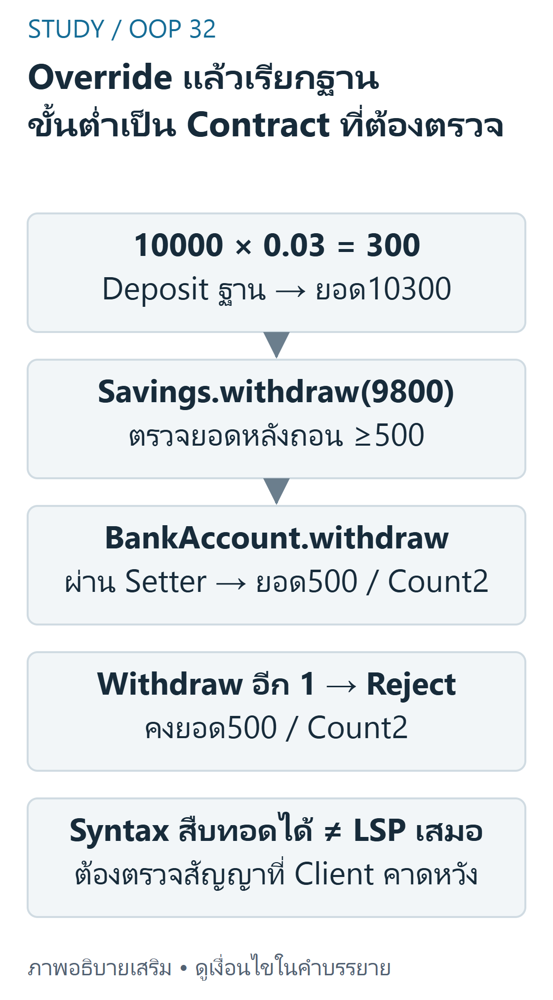

---
{"version":1,"id":"oop-python-inheritance-mro","course":"oop-python","category":"summaries","slug":"inheritance-mro","title":"การสืบทอด Override และ MRO (Inheritance)","language":"th"}
---

> Week3 ยืนยัน is-a/reuse/override/MRO และ SavingsAccount ข้อจำกัด LSP อธิบายเชื่อมกับ Week7 โค้ดปรับให้รันเดี่ยวและเพิ่ม zero-interest policy ที่ระบุชัด ไม่คัดลอก generatedreader หรือโค้ดงานที่ import ไม่ครบ

## เป้าหมายการเรียนรู้ {#objectives}
- เลือก inheritance ด้วย is-a และสัญญาพฤติกรรม ไม่ใช่แค่เห็น attributes เหมือนกัน
- ติดตาม initialization,override,super และ MRO ใน single/multiple inheritance
- คำนวณดอกเบี้ย/ขั้นต่ำพร้อมนับธุรกรรม และแยกข้อจำกัดของตัวอย่างออกจากกฎทั่วไป

## Inheritance และการออกแบบสัญญา {#concepts}
Week3 pp.3–16 แก้ copy-paste ด้วย subclass: `class SavingsAccount(BankAccount)` สืบทอด method/property ที่ค้นพบตาม MRO แต่ instance ยังมี object identity ของมันเอง ไม่ได้คัดลอก instance บัญชีแม่อีกตัวขึ้นมา `isinstance(s,BankAccount)`เป็น True และ `issubclass(SavingsAccount,BankAccount)`เป็น True แต่ชนิดอย่างเดียวไม่พิสูจน์ LSP


 เดินตามลำดับจริง — ลำดับฐาน D(B,C); แต่ละ chain เรียก super()")
ที่มา: [ภาพเขียนเสริม ตรวจตามบทเรียนและเอกสารเทคนิค](https://docs.python.org/3.12/tutorial/classes.html)

อ่านภาพ: DสืบทอดB,Cซึ่งสืบทอดAเหมือนกัน Pythonให้MRO D,B,C,A,object สำหรับhierarchyนี้ super()ภายในBบนinstanceDจึงไปCไม่ใช่Aโดยตรง ลูกศรสืบทอดชี้ฐาน ไม่ใช่ลำดับเรียกmethod; ลำดับMROแสดงแยกด้านล่าง

Override คือนิยามชื่อ method เดิมใน child อาจแทนทั้งหมดหรือขยายด้วย super เช่น source ให้ withdraw ตรวจขั้นต่ำก่อนใช้ logic ฐาน และ apply_interest เรียก deposit เพื่อนับธุรกรรม

ไม่ควรอ้างว่าทุก override ต้องเรียก super เสมอ ขึ้นกับสัญญาของ operation

`super()`คืน proxy ที่ค้นหาลำดับถัดไปใน MRO ไม่ใช่ object พ่ออีกตัว และไม่จำเป็นต้องตรงกับ parent ที่คิดไว้โดยชื่อ ใน diamondD(B,C) ลำดับ D,B,C,A,object ทำให้ super ใน B ไป C การเรียก A.method(self) ตรงอาจข้าม C/ทำ base ซ้ำ ควรใช้ cooperative interfaces ที่รับ arguments เข้ากันได้

## ตัวอย่าง Savings และ Diamond {#python}
จาก sourcephysicalpp.25–30: rate ช่วง 0..0.10;ดอกเบี้ยจาก balance×rate;ถอนแล้วเหลืออย่างน้อย 500 ปรับ type/finite validation ตามบทก่อน และกรณี interest0 ให้ no-op เพราะ source ยอม rate0 แต่ deposit0 ผิดสัญญาบัญชี อย่าเรียก deposit(0) แล้วอ้างว่าเป็นธุรกรรมสำเร็จ

```python
from math import isfinite


def number(value, positive=False):
    # Authored stricter policy: reject bool and nonfinite values.
    if type(value) not in (int, float):
        raise TypeError("number required")
    if not isfinite(value) or value < 0 or (positive and value == 0):
        raise ValueError("invalid numeric range")
    return value


class BankAccount:
    def __init__(self, account_number, owner, balance=0):
        self.__account_number = account_number
        self.__owner = owner
        self.balance = balance
        self.__transaction_count = 0

    @property
    def account_number(self): return self.__account_number
    @property
    def owner(self): return self.__owner
    @property
    def transaction_count(self): return self.__transaction_count
    @property
    def balance(self): return self.__balance
    @balance.setter
    def balance(self, value): self.__balance = number(value)

    def deposit(self, amount):
        self.balance += number(amount, positive=True)
        self.__transaction_count += 1

    def withdraw(self, amount):
        amount = number(amount, positive=True)
        if amount > self.balance: raise ValueError("insufficient funds")
        self.balance -= amount
        self.__transaction_count += 1


class SavingsAccount(BankAccount):
    def __init__(self, account_number, owner, balance, interest_rate):
        super().__init__(account_number, owner, balance)
        self.interest_rate = interest_rate

    @property
    def interest_rate(self): return self.__interest_rate
    @interest_rate.setter
    def interest_rate(self, value):
        value = number(value)
        if value > .10: raise ValueError("rate must be <= .10")
        self.__interest_rate = value

    def apply_interest(self):
        interest = self.balance * self.interest_rate
        if interest: self.deposit(interest)  # authored zero-interest no-op
        return interest

    def withdraw(self, amount):
        amount = number(amount, positive=True)
        if self.balance - amount < 500: raise ValueError("minimum balance 500")
        super().withdraw(amount)


class A:
    def chain(self): return ["A"]
class B(A):
    def chain(self): return ["B"] + super().chain()
class C(A):
    def chain(self): return ["C"] + super().chain()
class D(B, C):
    def chain(self): return ["D"] + super().chain()


s = SavingsAccount("demo-s", "Nana", 10000, .03)
print(s.apply_interest(), s.balance, s.transaction_count)  # 300.0 10300.0 1
s.withdraw(9800)
print(s.balance, s.transaction_count)                      # 500.0 2
print(D().chain())                                        # ['D', 'B', 'C', 'A']
```

## Trace ของ Source-derived Example {#trace}
| ขั้น | balance | rate | count | การ dispatch |
|---|---:|---:|---:|---|
| SavingsAccount(...10000,.03) | 10000 | .03 | 0 | superinit เตรียมข้อมูลฐาน ก่อนตั้ง rate |
| apply_interest | 10300 | .03 | 1 | interest300→deposit จากฐาน→setter |
| withdraw9800 | 500 | .03 | 2 | child ตรวจขั้นต่ำแล้วเรียกฐาน |
| withdraw1 | 500 | .03 | 2 | childraise ก่อนหักเงินจริง |



ที่มา: [ภาพเขียนเสริม ตรวจตามบทเรียนและเอกสารเทคนิค](https://docs.python.org/3.12/tutorial/classes.html)

อ่านภาพ: Savingsเริ่ม10000/rate0.03 apply_interestได้300แล้วdepositผ่านฐานทำให้ยอด10300/count1; withdraw9800ตรวจขั้นต่ำ500ก่อนเรียกwithdrawฐาน เหลือ500/count2 แต่withdraw1ถูกrejectที่child ไม่เรียกฐานและstateไม่เปลี่ยน สัญญาฐานที่ถอนหมดได้จึงไม่ถูกทดแทนทุกกรณี

ค่า 300/10300 มาจากชุด Nana10000,.03 ใน physicalp.30;การถอน 9800 และ diamond เป็นตัวอย่างเสริมสำหรับ boundary/MRO ไม่อ้างว่าเป็นเฉลย lab

## Private, Init Order และ LSP {#contracts}
Parent__balance ถูก mangle ตามชื่อ parent การเขียน self.__balance ใน Savings สร้างคนละชื่อและไม่แก้ balance จริง จึงใช้ property ฐาน `super().__init__`อยู่ก่อนใช้ attributes ที่ฐานเตรียมให้ในตัวอย่างนี้ แต่ไม่ใช่ข้อห้ามสากลว่าไม่มีโค้ดใดนำหน้ามันได้

SourceSavings ตรวจขั้นต่ำ 500 แต่ BankAccount ฐานอนุญาตถอนหมดบัญชี ถ้า client ยึดสัญญาฐานว่า withdraw ยอดที่มีทั้งหมดต้องสำเร็จ การแทนด้วย Savings จะทำให้ล้มเหลว:นี่คือการเพิ่ม precondition ที่ขัด LSP ควรแยก policy หรือกำหนดสัญญาฐานให้รองรับอย่างชัดเจน ไม่สรุปว่าสืบทอดได้ทาง syntax แล้วทดแทนได้ทุกงาน การออกแบบมรดกตาม domain ต้องตรวจพฤติกรรมด้วย

## ต้นทุนและข้อผิดพลาด {#complexity}
ตัวอย่างบัญชีถือ arithmetic คงที่ O(1);การค้น method มีต้นทุนตามขนาด hierarchy ไม่ใช่จำนวนบัญชี ไม่ใช้จำนวนคลาสแทน n ของข้อมูล ข้อผิดพลาดหลักคือลืม init ฐานก่อนใช้ property,ส่ง args ผิด,เขียน private ฐานซ้ำ,ใช้ inheritance กับ has-a เช่น Customer ไม่ใช่ BankAccount และเข้าใจ MRO เป็นค้นพ่อโดยตรงเสมอ

## แบบฝึกพร้อมเฉลย (ผู้เขียนจัดทำและตรวจอิสระ) {#practice}

### ข้อ1 คำนวณดอกเบี้ย

**เฉลย:** 10000×.03=300 ฝากผ่าน deposit แล้ว balance10300,count1 ถ้าปรับ balance ตรงจะข้าม count;rate.11ถูก ValueError เพราะเกิน.10

### ข้อ2 ถอนถึงขอบ

**เฉลย:** จาก10300ถอน9800เหลือ500และ count2 ถอนต่อ1จะ ValueError และสถานะไม่เปลี่ยน เพราะ499<500

### ข้อ3 Zero interest

**เฉลย:** rate0ผ่าน setter;apply_interest คืน0และไม่ฝาก ไม่เพิ่ม count เป็นการแก้ boundary ที่ผู้เขียนประกาศ ต่างจากการเรียก deposit0ที่ผิดสัญญา

### ข้อ4 MRO ของ diamond

**เฉลย:** D.__mro__คือ D,B,C,A,object;D().chain()ได้ D,B,C,A การค้น super ใน B เดินไป C ไม่ใช่เรียก A โดยตรง

### ข้อ5 Is-a เท่ากับ LSP หรือไม่

**เฉลย:** ไม่เท่ากัน Client ฐานที่ถอนทั้งหมดได้จะล้มเหลวกับ Savings ขั้นต่ำ500 แม้ isinstance เป็น True ต้องปรับ contract/policy ไม่แก้โดยซ่อน exception หรืออ้างว่า client ผิดโดยอัตโนมัติ

## สรุปทบทวน {#summary}
ตรวจ is-a และ contract→reuse ฐาน→override เฉพาะจุด→super ตาม MRO→ใช้ property ฐาน→testedgecases และทดแทนชนิดจริง อย่าคัดลอก private fields และอย่าสับสนการสืบทอดกับการคัดลอก object

## แหล่งอ้างอิงและขอบเขต {#sources}
- [Week3 physical pp.3–40](../slides/Week3.pdf#page=3) — inheritance/is-a,super/override,MRO,Savings และ mistakes
- [Week7 physical pp.3–13](../slides/Week7.pdf#page=3) — LSP และ hierarchy ที่ผิดสัญญา
- แหล่ง lab เพิ่มเติม (local-only ไม่เผยแพร่ไฟล์งานส่ง): Lab3-1 Employee/Manager,Lab3-2 Room/SuiteRoom,Hw3 Ticket/VIPTicket;manager.py มี import employe ต่างจากชื่อ employee.py จึงไม่อ้างว่ารันต้นฉบับได้ครบ
- [แผนผังแหล่งสอน](../../../docs/oop-curriculum-map.md). คำอธิบาย/โค้ดที่ปรับให้รันเดี่ยวและเฉลยในบทเป็นงานผู้เขียน ไม่ใช่เฉลยข้อสอบทางการ ไม่มี prerequisite gating; เลือกบทจากแคตตาล็อกได้โดยตรง
