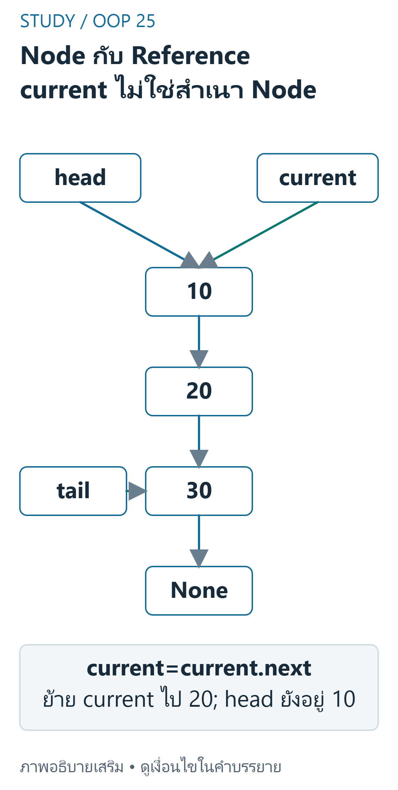
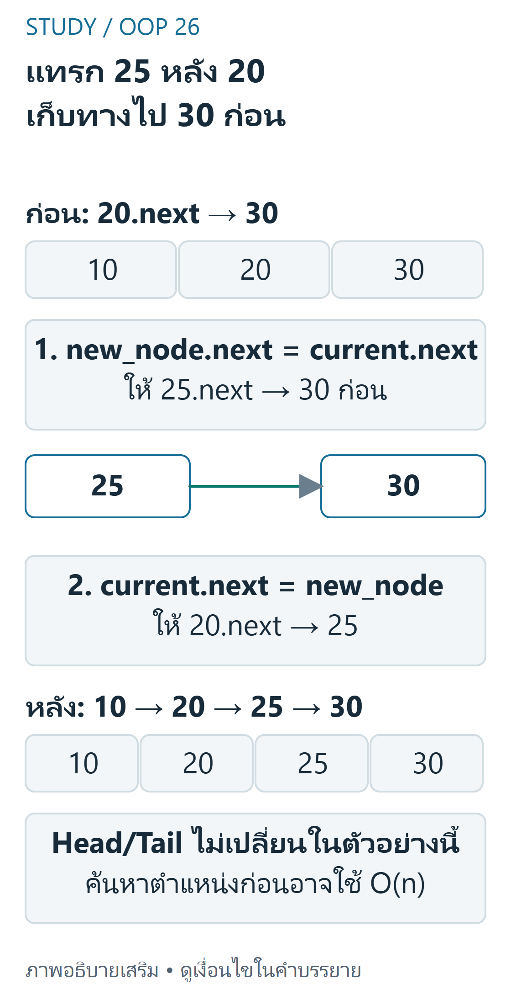

---
{"version":1,"id":"oop-python-linked-list","course":"oop-python","category":"summaries","slug":"linked-list","title":"Linked List — เข้าใจ Node และไล่ Python ทีละขั้น","language":"th"}
---

> บทเรียนนี้เรียบเรียงคำอธิบาย ตัวอย่าง แบบฝึก และภาพจำลองขึ้นเองเพื่อฝึกหัวข้อ Week 10 ในสรุปเดิม รูปแบบ traversal เทียบกับสไลด์ Week10.pdf หน้า 13 ซึ่งใช้ self._head; ตัวอย่างนี้ใช้ตัวแปร head เพื่อให้ทดลองได้โดยไม่ต้องสร้างคลาส List ทั้งหมด ไม่ใช่การถอดข้อความจากสไลด์

## เป้าหมายการเรียนรู้ (Learning Objectives) {#objectives}
- อธิบาย Node, data, next, head และ tail ได้
- ไล่ Singly Linked List ด้วย Python โดยไม่ทำให้ head เปลี่ยน
- แยกการเปลี่ยน reference ของตัวแปรออกจากการเปลี่ยน link ของ Node
- อธิบายการแทรกและ Big-O พร้อมสมมติฐานที่จำเป็น

## แนวคิดสำคัญ (Key Concepts) {#concepts}
| คำศัพท์ | ความหมายในบทเรียนนี้ |
|---|---|
| Node | object หนึ่งตัวที่เก็บ data และ reference ไป Node ถัดไป |
| data | ข้อมูลใน Node เช่น 10 |
| next | อ้างอิง Node ถัดไป หรือ None เมื่อสิ้นสุด |
| head | reference ไป Node แรก; เป็น None เมื่อ list ว่าง |
| tail | reference ไป Node สุดท้าย ถ้า implementation เก็บไว้ |
| Singly Linked List | เชื่อมไปข้างหน้าด้วย next; ไม่มี prev ให้เดินย้อนกลับ |

## อธิบายโครงสร้างและ Reference {#explanation}
Node แต่ละตัวไม่จำเป็นต้องอยู่ติดกันในหน่วยความจำ



ที่มา: [ภาพเขียนเสริม ตรวจตามบทเรียนและเอกสารเทคนิค](https://docs.python.org/3.12/tutorial/classes.html)

อ่านภาพ: headและcurrentอ้างNode10ตัวเดียวกัน จากนั้นnextเชื่อม10→20→30→Noneและtailอ้างNode30 การเลื่อนcurrent=current.nextย้ายเพียงreferencecurrentไป20 ไม่เปลี่ยนheadหรือlinksและไม่คัดลอกNode

การเข้าถึงตัวถัดไปต้องตาม next จึงไม่สามารถกระโดดไป index ใด ๆ ใน O(1) เหมือน array ได้

```text
head → [10] → [20] → [30] → None
                         ↑
                        tail
```

เมื่อเขียน **current = head** ตัวแปรทั้งสองอ้างอิง object เดียวกัน ไม่ได้คัดลอก Node การเขียน **current = current.next** เปลี่ยน reference ของ current เท่านั้น แต่ **current.next = another_node** เปลี่ยน field ใน Node และอาจเปลี่ยนโครงสร้างของ list

## ตัวอย่างสร้าง Node และ Traversal {#examples}
ตัวอย่างต่อไปนี้เป็น Python ปกติสำหรับคัดลอกไปทดลองเอง เว็บไซต์แสดงโค้ดแต่ไม่รัน Python

```python
class Node:
    def __init__(self, data, next_node=None):
        self.data = data
        self.next = next_node

head = Node(10, Node(20, Node(30)))
tail = head.next.next
current = head
while current is not None:
    print(current.data)
    current = current.next
```

ผลลัพธ์คือ 10, 20, 30 คนละบรรทัด เมื่อจบ loop current เป็น None แต่ head ยังชี้ Node 10 และ tail ยังชี้ Node 30

### แทรกหลัง Node ที่รู้ตำแหน่งแล้ว {#insertion}
สมมติ current ชี้ Node 20 และต้องการแทรก Node 25 ระหว่าง 20 กับ 30 ต้องเก็บทางไป Node 30 ก่อนเปลี่ยน link ของ Node 20



ที่มา: [ภาพเขียนเสริม ตรวจตามบทเรียนและเอกสารเทคนิค](https://docs.python.org/3.12/tutorial/classes.html)

อ่านภาพ: ก่อนแทรก20.nextอ้าง30 ขั้นแรกnew_node.next=current.nextเชื่อม25ไป30 แล้วcurrent.next=new_nodeจึงเชื่อม20ไป25 ได้10→20→25→30→None; ถ้าสลับสองคำสั่งจะเสี่ยง25ชี้ตัวเองและเสียทางไป30 ตามตัวอย่างบทเดิม ไม่เพิ่ม deletion algorithm ใหม่

```python
current = head.next  # ตัวอย่างนี้เลือก Node 20 ก่อนแทรก
new_node = Node(25)
new_node.next = current.next
current.next = new_node
if tail is current:
    tail = new_node
```

ผลคือ 10 → 20 → 25 → 30 → None การแทรกที่ head ใช้ new_node.next = head แล้ว head = new_node; ถ้าเดิม list ว่างและเก็บ tail ต้องตั้ง tail = new_node ด้วย

### Complexity พร้อมสมมติฐาน {#complexity}
สมมติ list มี n Node, ไม่มี cycle, index i อยู่ในช่วง 0 ถึง n - 1, การอ่าน/เขียน reference และการทำงานต่อ Node ใช้ O(1) และไม่รวมต้นทุนการพิมพ์ข้อมูลที่ยาวตามขนาด data

| Operation | เวลา | สมมติฐาน |
|---|---|---|
| Traversal / ค้นหาค่าที่ไม่พบ | O(n) | ต้องตาม next จนครบ; traversal ใช้พื้นที่เสริม O(1) ถ้าไม่เก็บผลทั้งหมด |
| เข้าถึง index i | O(i + 1), worst case O(n) | เริ่มจาก head และไม่เก็บ index แยก |
| เพิ่มที่ head | O(1) | มี reference ไป head; ไม่ต้องค้นหา |
| แทรกหลัง Node ที่รู้แล้ว | O(1) | มี reference ของ Node นั้นและ Node ใหม่แล้ว; ถ้าต้องค้นหาก่อนรวมเป็น O(n) |
| เพิ่มท้าย | O(1) เมื่อเก็บ tail | ถ้าไม่มี tail ต้องหา Node สุดท้ายก่อนเป็น O(n) |
| ลบ Node ท้าย | O(n) | Singly LL ต้องหา Node ก่อนท้าย แม้มี tail |

## ทดลองทีละขั้น (Interactive Demo) {#interactive}
ภาพจำลองแสดงสถานะ **หลังประมวลผลบรรทัดที่เน้น** visited หมายถึง Node ที่พิมพ์ค่าแล้ว กรอบหนาแสดง current ไม่ใช่ head ซึ่งยังชี้ Node 10 เสมอ ใช้ปุ่มหรือโฟกัสแผงแล้วกดลูกศรซ้าย/ขวา; Home เริ่มใหม่ ข้อมูลขั้นตอนกำหนดไว้ล่วงหน้าและไม่รันโค้ด

```study-stepper
{
  "version": 1,
  "id": "linked-traversal",
  "title": "Head → 10 → 20 → 30 → None",
  "code": "current = head\nwhile current is not None:\n    print(current.data)\n    current = current.next",
  "startLabel": "Head",
  "endLabel": "None",
  "nodes": [{"id":"n10","label":"10"},{"id":"n20","label":"20"},{"id":"n30","label":"30"}],
  "steps": [
    {"line":1,"active":"n10","visited":[],"output":"","explanation":{"th":"กำหนด current = head ตอนนี้ current และ head ชี้ Node 10 ตัวเดียวกัน ยังไม่พิมพ์ค่า","en":"Set current = head. Both references point to node 10. Nothing has been printed."}},
    {"line":2,"active":"n10","visited":[],"output":"","explanation":{"th":"ตรวจเงื่อนไข: current คือ Node 10 ไม่ใช่ None จึงเข้า loop","en":"Check the condition: current is node 10, not None, so enter the loop."}},
    {"line":3,"active":"n10","visited":["n10"],"output":"10","explanation":{"th":"พิมพ์ 10 และทำเครื่องหมายว่าประมวลผล Node 10 แล้ว current ยังอยู่ที่เดิม","en":"Print 10 and mark node 10 as processed. current has not moved yet."}},
    {"line":4,"active":"n20","visited":["n10"],"output":"10","explanation":{"th":"เลื่อน current ไป Node 20 ตาม next ของ Node 10; head และ links ไม่เปลี่ยน","en":"Move current to node 20 via node 10's next reference. head and the links stay unchanged."}},
    {"line":2,"active":"n20","visited":["n10"],"output":"10","explanation":{"th":"current คือ Node 20 ไม่ใช่ None จึงวนซ้ำได้อีก","en":"current is node 20, not None, so another iteration is allowed."}},
    {"line":3,"active":"n20","visited":["n10","n20"],"output":"10\n20","explanation":{"th":"พิมพ์ 20 ตอนนี้ประมวลผล Node 10 และ 20 แล้ว","en":"Print 20. Nodes 10 and 20 have now been processed."}},
    {"line":4,"active":"n30","visited":["n10","n20"],"output":"10\n20","explanation":{"th":"เลื่อน current ไป Node 30 แต่ยังไม่พิมพ์ 30","en":"Move current to node 30. Its value has not been printed yet."}},
    {"line":2,"active":"n30","visited":["n10","n20"],"output":"10\n20","explanation":{"th":"Node 30 ยังเป็น object ไม่ใช่ None จึงต้องประมวลผล Node สุดท้ายด้วย","en":"Node 30 is still an object, not None, so the last node must also be processed."}},
    {"line":3,"active":"n30","visited":["n10","n20","n30"],"output":"10\n20\n30","explanation":{"th":"พิมพ์ 30 ทุก Node ถูกประมวลผลแล้ว แต่ยังต้องเลื่อนและตรวจเงื่อนไขหยุด","en":"Print 30. Every node is processed, but current must still advance and the loop condition must be checked."}},
    {"line":4,"active":null,"visited":["n10","n20","n30"],"output":"10\n20\n30","explanation":{"th":"next ของ Node 30 คือ None ดังนั้น current กลายเป็น None; head ยังชี้ Node 10","en":"Node 30's next is None, so current becomes None. head still points to node 10."}},
    {"line":2,"active":null,"visited":["n10","n20","n30"],"output":"10\n20\n30","explanation":{"th":"เงื่อนไข current is not None เป็น False จบ loop โดยไม่เข้าถึง current.data อีก","en":"current is not None is False. Exit the loop without accessing current.data again."}}
  ]
}
```

## ข้อผิดพลาดที่พบบ่อย (Common Mistakes) {#mistakes}
- ลืม current = current.next ทำให้ loop ไม่จบเมื่อ list ไม่ว่าง
- ใช้ head เป็นตัวเดินแล้วทำให้เสีย reference ไปจุดเริ่มต้น ใช้ current แทน
- เข้าถึง current.data เมื่อ current เป็น None ทำให้เกิด AttributeError
- สลับลำดับการแทรก: ถ้าตั้ง current.next = new_node ก่อน แล้วใช้ new_node.next = current.next จะทำให้ Node ใหม่ชี้กลับตัวเองและเสียทางไปส่วนท้ายเดิม
- อ้างว่า Linked List แทรกเป็น O(1) ทุกกรณี ทั้งที่อาจต้องค้นหาตำแหน่งเป็น O(n) ก่อน
- ข้อมูลมี cycle แต่ใช้เงื่อนไขหยุดแค่ None ทำให้ traversal ไม่จบ; บทเรียนนี้สมมติว่าไม่มี cycle

## คำถามฝึกคิดและคำตอบ (Practice) {#practice}
### 1. เมื่อ traversal จบ head มีค่าอะไร? {#question-head}
**คำตอบ:** ยังชี้ Node 10 เพราะเปลี่ยนเฉพาะ reference ของ current ซึ่งตอนจบเป็น None ไม่ได้เปลี่ยน link หรือ head

### 2. List ว่างต้องพิมพ์กี่ค่า? {#question-empty}
**คำตอบ:** ศูนย์ค่า เมื่อ head เป็น None จะได้ current = None และเงื่อนไข while เป็น False ตั้งแต่ครั้งแรก โดยไม่เข้าถึง data

### 3. Node เดียวที่เก็บ 10 จะเกิดอะไรขึ้น? {#question-single}
**คำตอบ:** พิมพ์ 10 หนึ่งครั้ง จากนั้น current = current.next ทำให้ current เป็น None แล้วหยุด head และ tail ยังชี้ Node เดิม

### 4. ทำไมมี tail แล้วยังลบตัวท้ายช้า? {#question-tail}
**คำตอบ:** Singly LL ไม่ได้เก็บ prev ต้องค้นหา Node ก่อนท้ายเพื่อเปลี่ยน next ให้เป็น None และย้าย tail ต้นทุนนี้เป็น O(n) ในกรณีทั่วไป

### 5. ถ้ารู้แค่ค่าที่จะแทรกหลัง เช่น 20 การแทรกเป็น O(1) หรือไม่? {#question-cost}
**คำตอบ:** การแก้ links เป็น O(1) แต่การค้นหา Node ที่มีค่า 20 ก่อนอาจเป็น O(n) จึงไม่ควรเรียกรวมทั้งหมดว่า O(1)

## สรุปสั้น (Quick Summary) {#summary}
- Node เก็บ data และ next; head และ tail เป็น reference ไม่ใช่สำเนาของ list
- Traversal ตรวจ None ก่อนอ่าน data แล้วเลื่อน current; ไม่เปลี่ยน head หรือ links
- แทรก Node โดยเก็บ next เดิมก่อนเชื่อม Node ใหม่
- ระบุว่ามี reference ใดพร้อมอยู่แล้วก่อนสรุป Big-O

## แหล่งข้อมูลและขอบเขต (Sources) {#sources}
- [สรุปเดิม Final Week 10–15](final-week10-15.md): ส่วน Week 10 มีคำศัพท์ traversal การเปลี่ยน reference และลำดับการแทรก
- [Week10.pdf หน้า 13 — Traversal Pattern](../slides/Week10.pdf#page=13): ตรวจสอบรูปแบบเริ่มจาก self._head ตรวจ current is not None และเลื่อน current = current.next แล้ว; ตัวอย่าง 10 → 20 → 30 ภาพจำลอง เฉลย และการแจกแจงสมมติฐานในบทเรียนนี้เรียบเรียงเพิ่มเติมเอง
