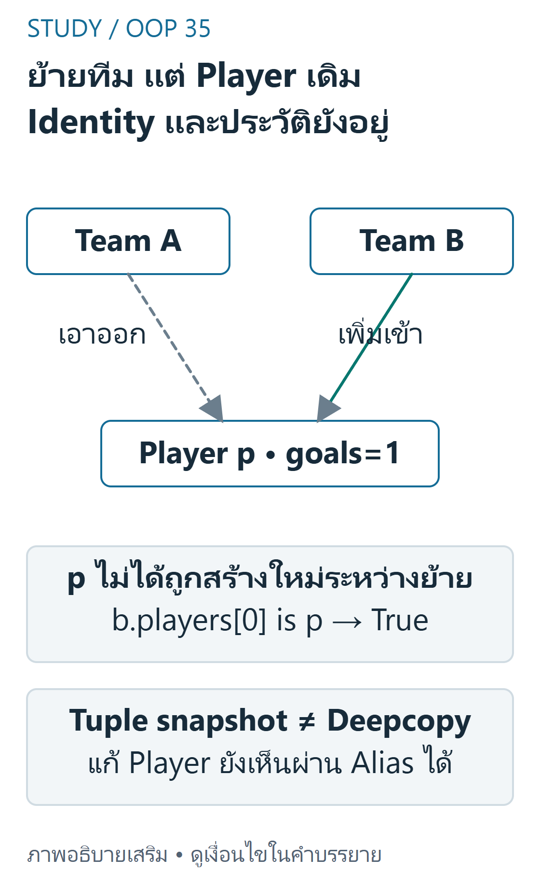
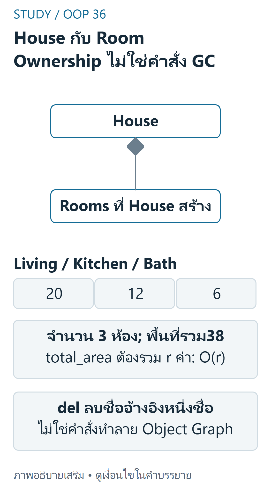

---
{"version":1,"id":"oop-python-object-relationships","course":"oop-python","category":"summaries","slug":"object-relationships","title":"Reference และความสัมพันธ์ระหว่าง Object","language":"th"}
---

> Week5: object references, Association/Aggregation/Composition และ encapsulation ตัวอย่าง Team/Player และ House/Room จาก source โค้ดผู้เขียนลดเหลือส่วนที่ใช้แสดง ownership และ identity ไม่ใช่ fullClinic/Librarylab

## เป้าหมายการเรียนรู้ {#objectives}
- แยก is-a จาก has-a และการใช้งาน object ชั่วคราว
- ติดตาม reference/shared state และผลของการ copy container
- เลือก ownership/multiplicity ให้เข้ากับ domain และอธิบาย Python lifetime อย่างถูกต้อง

## ทำไมไม่ยัดทุกอย่างใน Class เดียว {#concepts}
Week5 pp.3–18 ยก order / address / item และการเก็บ object ไว้เป็น attribute แยกข้อมูลกับพฤติกรรมตามขอบเขตที่เปลี่ยนจริง เช่น อ้าง Address object แทนการใช้หลายลิสต์ขนานกัน ซึ่ง index อาจคลาดกันได้

Attribute เก็บ reference ไม่ใช่สำเนา object ใหม่ `None` อาจแทนความสัมพันธ์ที่ยังไม่มี จึงต้องตรวจ None ก่อนเรียก method

## ความสัมพันธ์สามแบบ {#relationships}
| แบบ | เจตนา | ตัวอย่างที่ source ใช้ | สิ่งที่ต้องประกาศ |
|---|---|---|---|
| Association | objects รู้จัก/ใช้งานกัน | โอนระหว่างบัญชี/ใช้ service | ใครเรียกใครและมี reference นานเท่าใด |
| Aggregation | whole เก็บ part ที่มีตัวตนอิสระ | Team รับ Player ที่สร้างแล้ว | part ย้าย/แชร์ได้ตาม businessrules |
| Composition | whole รับผิดชอบสร้าง/จัดการ part | House สร้าง Room ภายใน | ownership/lifecycle ตาม interface ที่ออกแบบ |

Association เป็นความสัมพันธ์ทั่วไป ไม่จำเป็นว่าต้องชั่วคราวเสมอ กรอบเปรียบเทียบ source pp.20–42 เน้น whole–part เพื่อการสอน UML multiplicity เช่น 0..1,1,0..*,1..*บอกจำนวนที่อนุญาต ไม่ได้สร้าง validation ใน Python ให้อัตโนมัติ

## Python: เก็บ Object เดิม ไม่สร้างซ้ำ {#python}
Team.add_player รับ object เดิม;House.add_room รับข้อมูลแล้วสร้าง part นโยบายเพิ่มของผู้เขียน:Team ไม่รับสมาชิกเดิมซ้ำ และส่ง tuple ออกแทน list ภายใน ไม่เปลี่ยนกฎ source ให้เป็น ownership ที่ภาษา enforce เอง

```python
class Player:
    def __init__(self, name):
        self.name = name
        self.__goals = 0
    @property
    def goals(self): return self.__goals
    def score(self): self.__goals += 1


class Team:
    def __init__(self, name):
        self.name = name
        self.__players = []
    @property
    def players(self): return tuple(self.__players)  # snapshot of container, not objects
    def add_player(self, player):
        if not isinstance(player, Player): raise TypeError("Player required")
        if player in self.__players: raise ValueError("duplicate player")
        self.__players.append(player)
    def remove_player(self, player): self.__players.remove(player)


class Room:
    def __init__(self, name, area):
        if area <= 0: raise ValueError("positive area")
        self.name, self.area = name, area


class House:
    def __init__(self): self.__rooms = []
    def add_room(self, name, area): self.__rooms.append(Room(name, area))
    @property
    def room_count(self): return len(self.__rooms)
    @property
    def total_area(self): return sum(room.area for room in self.__rooms)
    @property
    def room_summaries(self): return tuple((r.name, r.area) for r in self.__rooms)


p = Player("P")
a, b = Team("A"), Team("B")
a.add_player(p)
p.score()
a.remove_player(p)
b.add_player(p)
print(a.players, b.players[0] is p, p.goals)  # () True 1
h = House()
for name, area in [("Living",20),("Kitchen",12),("Bath",6)]: h.add_room(name,area)
print(h.room_count, h.total_area)  # 3 38
```

## Trace Identity และ Container Copy {#trace}
เริ่ม p(goals0)→เพิ่มเข้า A ยัง objectp เดิม→p.score ทำ goals1 ซึ่ง A เห็นด้วย→remove ออก A→เพิ่มเข้า B ยัง is p และ goals1 ไม่มีการสร้าง Player ใหม่ระหว่างย้าย การทำ `Player(p.name)`แทนจะเริ่ม goals0 และทำประวัติหาย



ที่มา: [ภาพเขียนเสริม ตรวจตามบทเรียนและเอกสารเทคนิค](https://docs.python.org/3.12/tutorial/classes.html)

อ่านภาพ: TeamAรับreferenceของPlayerpเดิม เมื่อp.score goalsเป็น1 ก่อนremoveจากAแล้วaddเข้าB ไม่สร้างPlayerใหม่ จึงb.players[0] is pและgoalsยัง1 Snapshotของcontainerยังอ้างPlayerเดิมได้แม้Aเอาออกแล้ว ไม่ใช่deepcopy

House สร้าง 3rooms พื้นที่ 20,12,6 ตาม sourcepp.37–38 รวม 38 การสร้าง room สี่เหลี่ยม?source ไม่ได้ให้รูปทรง จึงไม่แต่ง width/height เพื่อคำนวณพื้นที่ใหม่ `total_area`รวมข้อมูล area ที่มีอยู่

`team.players`เป็น tuple ใหม่ที่ป้องกัน append ลง container ภายในโดยตรง แต่สมาชิกยังเป็น reference เดิม การเรียก team.players[0].score() ยังแก้ Player ได้ Copycontainer ไม่ใช่ deepcopy;ถ้าต้องการ immutableview ต้องออกแบบให้คืนข้อมูลค่าเช่น room_summaries

## Composition ไม่ใช่ Garbage-Collection Command {#lifetime}
pp.39–41 เน้นว่าไม่มี external reference ใน interface ตัวอย่างจึงหมดการเข้าถึง room เมื่อ house หมดไป แต่ Python ไม่ห้ามสร้าง Room ลอยๆหรือเก็บ alias ถ้าโค้ดเปิดทาง `del house`ลบ reference หนึ่งชื่อ ไม่รับรอง part ถูกทำลายทันทีเมื่อยังมี alias อยู่ แยกความเป็นเจ้าของเชิง domain ออกจากการจัดสรร/เก็บกวาดหน่วยความจำ และอย่าใช้ private เป็นเหตุผลว่าบังคับ ownership ได้ 100%



ที่มา: [ภาพเขียนเสริม ตรวจตามบทเรียนและเอกสารเทคนิค](https://docs.python.org/3.12/tutorial/classes.html)

อ่านภาพ: Houseสร้างRoomภายในจากข้อมูลชื่อ/พื้นที่ Living20 Kitchen12 Bath6 รวม38ตามตัวอย่าง การควบคุมRoomผ่านinterfaceแสดงcompositionเชิงdomain เพชรอยู่ฝั่งHouse ไม่ได้บังคับว่าdel houseทำลายทุกRoomทันทีหากมีaliasหรือเปลี่ยนinterface

## ต้นทุนและการประยุกต์ {#complexity}
Team การตรวจซ้ำ/ลบด้วย list ต้อง O(n),สร้าง tuplesnapshotO(n);การเข้าถึง object ที่รู้อยู่แล้ว O(1) ภายใต้แบบจำลองนี้ House.total_area เป็น O(r) สำหรับ r ห้อง ไม่ใช่ O(1) เพียงเพราะเป็น property LabLibrary/Gym/Clinic มีหลายความสัมพันธ์พร้อมกัน:หนังสือ/สมาชิกอาจ aggregate แต่ record ที่ระบบสร้างมี composition ตามโจทย์ ต้องดูสัญญาแต่ละ task ไม่ใช้คำว่า has-a แล้วตัดสินทั้งหมด

ในห้าสถานการณ์ source pp.51–55: Playlist/Song เป็น aggregation; Invoice/InvoiceLine, Car/Engine และ University/Department เป็น composition ตามเงื่อนไขการสร้าง/ไม่ย้าย/ยุบตามเจ้าของที่โจทย์ระบุ; Doctor/Patient เป็น association เมื่อใช้ผ่าน examine โดยไม่เก็บ reference เป็น attribute การสรุปนี้อาศัยเงื่อนไขโจทย์ ไม่ใช่ชื่อ nouns เพียงอย่างเดียว

## ข้อผิดพลาดที่พบบ่อย {#mistakes}
คืน list ภายในให้ caller ลบทิ้งได้;สร้าง part ใหม่แทนเก็บ reference เดิม;สืบทอด Customer จาก Account เพียงเพราะมี account;คิด tuple ทำให้ทุก object ข้างใน immutable;ถือ del เป็นคำสั่งทำลาย graph ทุกตัว

## แบบฝึกพร้อมเฉลย (ผู้เขียนจัดทำและตรวจอิสระ) {#practice}

### ข้อ1 Playlist และ Song

**เฉลย:** ตาม scenarioWeek5p.51 Song มีตัวตนอิสระและใช้หลาย playlist ได้จึง aggregation ตามสัญญานั้น ไม่ควรสร้าง Song ใหม่ทุกครั้งที่เพิ่มเพราะอาจทำ metadata/identity หาย

### ข้อ2 Invoice และ InvoiceLine

**เฉลย:** p.52 line เป็นส่วนหนึ่งของ invoice ที่เจ้าของสร้างและจัดการจึง composition ตาม domain แต่ Pythonalias ยังต้องออกแบบ interface ให้รอบคอบ ไม่ใช่รับรอง destructor

### ข้อ3 Doctor/Patient และ Car/Engine

**เฉลย:** p.53 Doctor/Patient เป็น association เพราะ examine ใช้ Patient โดยไม่เก็บไว้; p.54 Car สร้าง Engine ใน__init__และไม่ย้าย Engine ระหว่างรถในระบบนี้ จึงเป็น composition ตามสัญญาที่กำหนด ไม่ใช่ต้องเดา ownership ใหม่จากชื่อ Car/Engine

### ข้อ4 ผลของ tuple snapshot

**เฉลย:** snapshot=a.players ก่อนย้าย p ยังอ้าง Player เดิมแม้ remove ออก A;len(snapshot)ยัง1แต่ a.players ว่าง การเรียก snapshot[0].score เพิ่ม goals ของ p เดิมได้

### ข้อ5 พื้นที่และต้นทุน

**เฉลย:** House3rooms20+12+6=38;room_count อ่าน lenO(1),total_area รวม r ค่าจึง O(r);ส่ง room_summaries สร้าง snapshotO(r) ไม่มีเหตุผลอ้างทุก propertyO(1)

## สรุปทบทวน {#summary}
ตรวจ identity ก่อน copy→กำหนด ownership/multiplicity→แยก container กับ part→ออกแบบ interface→วิเคราะห์ต้นทุนจากงานจริง Relationships เป็นสัญญาออกแบบ ไม่ใช่กฎ GC ที่ภาษาอนุมานจาก UML ให้เอง

## แหล่งอ้างอิงและขอบเขต {#sources}
- [Week5 physical pp.3–55](../slides/Week5.pdf#page=3) — object decomposition/references,three relationships,Team/House,scenario exercises
- แหล่ง lab เพิ่มเติม (local-only ไม่เผยแพร่ไฟล์งานส่ง): Lab5-1 Library,Lab5-2 Gym,Hw5 Clinic และ library.py แสดงการเก็บ Book เดิม/สร้าง BorrowRecord แยกกัน
- [แผนผังแหล่งสอน](../../../docs/oop-curriculum-map.md). คำอธิบาย/โค้ดที่ปรับให้รันเดี่ยวและเฉลยในบทเป็นงานผู้เขียน ไม่ใช่เฉลยข้อสอบทางการ ไม่มี prerequisite gating; เลือกบทจากแคตตาล็อกได้โดยตรง
