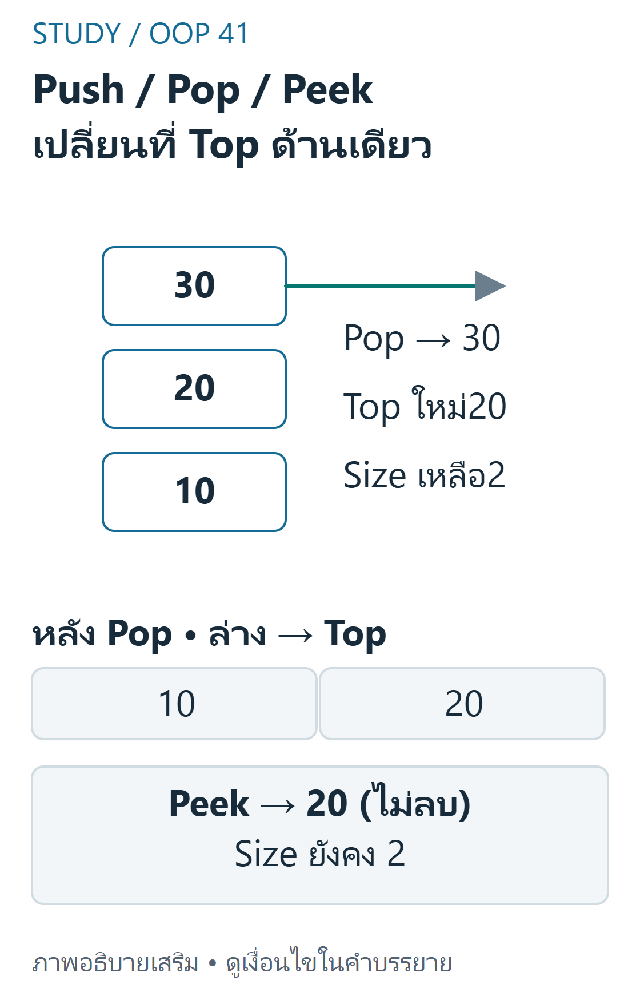
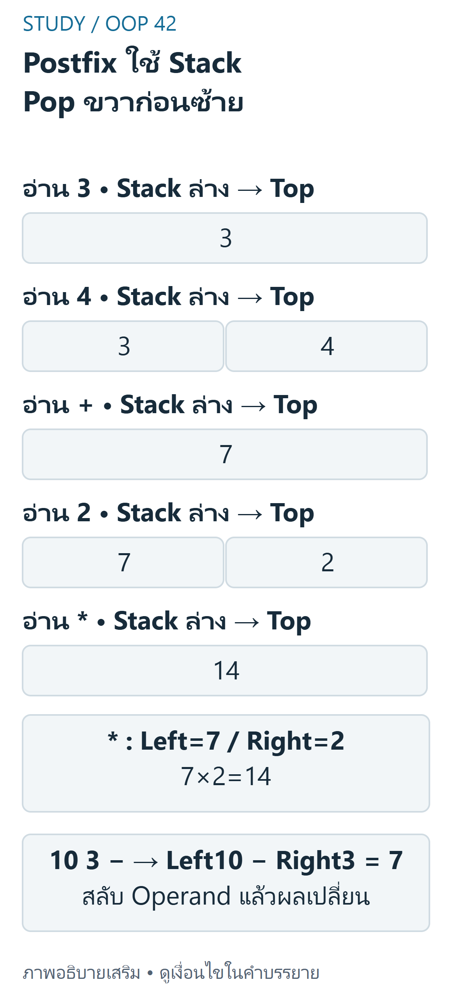

> FINAL: Week11 ทุกหัวข้อหลักและ Week8stackwrapper ขยาย Postfix จาก Lab11-1 ที่มีจริง โค้ด/trace/เฉลยผู้เขียนตรวจอิสระ ไม่ใช่ข้อสอบจริงหรือเฉลยทางการ ไม่สร้าง interactivecomponent ที่แสดง algorithm ผิด

## เป้าหมายการเรียนรู้ {#objectives}
- ใช้ LIFO และ Stack ADT แยกจาก รูปแบบจัดเก็บข้อมูล (storage implementation)
- ไล่การทำงานของ push / pop / peek และ empty/singleton โดยไม่ให้ head/size ผิด
- อธิบาย call stack/recursion,balancedbrackets,postfix และ undo/redo
- แยก worst case/amortized และต้นทุนข้อมูล snapshot

## LIFO และ Stack ADT {#concepts}
Week11 pp.3–17: ข้อมูลที่เข้าทีหลังออกก่อน (Last In, First Out: LIFO) เข้าถึงข้อมูลจากด้าน top โดย push เพิ่มค่า, pop คืนค่าและนำออก และ peek อ่านค่าโดยไม่ลบ ส่วน is_empty และ len ใช้ตรวจสถานะ



ที่มา: [ภาพเขียนเสริม ตรวจตามบทเรียนและเอกสารเทคนิค](https://docs.python.org/3.12/library/collections.html)

อ่านภาพ: Push10,20,30ทำให้30อยู่Top จากนั้นpopคืน30และนำออก ส่วนpeekอ่าน20โดยไม่ลบจึงsizeยัง2 StackADTกำหนดLIFOแต่ไม่ได้บังคับต้องใช้linkedlistหรือPythonlist ทุกimplementationต้องตกลงempty policyในบทใช้IndexError

Stack ADT กำหนดพฤติกรรม ไม่ได้บังคับรูปแบบจัดเก็บ Python list ใช้ท้ายลิสต์เป็น top ส่วน linked stack ใช้ head เป็น top เพื่อให้ push และ pop ไม่ต้องค้นหาโหนดก่อน tail

ตัวอย่างเพิ่มค่า 10, 20, 30 ตามลำดับ จะได้ top เป็น 30 เมื่อ pop จะคืน 30 แล้ว peek อ่าน 20 โดยไม่ลบ ดังนั้น size ยังเป็น 2

เมื่อ stack ว่าง การเรียก pop หรือ peek ต้องมี policy ชัดเจน ตัวอย่างในบทนี้ใช้ IndexError ส่วน undo ที่ไม่มีประวัติเป็น no-op เพื่อให้ UI ไม่ล้มตามแนว source pp.44–45 อย่าใช้ None แทนสถานะว่างโดยไม่ประกาศ เพราะ None อาจเป็นข้อมูลจริง

## Python: สอง Implementations และ Applications {#python}
LinkedStack อิง Node/head ใน source ส่วน ArrayStack เป็น wrapper ของ list โค้ด Postfix อิง Lab11-1 โดยเพิ่มการตรวจค่า float ที่เป็น finite ตาม policy ที่ประกาศไว้

TextEditor เก็บสำเนาสถานะข้อความที่แก้ไขไม่ได้ (immutable text snapshots) และไม่นับ no-op ตัวอย่างเหล่านี้ไม่ใช้ eval หรือรัน Python จากหน้าเว็บ

```python
from math import isfinite
import operator


class Node:
    def __init__(self, value, next_node=None): self.value, self.next = value, next_node


class LinkedStack:
    def __init__(self): self._head, self._size = None, 0
    def __len__(self): return self._size
    def is_empty(self): return self._size == 0
    def push(self, value):
        self._head = Node(value, self._head)
        self._size += 1
    def peek(self):
        if self.is_empty(): raise IndexError("empty stack")
        return self._head.value
    def pop(self):
        value = self.peek()
        self._head = self._head.next
        self._size -= 1
        return value


class ArrayStack:
    def __init__(self): self._items = []
    def __len__(self): return len(self._items)
    def is_empty(self): return not self._items
    def push(self, value): self._items.append(value)
    def pop(self): return self._items.pop()
    def peek(self):
        if not self._items: raise IndexError("empty stack")
        return self._items[-1]


def is_balanced(text):
    pairs = {')':'(', ']':'[', '}':'{'}
    stack = LinkedStack()
    for ch in text:
        if ch in '([{': stack.push(ch)
        elif ch in pairs:
            if stack.is_empty() or stack.pop() != pairs[ch]: return False
    return stack.is_empty()


class PostfixCalculator:
    def __init__(self): self._last_result = None
    @property
    def last_result(self): return self._last_result
    def evaluate(self, expression):
        stack = LinkedStack()  # fresh state for each expression
        ops = {'+':operator.add, '-':operator.sub, '*':operator.mul, '/':operator.truediv}
        for token in expression.split():
            if token in ops:
                if len(stack)<2: raise ValueError("not enough operands")
                right, left = stack.pop(), stack.pop()
                value = ops[token](left,right)  # / may raise ZeroDivisionError
            else:
                try: value = float(token)
                except ValueError: raise ValueError("invalid token") from None
            if not isfinite(value): raise ValueError("finite result required")
            stack.push(value)
        if len(stack)!=1: raise ValueError("one result required")
        result = stack.pop()
        self._last_result = result  # only successful expressions replace last_result
        return result


class TextEditor:
    def __init__(self):
        self.text, self._undo, self._redo = '', ArrayStack(), ArrayStack()
    def _change(self, new):
        if new != self.text:  # authored no-op policy
            self._undo.push(self.text)
            self._redo = ArrayStack()
            self.text = new
    def type_text(self, text): self._change(self.text+text)
    def delete_last(self):
        if self.text: self._change(self.text[:-1])
    def undo(self):
        if not self._undo.is_empty():
            self._redo.push(self.text)
            self.text = self._undo.pop()
    def redo(self):
        if not self._redo.is_empty():
            self._undo.push(self.text)
            self.text = self._redo.pop()


def factorial(n):
    if type(n) is not int: raise TypeError("integer required")
    if n<0: raise ValueError("nonnegative required")
    return 1 if n<=1 else n*factorial(n-1)


s = LinkedStack()
for x in [10,20,30]: s.push(x)
print(s.pop(), s.peek(), len(s))       # 30 20 2
print(is_balanced('([{}])'),is_balanced('([)]'))  # True False
calc = PostfixCalculator()
print(calc.evaluate('3 4 + 2 *'))      # 14.0
print(calc.evaluate('10 3 -'))         # 7.0, not -7
editor = TextEditor()
editor.type_text('A'); editor.type_text('B'); editor.undo(); editor.type_text('C'); editor.redo()
print(editor.text, factorial(4))       # AC 24
```

## ไล่ Bracket Matching {#brackets}
Week11 pp.22–25, 37–41: อ่านอักขระทุกตัว เมื่อพบวงเล็บเปิดให้ push และเมื่อพบวงเล็บปิดต้องตรวจว่าตรงกับตัวบนสุด เมื่ออ่านจบ stack ต้องว่าง

ตัวอย่างนี้ข้ามอักขระอื่น จึงเป็นตัวตรวจวงเล็บ ไม่ใช่ตัววิเคราะห์ไวยากรณ์ Python หรือ HTML แบบสมบูรณ์

| token ใน([{}]) | action | stack จากล่างไปบน |
|---|---|---|
|( | push | ( |
|[ | push | ( [ |
|{ | push | ( [ { |
|} | pop{ตรง | ( [ |
|] | pop[ตรง | ( |
|) | pop(ตรง | ว่าง→True |

`([)]`ล้มเมื่อเจอ) แต่ top เป็น[;`)`ล้มเพราะ empty;`((`ล้มตอนจบเพราะยังค้าง;`hello`และ emptystring ได้ True ตาม policyignoreotherchars ไม่เอาอัลกอริทึมนี้อ้างว่าตรวจ nestedHTML ได้ครบ (HTMLtagvalidator เป็นอีก lab ที่มีรายละเอียดเพิ่ม)

## Postfix: ลำดับตัวถูกดำเนินการ {#postfix}
Lab11-1 ระบุ token คั่นด้วย space,+−*/และ stack ใหม่ต่อ expression ตัวอย่าง source3 4 + 2 *:



ที่มา: [ภาพเขียนเสริม ตรวจตามบทเรียนและเอกสารเทคนิค](https://docs.python.org/3.12/library/collections.html)

อ่านภาพ: นิพจน์3 4 + 2 *เริ่มstackใหม่ อ่าน3,4แล้วpopright4,left3เพื่อบวกเป็น7 จากนั้นอ่าน2แล้วpopright2,left7คูณได้14 ต้องจบเหลือผลเดียว ส่วน10 3 −ต้อง10−3=7ไม่ใช่−7 ทุกขั้นเป็นข้อมูลคำนวณล่วงหน้าไม่ได้executecodeในเว็บ

| token | การทำงาน | stack |
|---|---|---|
|3|push3|3|
|4|push4|3,4|
|+|right4,left3→7|7|
|2|push2|7,2|
|*|right2,left7→14|14|

`10 3 -`ต้อง 10−3=7 ไม่ใช่ 3−10;`8 2 /`คือ 4.0 ใช้ true division ไม่ใช่ floor division ต้องจบเหลือผลเดียว มิฉะนั้น invalid (`1 2`),operator ก่อน operand พอไม่ได้ (`1 +`),token แปลไม่ได้ต้อง error,หาร 0 เป็น ZeroDivisionError last_result เปลี่ยนเฉพาะเมื่อประเมินสำเร็จทั้งหมด ครั้งถัดไปไม่ reuseoperands เก่า

## Call Stack และ Recursion {#call-stack}
Week11 pp.18–20:เมื่อ calculate_total เรียก calculate_tax แล้ว get_tax_rate เฟรมบนสุดที่กำลังทำงานต้องจบก่อนกลับ caller ไม่ได้แปลว่าตัวแปร local ทุก call เป็น global ชุดเดียว ตัวอย่าง factorial4 ของผู้เขียน: f4 รอ 4×f3→f3 รอ 3×f2→f2 รอ 2×f1→f1 คืน 1→f2 คืน 2→f3 คืน 6→f4 คืน 24

base case ต้องถึงได้;f0=1;negativeinput ถูก reject Python มี recursionlimit ขึ้นกับ runtime ไม่รับรองจำนวน 1000 ใช้ได้ทุก call และไม่แก้ infinite recursion ด้วยการเพิ่ม limit เฉยๆ พื้นที่ call stackO(n) สำหรับ factorial เชิงเส้นนี้

## Undo / Redo และข้อกำหนด State {#undo}
pp.27–29,42–45:ก่อน action ใหม่เก็บ state เก่าใน undo และล้าง redo;undo ย้าย state ปัจจุบันไป redo แล้วคืน state เก่าจาก undo;redo กลับทิศ Trace ผู้เขียน:
```text
เริ่ม '' → type A: 'A' → type B: 'AB'
undo: 'A', redoมี 'AB'
type C: 'AC', ล้างredoเดิม
redo: ยัง 'AC' (ไม่มีประวัติให้ทำซ้ำ)
```
หากไม่ล้าง redo เมื่อแตก branch ใหม่อาจย้อนเข้า stateAB ที่ไม่ใช่เส้นทางแก้ไขปัจจุบัน Source เลือก no-op เมื่อไม่มีประวัติ ต่างจาก ADTpop ว่างที่ raise ดังนั้น policy อยู่คนละชั้นกัน

## Complexity และข้อผิดพลาด {#complexity}
| งาน | เวลา | พื้นที่เพิ่มเติม |
|---|---|---|
|Linkedpush/pop/peek|O(1)|O(1)ต่อ operation,ทั้งหมด O(n)|
|Arraypush|amortizedO(1),worstO(n)|resizebuffer เมื่อจำเป็น|
|Arraypop/peek ท้าย|O(1)ในแบบจำลอง ADT;Python list มีรายละเอียด resize|ทั้งหมด O(n)|
|Bracket n ตัว|O(n)|O(n)กรณีซ้อนลึก|
|Postfix ktoken|O(k)เมื่อ arithmetic/parsebounded|O(k)|
|Undo/redo ย้าย reference ข้อความ|O(1)corestackamortized|history เก็บ reference ถึงข้อความเก่า|

การสร้างข้อความยาว L ด้วย concatenation/slicing ยัง O(L);เก็บหลาย snapshot มีพื้นที่ตามข้อมูลที่ยังอ้างถึง ไม่สรุป texteditor ทั้งระบบ O(1) ข้อผิดพลาดหลัก:pop ท้าย linkedlist จนต้องหาตัวก่อนท้าย;ลืมเช็ค empty;สลับ left/rightpostfix;ลืม finalstackcount;ไม่ล้าง redo หรือไม่มี base case

## แบบฝึกพร้อมเฉลย (ผู้เขียนจัดทำและตรวจอิสระ) {#practice}

### ข้อ1 LIFO/Peek

**เฉลย:** pushA,B,C แล้ว pop คืน C;peek คืน B โดย size ยัง2;pop ต่อได้ B,A แล้ว pop ว่าง IndexError ทั้ง array และ linked ต้องพฤติกรรมตรงกัน

### ข้อ2 วงเล็บสี่กรณี

**เฉลย:** ([{}])True,([)]False,((False,helloTrue ตาม policyignoreotherchars ต้องตรวจทั้งชนิดคู่และการว่างตอนจบ ไม่ใช่นับจำนวนเปิด/ปิดเท่ากันอย่างเดียว

### ข้อ3 Postfix และ order

**เฉลย:** 5 1 2 + 4 * + 3 - →(5+(1+2)×4)−3=14;10 3 - =7;8 2 /=4.0 ขวาถูก pop ก่อนซ้าย

### ข้อ4 Errors และ last_result

**เฉลย:** หลัง evaluate3 4 +ได้7 ถ้าครั้งถัดไป1 +จะ ValueError และ last_result ยัง7;1 0 /ZeroDivisionError;1 2invalid เพราะเหลือ2ค่า ไม่มีการใช้ stack เก่าปะปน

### ข้อ5 Undo หลัง branch ใหม่

**เฉลย:** typeA,typeB,undo,typeC,redo ได้ AC ไม่ใช่ AB เพราะ actionC ล้าง redo;undo/redo ว่างเป็น no-op ตาม applicationcontract

### ข้อ6 Recursion และต้นทุน

**เฉลย:** factorial4คืน24ผ่าน f4,f3,f2,f1 (ไม่นับเฟรมระบบ) เวลาการคูณ O(n)ภายใต้ตัวเลขขนาดคงที่และ call stackO(n);สำหรับจำนวนเต็มใหญ่ต้องรวมต้นทุนเลขหลายหลักด้วย

## สรุปทบทวน {#summary}
LIFO ที่ top→เลือก storage ตาม operation→เช็ค empty→แยก ADTerror จาก applicationno-op→postfixpop ขวาก่อนซ้าย→undo เก็บ snapshot และล้าง redo เมื่อมี action ใหม่

## แหล่งอ้างอิงและขอบเขต {#sources}
- [Week8 physical pp.26–35](../slides/Week8.pdf#page=26) — Stackwrapper และ composition
- [Week11 physical pp.3–45](../slides/Week11.pdf#page=3) — LIFO,linked/array,call stack,bracket,undo/redo
- แหล่ง lab เพิ่มเติม (local-only ไม่เผยแพร่ไฟล์งานส่ง): Lab11-1.docx/PostfixCalculator และ postfix_calculator.py;Lab11-2 HTMLTagValidator;Hw11 CallStackSimulator ไม่ใช่การจำลอง interpreter ครบทุกเฟรม
- [แผนผังแหล่งสอน](../../../docs/oop-curriculum-map.md). คำอธิบาย/โค้ดที่ปรับให้รันเดี่ยวและเฉลยในบทเป็นงานผู้เขียน ไม่ใช่เฉลยข้อสอบทางการ ไม่มี prerequisite gating; เลือกบทจากแคตตาล็อกได้โดยตรง
