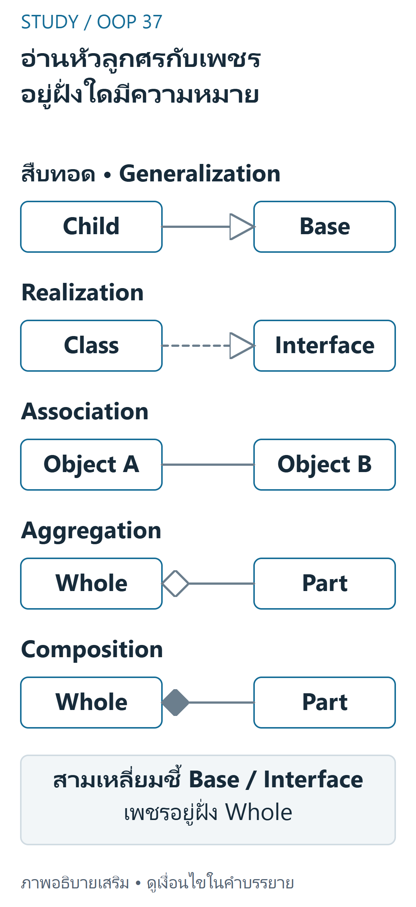
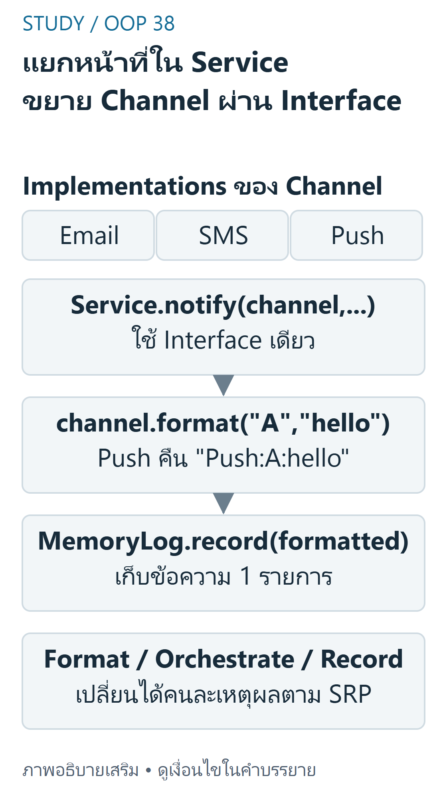

---
{"version":1,"id":"oop-python-uml-solid","course":"oop-python","category":"summaries","slug":"uml-solid","title":"UML และหลักออกแบบ SRP, OCP, LSP","language":"th"}
---

> Week6 และ Week7 pp.3–23 เป็นชุดแนวคิดออกแบบต่อเนื่องจึงรวมเป็นบทเดียว ไม่สร้าง chapter ปลอมตามจำนวนสัปดาห์ ตัวอย่าง notification เป็น simulation ที่คืนข้อความ/เขียน memory เท่านั้น ไม่ส่งอีเมลหรือเขียนไฟล์จริง

## เป้าหมายการเรียนรู้ {#objectives}
- อ่าน UML class box/visibility/relationship/multiplicity แล้วเชื่อมกับ Python
- แยก SRP,OCP,LSP ด้วยเหตุผลของการเปลี่ยนและ contract จริง
- trace การเพิ่ม channel ใหม่โดยไม่เพิ่ม type branch และสร้าง counterexample ของ hierarchy ที่ผิด

## อ่าน UML อย่างเป็นขั้นตอน {#uml}
Week6 pp.10–26:ดูชื่อ class→attributes/types→operations→visibility→เส้นสัมพันธ์→multiplicity `+`public,`-`private,`#`protected เป็น notation ออกแบบ;Pythonunderscore/mangling ไม่ได้ enforce แบบ Java ทุกอย่าง abstractclass/operation ใช้ตัวเอียงหรือ annotation ให้เข้าใจว่าเป็น contract



ที่มา: [ภาพเขียนเสริม ตรวจตามบทเรียนและเอกสารเทคนิค](https://www.omg.org/spec/UML/2.5.1)

อ่านภาพ: Generalizationใช้เส้นทึบหัวสามเหลี่ยมโปร่งชี้Base Realizationใช้เส้นประหัวสามเหลี่ยมโปร่งชี้Interface Associationเป็นเส้นทั่วไป Aggregationมีเพชรโปร่งและCompositionมีเพชรทึบที่Whole ไม่ได้สร้างruntime validationหรือบังคับPythonlifetimeเอง

แผนภาพตัวอักษรต่อไปนี้ผู้เขียนสร้างใหม่จากตัวอย่าง source ไม่ใช่รูป UML ต้นฉบับ:
```text
NotificationService
+ notify(channel, recipient, message)
  uses Channel       (format)
  uses MemoryLog     (record)
Channel <|-- Email / SMS / Push  (implements interface)
```

ตาราง p.26 มี 5 แบบ worked:inheritance ลูกศรหัวสามเหลี่ยมโปร่งชี้ฐาน,realization เส้นประหัวสามเหลี่ยมชี้ interface,association เส้นทั่วไป,aggregation เพชรโปร่งฝั่ง whole,composition เพชรทึบฝั่ง whole หัวข้อ p.19 เรียก 6 ระดับแต่ไม่แสดง worked ตัวที่หกครบ จึงไม่แต่งว่า source สอนตัวอย่าง dependency เพิ่มเติม การวาดสัญลักษณ์ไม่ทำให้ code มี validation/multiplicity เอง

## SRP: หนึ่งเหตุผลของการเปลี่ยน {#srp}
Week6 pp.28–35 แยก Report การคำนวณ,Formatter รูปแบบ,Repository การเก็บ,Notifier การแจ้งเตือน เพราะ requirements เหล่านี้เปลี่ยนคนละเหตุผล

SRP ไม่ใช่มี method เดียวต่อ class และไม่ควรแยก count/total/average เป็นสาม class โดยไม่มีเหตุผลต่างกัน การแยกมากเกินไปเพิ่ม coupling/ความซับซ้อนแทน

## OCP: เปิดให้ขยายผ่านจุดที่ออกแบบไว้ {#ocp}
pp.37–43 และ Week7 pp.14–23:ถ้าต้องเพิ่ม output/channel ใหม่แล้วกลับไปแก้ ifemail/sms/...ทุกครั้ง อาจแยก interface ให้เพิ่ม implementation ใหม่ โดย client ไม่ต้องรู้ชนิด OCP ไม่ใช่ห้ามแก้โค้ดใดตลอดกาล:การแก้ bug หรือเปลี่ยนสัญญาฐานยังทำได้หลังประเมินผลกระทบ จุด compositionroot ที่เลือก channel ย่อมต้องรับ configuration ใหม่



ที่มา: [ภาพเขียนเสริม ตรวจตามบทเรียนและเอกสารเทคนิค](https://docs.python.org/3.12/tutorial/classes.html)

อ่านภาพ: NotificationServiceใช้Channel.formatสร้างข้อความแล้วส่งMemoryLog.record ผู้เขียนจำลองในmemoryไม่ส่งemailจริง เพิ่มPushที่ทำformatตามinterfaceแล้วใช้notifyเดิมได้ แต่จุดcompositionเลือกChannelใหม่ยังต้องปรับ ไม่อ้างว่าOCPห้ามแก้bugทุกกรณี

## LSP: ทดแทนแล้วรักษา Contract {#lsp}
Week7 pp.3–13:การสืบทอดที่ถูก syntax ยังละเมิดความคาดหวัง client ได้ Square ทางคณิตศาสตร์เป็น rectangle แต่ mutableRectangle ที่ width/height แก้แยกกันมี contract ต่างจาก Square ที่ผูกสองค่า วิธีแก้คือแยกชนิดผ่าน Shape ร่วมและไม่ให้ Square รับสัญญา set อิสระที่ทำไม่ได้ เช่นเดียวกับ Bird ที่ไม่ควรรับรอง fly ถ้ามี Penguin ที่บินไม่ได้

ISP/DIP ปรากฏในภาพรวม SOLID แต่ source ช่วงนี้ไม่ได้มีหน่วยสอนเต็มเท่า SRP/OCP/LSP บทนี้ไม่เพิ่มคำกล่าวว่าครอบคลุมทุกหลักอย่างละเอียด

## Python และ Counterexample ที่ตั้งใจให้เห็นข้อผิดพลาด {#python}
โค้ด Channel อิงแนว NotificationService แต่ใช้ format/MemoryLog เพื่อตรวจโดยไม่เกิด externalactions ส่วน CoupledSquare เป็นตัวอย่าง **ผิด contract โดยเจตนา** ไม่ใช่แบบนำไปใช้จริง

```python
from abc import ABC, abstractmethod


class Channel(ABC):
    @abstractmethod
    def format(self, recipient, message): pass


class Email(Channel):
    def format(self, recipient, message): return f"Email:{recipient}:{message}"
class SMS(Channel):
    def format(self, recipient, message): return f"SMS:{recipient}:{message[:160]}"
class Push(Channel):
    def format(self, recipient, message): return f"Push:{recipient}:{message}"


class MemoryLog:
    def __init__(self): self.entries = []
    def record(self, event): self.entries.append(event)


class NotificationService:
    def __init__(self, logger): self.logger = logger
    def notify(self, channel, recipient, message):
        formatted = channel.format(recipient, message)
        self.logger.record(formatted)
        return formatted  # NO network/email/file write; teaching simulation only


class Rectangle:
    def __init__(self, width, height): self.width, self.height = width, height
    @property
    def area(self): return self.width*self.height


class CoupledSquare(Rectangle):
    # Deliberately wrong substitution contract: changing width changes height.
    def __init__(self, side): self._side = side
    @property
    def width(self): return self._side
    @width.setter
    def width(self, value): self._side = value
    @property
    def height(self): return self._side
    @height.setter
    def height(self, value): self._side = value


def client_area(r):
    r.width, r.height = 5, 4
    return r.area


log = MemoryLog()
service = NotificationService(log)
print(service.notify(Push(), "A", "hello"))  # Push:A:hello
print(len(log.entries))                      # 1
print(client_area(Rectangle(2, 3)))          # 20
print(client_area(CoupledSquare(2)))         # 16: contract violation demonstrated
```

## Trace และการเลือกความรับผิดชอบ {#trace}
Push.format("A","hello") คืน Push:A:hello→service ส่งค่าเดียวให้ logger→entries มี 1 รายการ เพิ่ม Email/SMS โดยใช้ service เดิมได้ ไม่มี ifbranch ตามชื่อชนิด ข้อมูลไม่ถูกส่งออกเครือข่าย

client_area ตั้ง width5 แล้ว height4:Rectangle ได้ 20;CoupledSquare เก็บ side ตัวเดียว จึงหลังสองคำสั่ง side4 และ area16 ไม่ใช่ 20 Counterexample หนึ่งที่ทำลาย contract ก็พอชี้ LSP violation ไม่ใช้ isinstance มาปิดบังหรือแก้ client ให้รู้ทุก child

## ต้นทุนและข้อผิดพลาด {#complexity}
การจัดรูปข้อความ m ตัวอักษรใช้ O(m);เพิ่ม loglistamortizedO(1) ไม่นับข้อความ;เก็บ k ข้อความใช้พื้นที่ตามความยาวรวม การแบ่ง class ไม่ลด Big-O โดยอัตโนมัติและมี indirection/objects เพิ่มบ้าง ห้ามอ้าง refactor ประหยัด memory หรือเร็วขึ้นโดยไม่มี measurement

ข้อผิดพลาดคือดู UML แล้วเลือก inheritance จากคำว่า has-a,สร้าง GodClass หรือแตก class เกินเหตุ,ถือ OCP เป็นคำสั่งห้ามแก้ bug และเชื่อ LSP ตรวจได้แค่ชื่อ method/ชนิดผลลัพธ์โดยไม่สนใจ invariants/exceptions

## แบบฝึกพร้อมเฉลย (ผู้เขียนจัดทำและตรวจอิสระ) {#practice}

### ข้อ1 เหตุผลของการเปลี่ยน

**เฉลย:** Report สูตรรวมกับ CSVformat กับการบันทึกไฟล์อาจเปลี่ยนคนละเหตุผล จึงแยกตาม SRP;มีสาม method ที่คำนวณข้อมูลชุดเดียวกันไม่ได้แปลว่าผิด SRP เสมอ

### ข้อ2 เพิ่ม Push โดยไม่แก้ service

**เฉลย:** สร้าง Push ที่ format ตาม Channelcontract แล้วส่งให้ notify จุด clientcomposition เลือก Push ใหม่ได้ แต่ notify ไม่ต้องเพิ่ม if ชนิด ผล Push:A:hello ถูกบันทึกหนึ่งครั้ง

### ข้อ3 พิสูจน์ LSPviolation

**เฉลย:** client ตั้ง width5,height4คาด area20 Rectangle ให้20 Square ผูก side ให้4จึง16 ถือผิด observablecontract แม้ isinstanceSquareRectangle เป็น True

### ข้อ4 เลือกสัญลักษณ์

**เฉลย:** Team/Player ตามกฎ part อิสระใช้ aggregation เพชรโปร่งที่ Team;Order/OrderLine ที่เจ้าของสร้างจัดการใช้ composition เพชรทึบที่ Order;ลูกศร inheritance ชี้ฐานไม่ชี้ child

### ข้อ5 OCP และความซับซ้อน

**เฉลย:** แก้ bugformatter ได้ ไม่ใช่ละเมิด OCP โดยอัตโนมัติ;เพิ่ม class ไม่ได้ทำให้การ format ข้อความยาว m จาก O(m)เป็น O(1) ต้องวิเคราะห์งานจริงและสัญญาที่ต้องรักษา

## สรุปทบทวน {#summary}
UML สื่อสัญญาไม่ใช่ runtime enforcement;SRP แยกเหตุผลเปลี่ยน;OCP เตรียม extension point;LSP ทดแทนต้องรักษา behavior ไม่ใช่เพียง syntax/source graph

## แหล่งอ้างอิงและขอบเขต {#sources}
- [Week6 physical pp.3–47](../slides/Week6.pdf#page=3) — UML,relationships,SRP/OCP และ overview
- [Week7 physical pp.3–23](../slides/Week7.pdf#page=3) — LSP,Square/Rectangle,Bird,NotificationService
- แหล่ง lab เพิ่มเติม (local-only ไม่เผยแพร่ไฟล์งานส่ง): Lab6-1 QueueAlertSystem,Lab6-2 AbsenceNotifier;absenceNotifier.py แยก channel กับ logger ตาม interface โค้ดต้นฉบับไม่ถูกเรียกให้ส่งข้อความ/เขียนไฟล์
- [แผนผังแหล่งสอน](../../../docs/oop-curriculum-map.md). คำอธิบาย/โค้ดที่ปรับให้รันเดี่ยวและเฉลยในบทเป็นงานผู้เขียน ไม่ใช่เฉลยข้อสอบทางการ ไม่มี prerequisite gating; เลือกบทจากแคตตาล็อกได้โดยตรง
